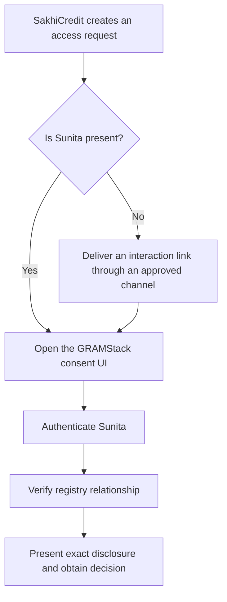

# Purpose and scenario

## What GRAMStack does

GRAMStack is a read-only interoperability and trust layer over existing Indian DPI source systems. Consumers request canonical resources through a common API. The layer coordinates authentication, registry-specific subject verification, human consent, policy decisions, short-lived retrieval grants, adapter execution and access evidence.

LokOS, JEEViKA, AgriStack and other sources retain authority over their records. GRAMStack does not become a rural-economy system of record, an eligibility engine, a central identity graph or a synchronized financial-history store. Domain applications can build those capabilities under their own explicit governance.

## The running example

**Hypothetical scenario:** SakhiCredit wants Sunita Devi's SHG membership status and savings summary from LokOS to assess credit eligibility. Neither the named application nor the example source endpoints imply an existing production integration.

| Actor | Responsibility | What the actor cannot assert alone |
|---|---|---|
| SakhiCredit | Authenticate as an approved consumer; declare scope, purpose and recipient terms | That Sunita owns a guessed member record or has consented |
| Sunita | Authenticate, participate in required verification and approve/reject | That source policy allows an otherwise forbidden disclosure |
| CRP/operator | Assist through a registry-approved procedure | Consent silently on Sunita's behalf |
| Registry operator | Own data, approve verification methods, authorize adapter credentials | That downstream plaintext was subsequently deleted |
| Gateway | Coordinate a bounded asynchronous request | Invent identity ownership or bypass independent adapter enforcement |
| Consent authority/custodian | Attest to approval and retain necessary evidence | Replace authentication, subject verification or AuthZ |
| AuthZ | Evaluate policy and issue/redeem narrowly scoped access | Turn consent into unlimited access |
| DeDi | Anchor signed evidence commitments and verifiable history | Prove the truth of every assertion or absence of unrelated native access |

## Architectural invariants

1. **Read-only v1.** Retrieval and approvals are in scope; source-record writes are excluded.
2. **Actual human consent.** Normal personal-data retrieval requires explicit approval by the person whose data will be disclosed.
3. **No persistent citizen identities.** External authorities authenticate citizens. GRAMStack does not provision citizen login accounts, credentials or cross-provider account links.
4. **No replicated business state.** No cached SHG balances, mirrored registry records or synchronized citizen relationships.
5. **Necessary state is permitted.** Pending workflows, callback correlation, replay prevention and consent enforcement can use bounded state. Historical security evidence may be durable.
6. **Gateway-owned lifecycle.** Request coordination is an internal gateway responsibility, not a mandatory standalone orchestrator service.
7. **Registry adapters are the integration boundary.** Transport, credentials, mappings, filtering and enforcement belong together. No additional connector service is required.
8. **Evidence before protected release.** Every successful GRAMStack-mediated disclosure must pass authorization and the required durable evidence boundary.
9. **Inclusive authentication.** Aadhaar is not the canonical GRAMStack identifier. Alternative routes must be assessed under registry policy and applicable obligations.
10. **Verification remains necessary.** Each registry integration must establish the approver's relationship to the requested record through a registry-approved mechanism.

## Two entry journeys

The default journey uses the GRAMStack consent UI and its backend as the OIDC client in both cases. Its authentication handlers belong to AuthN; its notice and decision handlers belong to the consent module. Delivery channels can vary. SMS merely delivers a locator; possession of the link does not prove identity, record ownership or approval.

An assisted journey must preserve Sunita's decision. A passbook number can be a lookup hint or evidence under an approved procedure; it is not a password. A CRP's own registry login may authenticate an operator who manages many members, not Sunita herself.

## Why registry adapters

Registry integrations do more than map JSON: they handle registry-specific verification, upstream authentication, policy enforcement and signed evidence. Each adapter owns this integration boundary; pure transformation remains an internal function.

## Scope outside this design

Source writes, universal citizen accounts, cross-registry identity matching, persistent economic histories, automated eligibility decisions, credential wallets, and statutory non-consent disclosure profiles are excluded from the normal v1 flow. None is made mandatory by the reference stack.

Development environments can use mock subject verification. Production integrations require a registry-approved verification mechanism.
