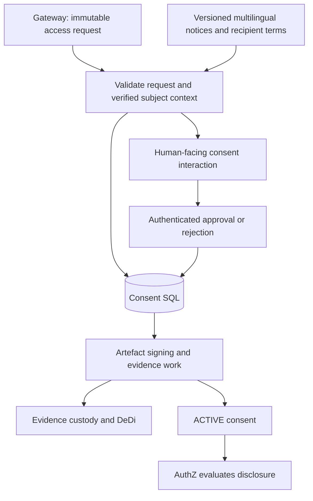
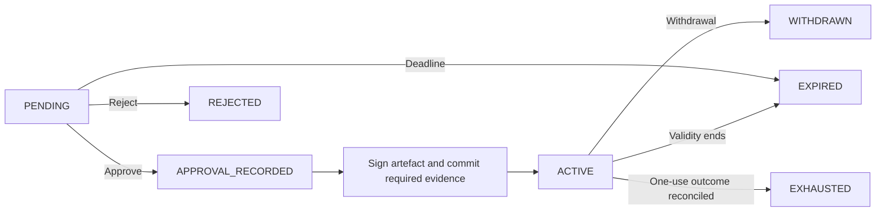
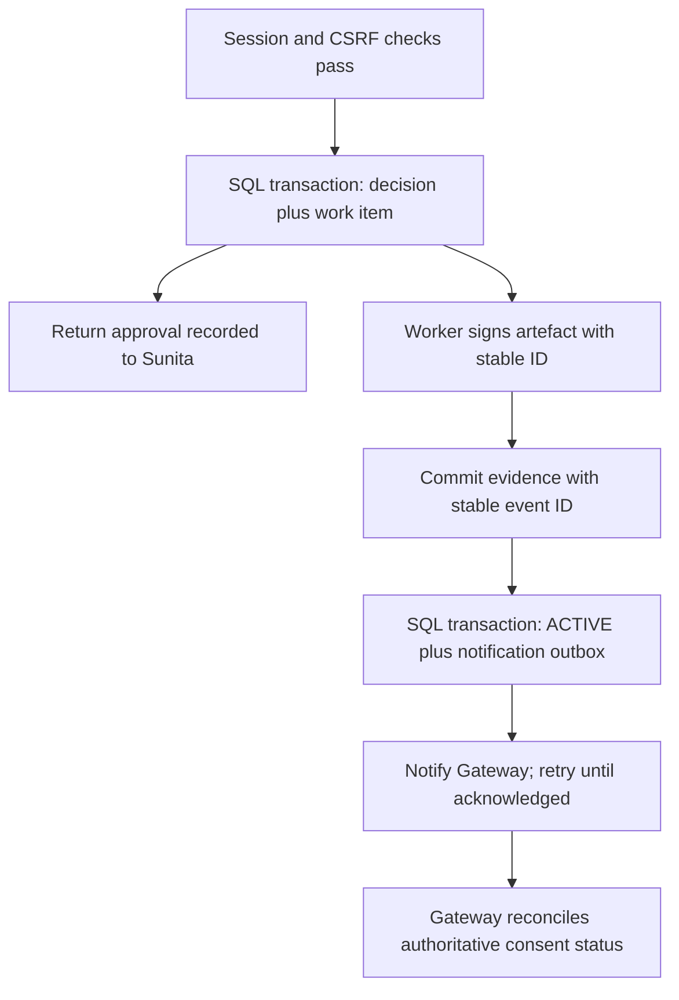

# Consent manager

## Implementation direction

GRAMStack implements a consent subsystem for request-bound registry disclosure, using DEPA as its architectural reference and established open implementations as engineering references.

The module displays exact notices, collects explicit approval or rejection, binds the human decision to the request and verified subject, signs consent artefacts, maintains authoritative status and withdrawal, delivers reliable events and retains necessary evidence. Consent does not issue retrieval grants or process registry response bodies.



## What Sunita is deciding

The notice identifies SakhiCredit, LokOS, the requested membership and savings fields, credit-eligibility purpose, frequency, validity, recipient retention terms, withdrawal method, consequences of refusal and help/grievance channel. It is presented in an accessible language; language, template revision and exact rendered content are retained as evidence.

For the single-disclosure profile, approval covers one bounded disclosure. Repeated/recurring consent, partial field approval, minors, guardians and delegated consent require explicit profiles. The interaction approves or rejects the exact request as a whole. If scope changes, create a new request rather than mutate a signed decision.

The browser session must correspond to the trusted verified-subject context. The module derives the approver from validated session state, never caller-provided `subject` JSON. CRP assistance does not make the CRP the approver.

## Lifecycle and background work



`APPROVAL_RECORDED` is a recovery boundary. Approval is durable, but no usable consent exists until signing and the chosen mandatory evidence commitment succeed. Transient outages leave recoverable work, not an invented ACTIVE status. Rejection/withdrawal evidence is also retained according to policy.

A human withdrawal during artefact preparation must prevent later activation. The worker conditionally updates the expected version; a late job cannot overwrite a cancellation. Cancellation before activation prevents the consent from becoming usable.

One-time usage has a separate enforcement lifecycle: AVAILABLE → RESERVED → outcome (release attempted, failed, or uncertain). Do not mark a consent successfully used merely because a grant was issued or a source HTTP request started. A use reservation and its recorded outcome distinguish exhausted disclosure authority from successful data delivery.

## Durable transaction and outbox



No distributed transaction is assumed across SQL, signing, DeDi and gateway workflow state. Stable IDs, conditional updates, durable work items, acknowledgements and reconciliation handle partial completion. Notification delivery is at least once. A webhook or browser redirect is not proof of current consent status.

## Artefact structure

Illustrative consent payload:

```json
{
  "consent_id": "con_61b4",
  "schema_version": "gramstack.consent.v1",
  "issuer": "https://consent.gramstack.example",
  "request_digest": "sha256:request-A",
  "subject_context_digest": "sha256:context-B",
  "consumer": "sakhi-credit",
  "provider": "lokos",
  "resource": "shg.membership",
  "fields": ["membership_status", "savings_summary"],
  "purpose": "credit_eligibility",
  "frequency": "ONCE",
  "recipient_terms_version": "sakhi-retention-v1",
  "notice_digest": "sha256:notice-HI-v1",
  "approved_at": "2026-11-01T10:02:00Z",
  "valid_until": "2026-11-01T10:07:00Z",
  "status_endpoint": "https://consent.gramstack.example/v1/consents/con_61b4/status"
}
```

Use a standard signature envelope and trusted issuer/key discovery. The consent authority's signature attests to its recorded approval process; it is not Sunita's personal digital signature. A signed ACTIVE artefact does not prove consent remains active later. Status is authoritative for enforcement. Sensitive references are protected; no global citizen identifier is introduced for convenience.

## Withdrawal and user history

An authenticated subject can review the notice/artefact and request withdrawal while future access remains possible. A permanent citizen account is not required. Later access uses reauthentication, an authorized evidence lookup and request-bound recovery correlation. A raw receipt ID or SMS link alone cannot authorize withdrawal.

The reference flow admits retrieval at atomic redemption; withdrawal before that point blocks admission. Consent status and redemption must share one atomic enforcement boundary to prevent check-then-use races. See [authorization](05-authorization). After plaintext release, withdrawal cannot recall copied data. Applicable downstream obligations need operational enforcement beyond token revocation.

## Implementation references

| Implementation | What to inspect | Important fit questions |
|---|---|---|
| GovStack / iGrant Consent BB | Generic agreement revisions, consent APIs, UI and dashboard | External identity without local citizen provisioning; DEPA artefact mapping |
| TSI DPDP CMS | Notices, purpose checks, withdrawal, verification, notifications and administrative workflows | Identity/storage model, runtime scope, interoperability and evidence export |
| ProjectEKA | Asynchronous health-consent and data-flow separation | Health-specific assumptions, user module and licensing before code reuse |

Source links are listed in [references](12-references). These projects inform implementation patterns; adopting their code requires license and security review. Product claims do not substitute for GRAMStack conformance checks.

## DEPA and legal posture

DEPA is the architectural reference for granular, revocable, auditable disclosure consent with separated consent and data flows. The older iSPIRT architecture repository is not treated as a maintained runtime dependency or a universal current conformance standard. ReBIT provides a concrete financial-ecosystem reference, not an automatic contract for LokOS.

The DPDP Act defines a Consent Manager as a registered person. A software module and a legally registered operator are separate matters. Each deployment defines its responsible fiduciary, consent authority, evidence custodian, retention policy and applicable regulatory obligations. This document makes no certification or registration claim.
