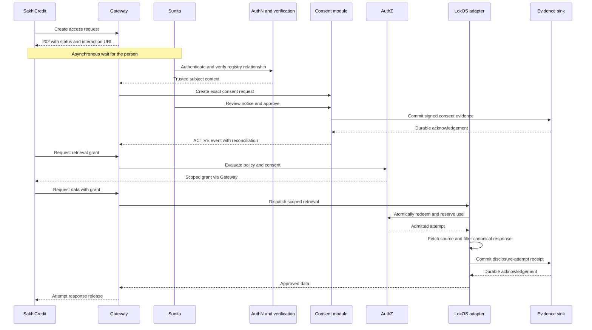
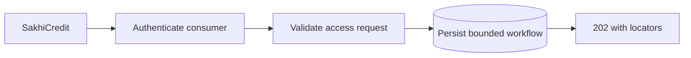
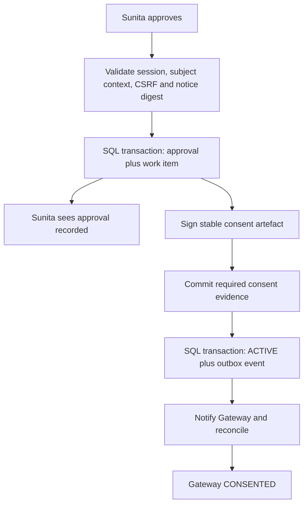
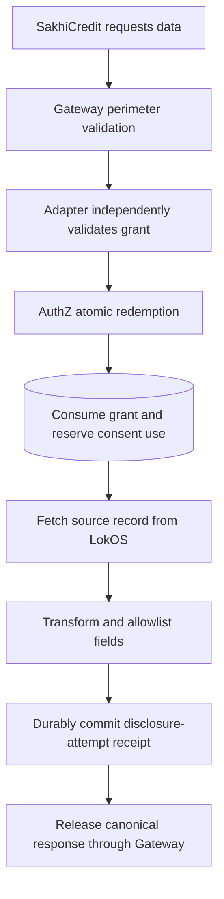
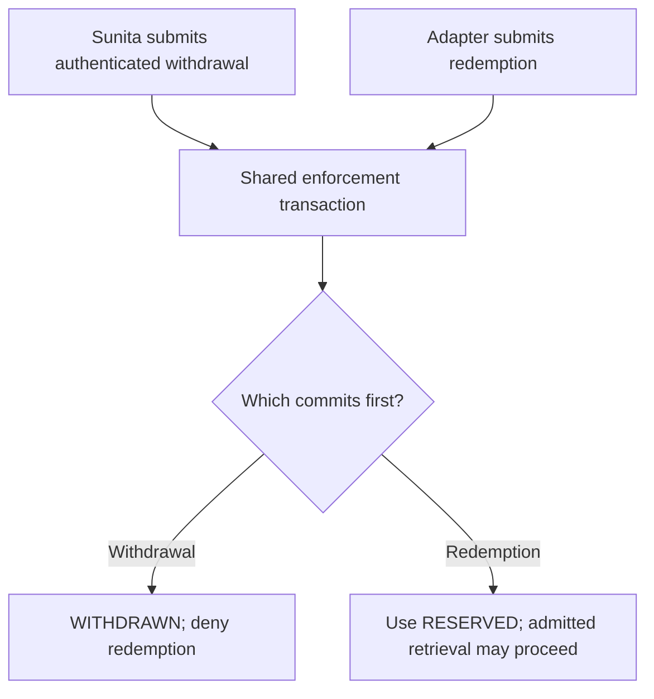

# Dry runs and user screens

## Scenario assumptions

All actors, IDs, balances and source APIs are illustrative. We use a mock pre-verified subject context `ctx_77`; this does not solve production identity binding. Time values are example bounds.

| Item | Value |
|---|---|
| Consumer | SakhiCredit |
| Data subject | Sunita Devi |
| Registry | LokOS |
| Access request | `req_8f21` |
| Consent request | `cr_92a1` |
| Consent artefact | `con_61b4` |
| Grant | `grant_73c2` |
| Retrieval attempt | `attempt_04` |
| Fields | Membership status and savings summary |
| Purpose | Credit eligibility |
| Frequency | One admitted disclosure |
| Decision deadline | Example: 10 minutes |
| Grant lifetime | Example: up to 5 minutes, never beyond other validity bounds |

## End-to-end message sequence

The solid request arrows are individual HTTP exchanges. The human wait and durable worker/notification stages span exchanges; no consumer request stays open through them. Step-by-step flowcharts below provide the same path in a simpler view.



## Step 1: consumer creates a request

SakhiCredit obtains a consumer token and submits the access request. Gateway validates its authority, scope and recipient terms, fixes the request digest and returns 202 with status and interaction URLs.



**Stored:** gateway request/version/deadline; client configuration already exists. **Not done:** no personal business-data retrieval, consent or grant. **SakhiCredit sees:** “Waiting for the person to complete verification and consent.”

## Step 2: Sunita authenticates and the subject gate completes

SakhiCredit opens the GRAMStack consent UI while Sunita is present, or provides the interaction link through an approved channel. She authenticates through the selected external IdP. The portal correlates the callback and establishes a short-lived session. Registry verification then completes through the approved mechanism; this dry run injects `ctx_77` as an explicitly non-production fixture.

**Stored:** auth transaction/session in TTL state, verified context reference in workflow. **Screen:** login method selection followed by verification progress/challenge. A failed or ambiguous match does not display alternative member records to the consumer.

## Step 3: create and display the consent request

Gateway creates `cr_92a1` idempotently, with the request digest and verified context. Consent module snapshots the notice and terms and returns an interaction URL. The HTTP exchange ends. Human waiting is asynchronous.

```text
SakhiCredit wants information from LokOS

Information requested
  - SHG membership status
  - Savings summary

Purpose
  Assess eligibility for credit

Access
  One retrieval before the displayed expiry

After sharing
  Plain-language recipient retention terms

Withdrawal
  How to stop future access, with the admission cutoff explained

Refusal and help
  Clear consequences, contact and grievance information

                 Reject       Approve
```

This is a text wireframe, not an active consent request. Render in the selected language. Notices must explain real recipient terms rather than invent “no retention” for a credit workflow that requires records.

**Stored:** consent SQL request, notice content/version/language/digests and deadline. **Gateway:** CONSENT_PENDING. **Consumer:** pending status, no grant. **Sunita:** exact disclosure, with genuine approve/reject choices.

## Step 4: approval becomes usable consent



Signing or evidence may finish inline if fast, but the durable protocol supports asynchronous completion. UI must not say “data shared” at this point. Duplicate approval returns the recorded result. Withdrawal during preparation prevents a late activation job from overriding it.

## Step 5: grant issuance

SakhiCredit polls status and explicitly requests a grant. AuthZ validates trusted consent/context, current status, consumer eligibility, field/purpose policy, recipient terms and validity. It records the decision and returns the stable issuance result. Grant issuance does not retrieve business data or consume a one-time disclosure.

**Gateway:** AUTHORIZED. **Consent:** ACTIVE, use AVAILABLE. **Sunita:** “Consent ready; waiting for retrieval.” **Consumer:** grant and expiry.

## Step 6: atomic redemption and scoped retrieval



Example response:

```json
{
  "source": "lokos",
  "resource_type": "shg.membership",
  "data": {
    "membership_status": "active",
    "savings_summary": {"amount": 12500, "currency": "INR"}
  }
}
```

The example amount is fictional. Canonical savings semantics are not defined by this payload: period, source freshness, aggregation rules and numeric representation must be specified before a real contract. Unknown native fields are not forwarded automatically.

## Step 7: close the attempt

Required evidence records the disclosure attempt before the adapter releases protected data to the gateway. Gateway records outward release intent and attempts transmission. Server completion becomes COMPLETED under the defined transport semantics; interruption can become DELIVERY_UNKNOWN. The response body is not retained by the gateway, adapter or consent module.

| Record | Final example state |
|---|---|
| Gateway | COMPLETED or DELIVERY_UNKNOWN |
| Grant | Consumed |
| Consent use | Reserved attempt reconciled with release outcome |
| Consent evidence | Durable signed notice/approval/artefact |
| Access evidence | Durable attempt and outcome references |
| DeDi | Commitments under chosen anchoring policy |
| Consumer | Approved canonical response and evidence references |

## Alternative run: rejection

Sunita rejects at the notice. Consent request becomes REJECTED and necessary notice/decision evidence is retained. Gateway becomes REJECTED. SakhiCredit gets a safe rejection outcome, no grant and no data. A delayed approval request cannot overwrite the recorded terminal decision.

## Alternative run: withdrawal wins



The interaction explains this admission cutoff to the user. If stronger post-redemption cancellation is required, the release protocol must change; the current diagram does not promise it.

## Alternative run: failure or uncertainty

| Trigger | State/evidence | Human/consumer outcome |
|---|---|---|
| IdP unavailable | Authentication pending/failure within deadline | Retry supported provider; no silent assurance downgrade |
| Verification fails | Protected verification failure | Generic unsuccessful result; no candidate records leaked |
| Signing/evidence delayed after approval | APPROVAL_RECORDED and durable retry work | “Approval recorded; preparing receipt” |
| Source fails after redemption | Grant remains consumed, failed attempt evidence | No automatic second read; follow the one-use retry policy |
| Evidence sink unavailable after source read | Data withheld, retry/recovery state | Retrieval not completed; no business-data cache |
| Consumer disconnects during release | Release-attempt receipt and uncertain delivery | DELIVERY_UNKNOWN; no automatic resend |
| Duplicate redemption | Existing attempt recoverable only under protocol | No second source execution or release authority |

## Assisted route

Sunita presents an SHG passbook to an authenticated, registry-authorized CRP. The CRP follows the registry's approved verification process. The procedure establishes an auditable subject context at the registry verification gate; possession of the passbook number is insufficient. The consent screen or assisted presentation still records Sunita's actual decision.

Assisted access profiles can restrict disclosure to one registry, one visit and a specific purpose. Advisory-only verification does not automatically authorize a credit-data disclosure. The registry defines the assurance and purpose limits of each assisted route.
