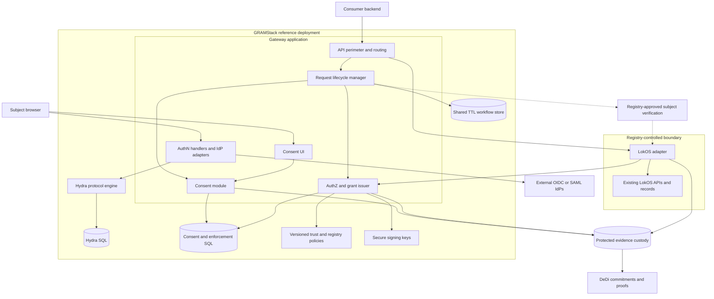
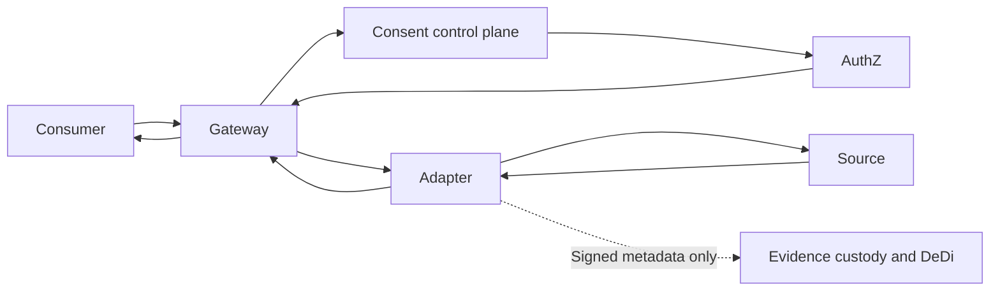
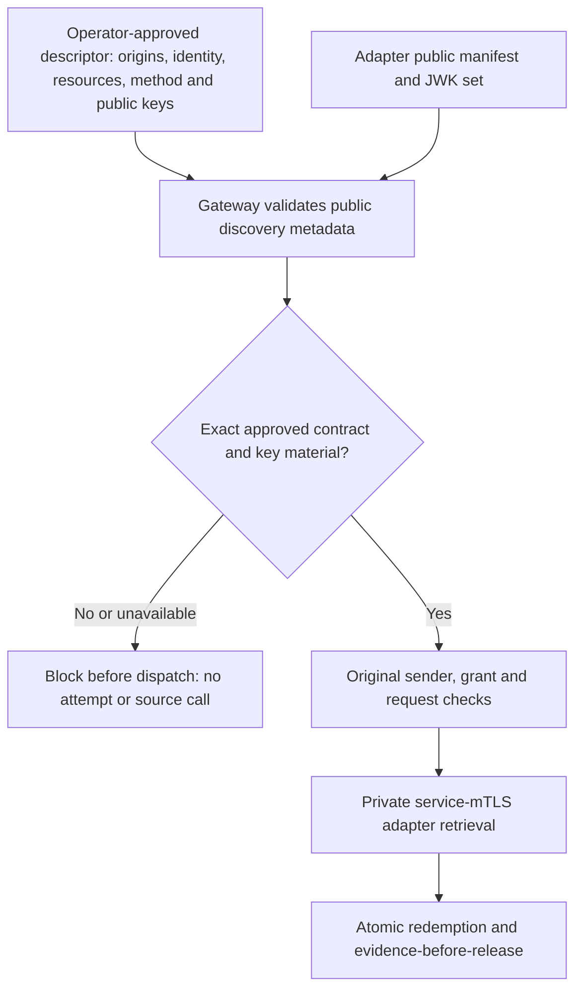

# High-level architecture

## Component and trust-boundary view

Sharing a deployment does not merge trust decisions. An externally exposed gateway must not expose Hydra admin APIs, private redemption APIs or signing keys.

## Responsibilities and contracts

| Component | Inputs | Outputs | Authoritative responsibility |
|---|---|---|---|
| API perimeter | Consumer token, request payload | Validated caller context, safe errors | Consumer authentication, quotas and routing |
| Lifecycle manager | API commands and verified callbacks | State transitions, deadlines, references | Overall request progress |
| AuthN integration | OIDC/SAML transactions | Issuer-qualified verified principal | Authentication context, not registry ownership |
| Subject verification | Principal and immutable request | Registry-approved request-bound context | Person-to-record relationship; registry-specific contract |
| Consent module | Verified context, request, human decision | Signed artefact and current status | Human disclosure approval and withdrawal |
| AuthZ | Consumer, consent, context, policy | Decision, scoped grant and redemption result | Permission to execute a particular read |
| Registry adapter | Authenticated caller and grant | Canonical approved fields and signed receipt | Independent source-side enforcement |
| Evidence subsystem | Signed events and artefacts | Durable acknowledgement, proof references | Accountable custody and anchoring |
| Discovery | Signed configuration | Capabilities, trusted issuers and endpoints | Configuration distribution, not citizen search |

## Consent control plane versus data plane

The consent module sees requested data categories and necessary identity references, not the returned membership/savings response. The gateway and adapter may process protected response bytes transiently. Therefore the overall gateway is not described as data-blind merely because the consent module is.

## Deployment guidance

The reference deployment uses one GRAMStack application containing gateway, lifecycle, login and consent handlers and AuthZ modules. Hydra and stores remain separate processes. Registry adapters can be embedded by registry owners or deployed in a controlled environment using exclusive integration credentials. Isolation of signing and consent services can be introduced when concrete operational or security requirements justify it.

The component contracts are language-independent. Deployment boundaries follow credential isolation, availability and scaling requirements rather than requiring a separate service for every logical module.

## Synchronous and asynchronous boundaries

| Boundary | Model | Consequence |
|---|---|---|
| Consumer authentication | Synchronous token exchange | No registry-data authority implied |
| Create access request | Synchronous validation, then `202` | Human approval is not held open in an HTTP request |
| External login | Browser redirects and callbacks | Persist state/nonce/PKCE correlation across instances |
| Registry verification | Immediate result or asynchronous challenge | Never assume an HTTP timeout is a rejection |
| Human decision | Asynchronous interaction | Subject can reject, abandon or time out |
| Artefact signing / evidence | Durable background work if required | Approval can be recorded before usable consent exists |
| Status propagation | At-least-once notifications plus reconciliation | Duplicate and missed deliveries are expected |
| Grant issuance | Bounded synchronous decision | Explicit consumer call |
| Redemption and retrieval | Bounded synchronous execution | Atomic reservation before source access |
| DeDi anchoring | Synchronous or batched according to deployment policy | Release depends on the chosen durable evidence boundary |

## Exclusive integration claim

Every GRAMStack-facing retrieval must pass authorized enforcement and produce required evidence before protected release. Upstream credentials must not be exposed to consumers. This claim covers GRAMStack-mediated retrieval, not unrelated native LokOS applications, administrative access or other integration credentials.

## Adapter discovery and onboarding trust

An independently hosted adapter publishes public capabilities and public verification keys. Its protected verification/retrieval RPCs use a separate mTLS listener. The gateway's descriptor pins the public metadata origin, private data origin/service identity, registry, adapter ID/audience, verification method, resource name/version/fields and approved signing key material. Discovery confirms the deployed contract; it cannot enroll a key, choose a new host, broaden policy or verify a person's registry ownership.

The [adapter discovery profile](specifications/adapter-discovery) defines fixed well-known paths, explicit versions, bounded JSON and strict EC/P-256 public JWKs. Before each protected dispatch, gateway checks the advertised method, required capabilities, resource versions and exact approved key points. Redirects, private key parameters, unknown fields, duplicate identities and unsupported algorithms fail closed. Metadata reads send no consumer token, cookie or private service credential. Production metadata uses HTTPS; explicit development permits literal-loopback HTTP only.

Unavailable or incompatible metadata returns a safe failure before the gateway claims an attempt. The request can proceed after valid metadata is restored. Actual permission still requires current source policy, verified subject, ACTIVE consent, original consumer certificate, independent SDK checks, atomic one-use admission and durable evidence. The manifest is a capability declaration, with dependency availability checked separately from trust.
