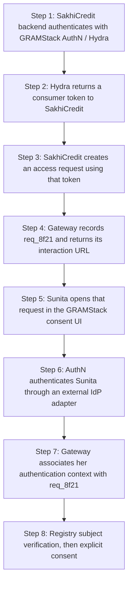
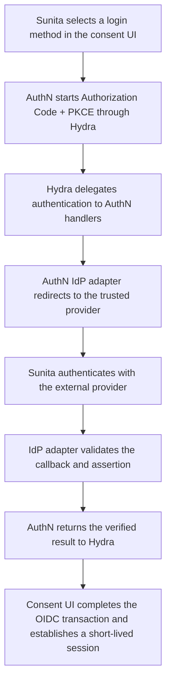

# Authentication

## Separate consumer and subject authentication

SakhiCredit authenticates as an institution/application. Sunita authenticates as the person making the consent decision. A consumer token cannot stand in for Sunita's session. An ID token attests to authentication for its intended client; it is not a registry-data access token.

## How the two authentications join the same request

The boxes below are steps in one journey, rather than separate deployed applications. SakhiCredit is the external consumer; its backend uses the consumer token to create the access request. Sunita then opens that same request and authenticates through GRAMStack AuthN.



| Authentication | What it establishes | Where the result is used |
|---|---|---|
| SakhiCredit authenticates as a client | Which application is requesting access | Gateway creation, ownership and policy checks for `req_8f21` |
| Sunita authenticates through an IdP | Which person is interacting and with what assurance | Registry subject verification and the consent decision for the same request |

Neither authentication alone permits retrieval. The shared request connects the consumer, verified registry subject, human decision and eventual grant.

## What runs inside AuthN

**AuthN owns login initiation, callbacks, sessions and IdP adapter integration.** These handlers are part of the AuthN layer, not a separate application or a new deployment boundary. Hydra calls them to obtain the external authentication result; the consent UI uses the resulting first-party session.




## Authentication components

| Function | Owner | Reason |
|---|---|---|
| OAuth/OIDC protocol engine | Ory Hydra | Reuse protocol implementation without citizen account provisioning |
| Citizen credentials and accounts | External IdPs | Preserve no-local-citizen-identity invariant |
| Provider-specific federation | AuthN handlers and IdP adapters | Own integration without forking protocol internals |
| Consumer registration | Durable operator configuration | Institutional client identity is not a citizen registry |
| Disclosure consent | GRAMStack consent module | OAuth client consent is a different decision |
| Retrieval grants | GRAMStack AuthZ | Request binding, single-use enforcement and consent status |

The reference architecture uses Hydra without a local citizen identity store. Provider-specific authentication is delegated upstream. Each deployment pins a supported release and validates its enabled protocol features and retention settings.

Hydra needs operational SQL state. The authentication profile disables remembered login/consent and refresh-token issuance for this profile, uses appropriate opaque subject handling, and schedules cleanup. `remember: false` is not a guarantee that all database rows, backups, logs and traces are anonymous or promptly removed. Retention controls cover table contents, logs, traces and backups.

## Login adapter contract

The adapter is transaction-oriented, not account-oriented. The following language-neutral pseudocode describes the integration contract.

```typescript
interface IdentityProviderAdapter {
  capabilities(): ProviderCapabilities;
  begin(input: AuthRequest, transaction: AuthTransaction): AuthChallenge;
  complete(callback: ProviderCallback, transaction: AuthTransaction): VerifiedPrincipal;
}

type VerifiedPrincipal = {
  issuer: string;
  subject: string;
  authTime: number;
  methods: string[];
  assurance?: { value: string; issuer: string };
  transactionId: string;
};
```

| Common integration layer | Provider adapter |
|---|---|
| Allocate one-time transactions, safe browser cookies and callback routing | Construct provider-specific challenge or redirect |
| Configure trusted provider and redirect allowlists | Validate protocol assertions using maintained libraries |
| Enforce transaction state and one-time completion | Verify issuer, audience, signature and protocol-specific correlation |
| Normalize safe errors and select accepted assurance | Preserve upstream assurance provenance without inventing equivalence |
| Issue first-party session after successful protocol completion | Handle provider metadata/key rotation under explicit trust configuration |

Ownership of state, nonce and PKCE checks must be unambiguous in the implementation. A shared library may implement checks on behalf of an adapter; neither layer may assume the other performed them.

## Browser flow and correlation

1. The consent UI backend creates a login transaction bound server-side to the access request and provider choice.
2. The consent UI backend starts Authorization Code + PKCE with Hydra using state and nonce.
3. AuthN handlers create a separate upstream transaction if federation requires another redirect.
4. Adapter validates the upstream response against that transaction.
5. AuthN handlers accept the matching Hydra login challenge using an appropriate opaque subject.
6. The consent UI backend exchanges its code and validates the expected issuer, audience and nonce.
7. The consent UI backend rotates/creates a Secure, HttpOnly session and records a short-lived verified principal reference.
8. Registry subject verification still runs before final disclosure consent.

Arbitrary query parameters and the browser's returned `request_id` are not trusted request binding. The authoritative mapping is server-side transaction correlation. A request locator is never a bearer authorization capability.

## eSignet and Indian integrations

The reference demo uses the official MOSIP eSignet service and UI as its upstream OIDC provider, backed by MOSIP’s mock identity system. Other deployments select a trusted provider through the adapter profile. A registry-run IdP only solves subject ownership if it authenticates the actual member and securely asserts the account-to-record relationship; an operator login or arbitrary `sub` does not produce that guarantee.

MeriPehchaan/JanParichay is a production integration candidate subject to onboarding, partner contracts and verified protocol documentation. Do not assume an endpoint described as OAuth is OIDC. SAML or custom integration may be needed. An AUA is a UIDAI ecosystem role, not automatically a third-party OIDC provider.

The independent Go module `adapters/auth/oidc` owns provider discovery, token authentication, signature verification and normalization to a verified principal. A versioned public profile pins issuer, client ID, accepted ID-token algorithms and the client-assertion audience; secrets and signing keys are supplied separately. The eSignet profile uses `private_key_jwt` and PS256. State custody, browser binding, request ownership and short-lived first-party sessions remain platform responsibilities. Neither OAuth login nor an upstream identity claim grants disclosure consent.

Local mock OIDC tests provide fast protocol regressions alongside the official eSignet integration. SAML and government integrations use the provider’s documented protocols, trust configuration and access agreements through the same transaction-oriented adapter boundary. An authentication result preserves issuer, pairwise subject, signed authentication time, methods when supplied, assurance provenance and transaction correlation; it invents no registry ownership or assurance equivalence.

## Security and failure behavior

Reject wrong issuer/audience, unsigned or disallowed-algorithm assertions, expired responses, state/nonce mismatch, unsolicited callbacks and replay. Fail closed when required validation cannot complete. Do not silently downgrade assurance on IdP outage. OTP proves control of a channel; it does not alone establish registry ownership. Citizen passkeys remain with upstream IdPs, avoiding first-party credential storage.

Key rotation must overlap valid token lifetimes. Unknown key IDs cause bounded trusted refresh, not arbitrary URL fetching. ID tokens and upstream assertions must not enter URLs, analytics or routine logs.
