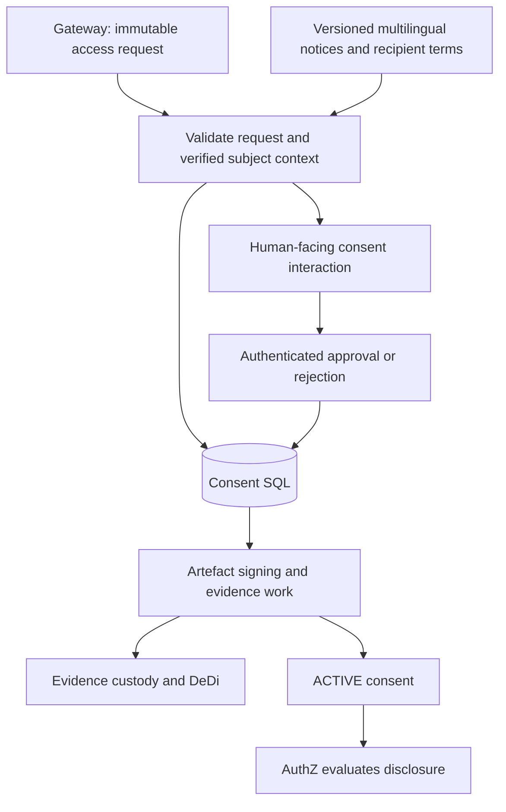
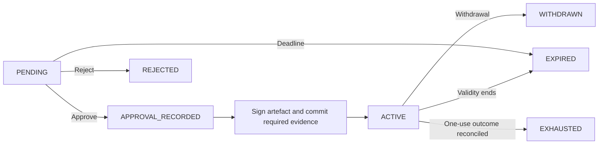
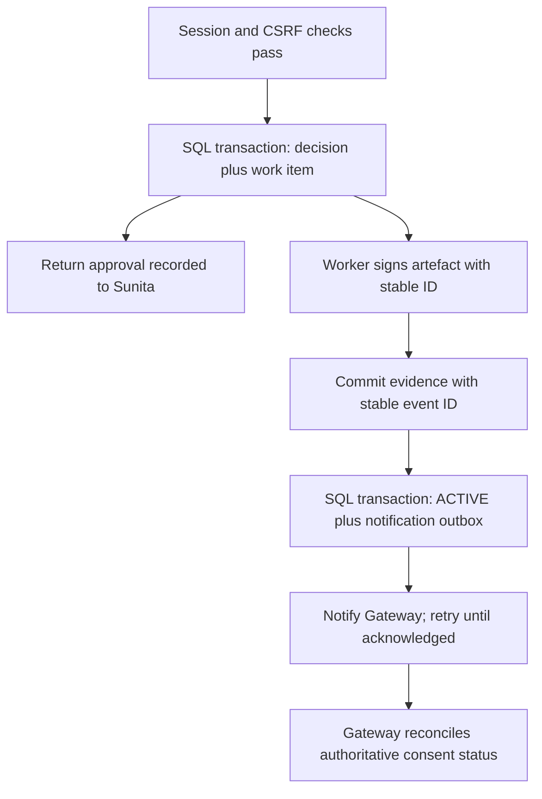
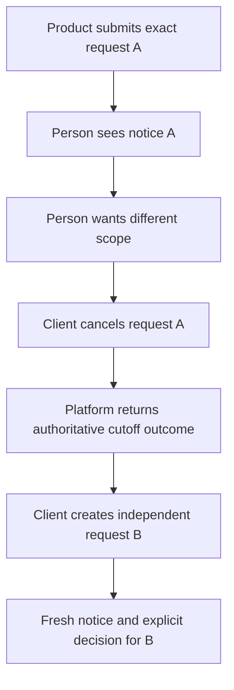
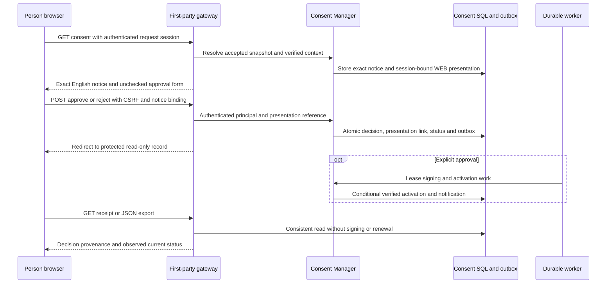
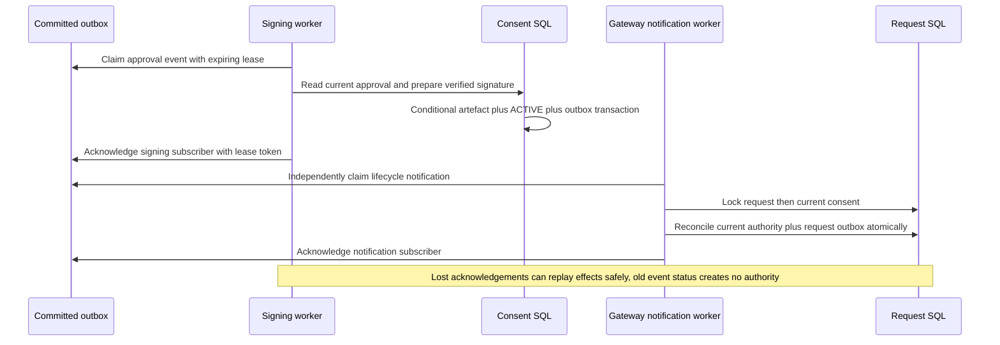

# Consent manager

## Implementation direction

GRAMStack implements a consent subsystem for request-bound registry disclosure, using DEPA as its architectural reference and established open implementations as engineering references.

The module displays exact notices, collects explicit approval or rejection, binds the human decision to the request and verified subject, signs consent artefacts, maintains authoritative status and withdrawal, delivers reliable events and retains necessary evidence. Consent does not issue retrieval grants or process registry response bodies.



## What Sunita is deciding

The notice identifies SakhiCredit, LokOS, the requested membership and savings fields, credit-eligibility purpose, frequency, validity, recipient retention terms, withdrawal method, consequences of refusal and help/grievance channel. It is presented in an accessible language; language, template revision and exact rendered content are retained as evidence.

For the single-disclosure profile, approval covers one bounded disclosure. Repeated/recurring consent, minors, guardians and delegated consent require explicit profiles. The interaction approves or rejects the exact request as a whole. There is no partial-refusal state, request-revision object or scope negotiation in the platform. If the person wants a narrower scope, the client cancels the old request and creates an independent new request with a fresh notice and decision. Cancellation must be acknowledged before treating the old authority as blocked; it cannot undo an admitted disclosure.

The browser session must correspond to the trusted verified-subject context. The module derives the approver from validated session state, never caller-provided `subject` JSON. CRP assistance does not make the CRP the approver.

## Lifecycle and background work



`APPROVAL_RECORDED` is a recovery boundary. Approval is durable, but no usable consent exists until signing and the chosen mandatory evidence commitment succeed. Transient outages leave recoverable work, not an invented ACTIVE status. Rejection/withdrawal evidence is also retained according to policy.

A human withdrawal during artefact preparation must prevent later activation. The worker conditionally updates the expected version; a late job cannot overwrite a cancellation. Cancellation before activation prevents the consent from becoming usable.

One-time usage has a separate enforcement lifecycle: AVAILABLE → RESERVED → outcome (release attempted, failed, or uncertain). Do not mark a consent successfully used merely because a grant was issued or a source HTTP request started. A use reservation and its recorded outcome distinguish exhausted disclosure authority from successful data delivery.

## Durable transaction and outbox



No distributed transaction is assumed across SQL, signing, DeDi and gateway workflow state. Stable IDs, conditional updates, durable work items, acknowledgements and reconciliation handle partial completion. Notification delivery is at least once. A webhook or browser redirect is not proof of current consent status.

## Artefact structure

Illustrative consent payload:

```json
{
  "consent_id": "con_61b4",
  "schema_version": "gramstack.consent.v1",
  "issuer": "https://consent.gramstack.example",
  "request_digest": "sha256:request-A",
  "subject_context_digest": "sha256:context-B",
  "consumer": "sakhi-credit",
  "provider": "lokos",
  "resource": "shg.membership",
  "fields": ["membership_status", "savings_summary"],
  "purpose": "credit_eligibility",
  "frequency": "ONCE",
  "recipient_terms_version": "sakhi-retention-v1",
  "notice_digest": "sha256:notice-HI-v1",
  "approved_at": "2026-11-01T10:02:00Z",
  "valid_until": "2026-11-01T10:07:00Z",
  "status_endpoint": "https://consent.gramstack.example/v1/consents/con_61b4/status"
}
```

Use a standard signature envelope and trusted issuer/key discovery. The consent authority's signature attests to its recorded approval process; it is not Sunita's personal digital signature. A signed ACTIVE artefact does not prove consent remains active later. Status is authoritative for enforcement. Sensitive references are protected; no global citizen identifier is introduced for convenience.

## Withdrawal and user history

An authenticated subject can review the notice/artefact and request withdrawal while future access remains possible. A permanent citizen account is not required. Later access uses reauthentication, an authorized evidence lookup and request-bound recovery correlation. A raw receipt ID or SMS link alone cannot authorize withdrawal.

The reference flow admits retrieval at atomic redemption; withdrawal before that point blocks admission. Consent status and redemption must share one atomic enforcement boundary to prevent check-then-use races. See [authorization](05-authorization). After plaintext release, withdrawal cannot recall copied data. Applicable downstream obligations need operational enforcement beyond token revocation.

## Product and platform boundary

Products supply use cases and user interfaces; GRAMStack supplies bounded disclosure authority and accountable evidence. A voice assistant, a credit application and a mobile field application use the same platform contracts. Speech recognition, conversational memory, AI interpretation and credit/advisory decisions remain in the product. A model may propose a request; it cannot establish identity, row ownership, representative authority or consent.

| Platform contract | Product responsibility | Platform enforcement |
|---|---|---|
| Purpose manifest | Declare the processing purpose and why each field is needed | Resolve an approved version; bind requirements, scope and time window to the request |
| Notice presentation | Present the approved notice in the selected language/channel | Bind presentation evidence to the exact notice and authenticated decision |
| Processing profile | Declare recipients, processors and data-handling commitments | Resolve trusted versions; bind them to notice and consent; enforce source policy |
| Authority context | Initiate an approved self/representative verification flow | Verify issuer, subject, request, assurance, authority scope and expiry |
| Rights and handling interfaces | Provide user screens and perform downstream actions | Authorize requests, route to responsible organisations and retain authenticated outcomes |

These are architecture extension contracts. Their illustrative records below do not add accepted fields to the published [current message schema](specifications/schemas). Extensions require explicit capability negotiation and a versioned contract before wire use. Unknown security-sensitive fields remain rejected.

## Purpose and processing profiles

A purpose manifest identifies its owner, version, field-level justifications, canonical resource and applicable time window. A processing profile identifies the responsible recipient, processor inventory, permitted uses, derived-data handling and retention policies. Approval of a registered purpose does not bypass the source owner's current policy.

The platform resolves approved manifests from trusted configuration, validates their compatibility with the exact request and stores immutable snapshots or content digests. An arbitrary client URL is not a trusted manifest. Material changes to purpose, fields, recipients, time windows or processing terms require a new request and fresh approval. A processing/decision rules version is a reference supplied by the product; the platform does not execute business decisions or certify their correctness.

Illustrative binding record, retained alongside the immutable request and committed by the extended request digest:

```json
{
  "access_request_id": "req_8f21",
  "purpose_manifest": {
    "id": "sakhi-credit-eligibility",
    "version": "1.0",
    "digest": "sha256:purpose-manifest-A",
    "requirements": [
      {"field": "membership_status", "justification": "Verify eligible SHG membership"},
      {"field": "savings_summary", "justification": "Assess savings history"}
    ],
    "period": {"from": "2025-11-01", "to": "2026-10-31"}
  },
  "processing_profile": {
    "id": "sakhi-credit-assessment",
    "version": "1.0",
    "digest": "sha256:processing-profile-A",
    "responsible_organisation": "sakhi-credit",
    "processor_manifest_ref": "processors_123",
    "data_handling_policy_ref": "handling_123",
    "derived_data_policy_ref": "assessment_results_123",
    "responsibility_manifest_ref": "responsibilities_123"
  }
}
```

Canonical resource semantics must define whether historical windows are supported and how dates, inclusivity, freshness and missing periods are interpreted. Do not silently add a date filter to a resource that cannot enforce it. The adapter enforces any supported time and field bounds independently.

## Presentation and decision evidence

The consent authority retains exact notice content; a hash without retrievable content is insufficient. A presentation record distinguishes the approved template from what was actually displayed or played. It records language, channel, content digest, timing, confirmation method and optional assistance. Evidence is access controlled and authenticated; a client-supplied claim that audio was played is not by itself proof of a person's informed approval.

```json
{
  "presentation_id": "presentation_123",
  "consent_request_id": "cr_123",
  "notice_ref": "notice_789",
  "notice_version": "consent-notice-v1",
  "rendered_content_digest": "sha256:notice-HI-v1",
  "language": "hi-IN",
  "channel": "VOICE",
  "presented_at": "2026-11-03T10:00:00Z",
  "confirmation_method": "AUTHENTICATED_EXPLICIT_CONFIRMATION",
  "confirmation_evidence_ref": "evidence_123",
  "assistance": {"assistant_ref": "worker_123", "role": "FACILITATOR"}
}
```

A voice integration can attach protected references to read-back evidence and interpreter/model versions. The product owns interpretation and ambiguity handling; the platform accepts only a structured decision bound to the authenticated subject and exact notice/request. A model confidence score is never approval authority. Audio retention is an explicit policy choice, not a default requirement; audio hashes also need privacy review. Translations and accessible renderings must preserve scope, recipient, retention and withdrawal meaning.

Assistance records describe participation, not delegation. An office-bearer role does not automatically authorise members' personal data; household membership does not establish authority over other adults. Unsupported guardian or representative profiles fail closed. Where approved aggregate resources are used, compute and minimise them at the source/adapter before individual rows cross the boundary; aggregates still require disclosure/privacy assessment.

## Explicit cancellation and a new request



No approval, reservation or grant carries from A to B. The cancellation path authenticates the owning client, records its reason separately from a human rejection, invalidates unadmitted authority under the same transactional boundary as redemption and makes late activation/grant work fail. Before consent exists it terminates the request; after approval it also blocks consent activation or future admission. After redemption it reports that the admission cutoff has passed and preserves the attempt outcome. It does not falsely report that an in-flight disclosure was recalled. The person may independently reject or withdraw using subject-authorised interfaces.

For multiple sources, the client creates separate bounded requests and handles product-level completeness. A conversation or parent application reference is correlation metadata, never authority to reuse consent across sources or subsequent questions.

## Rights and responsible organisations

The [post-disclosure profile](specifications/post-disclosure) specifies independent history sign-in, the consent record download, rights case intake and private operator queues.

The platform exposes authorised consent/disclosure history and machine-readable receipt export, with metadata minimised for the caller. It accepts and routes access, correction, erasure and grievance requests to the organisation responsible for the relevant records. Source correction happens in the registry's own process; read-only interoperability does not become registry mutation. Withdrawal, cancellation and erasure are distinct operations.

Each rights case records the verified requester/authority reference, request type, affected consent/disclosure references, responsible organisation, acknowledgement, policy-defined deadline, status and authenticated outcome or exception. Acceptance is not completion. Products provide user interfaces and notifications; the platform provides durable case correlation and status. History lookup and export require reauthentication and subject/role checks, without introducing a universal citizen identity index. Never return other household members' records through an export.

Registered external consent managers and wallet services are integrations with explicit trust, authority and conformance profiles. OAuth tokens and wallet authorisation are not substitutes for source-subject binding or disclosure consent. External redirects use one-time unpredictable state bound server-side to the transaction; token revocation stops future calls but does not erase fetched data.


## Implementation references

| Implementation | What to inspect | Important fit questions |
|---|---|---|
| GovStack / iGrant Consent BB | Generic agreement revisions, consent APIs, UI and dashboard | External identity without local citizen provisioning; DEPA artefact mapping |
| TSI DPDP CMS | Notices, purpose checks, withdrawal, verification, notifications and administrative workflows | Identity/storage model, runtime scope, interoperability and evidence export |
| ProjectEKA | Asynchronous health-consent and data-flow separation | Health-specific assumptions, user module and licensing before code reuse |

Source links are listed in [references](12-references). These projects inform implementation patterns; adopting their code requires license and security review. Product claims do not substitute for GRAMStack conformance checks.

## DEPA and legal posture

DEPA is the architectural reference for granular, revocable, auditable disclosure consent with separated consent and data flows. The older iSPIRT architecture repository is not treated as a maintained runtime dependency or a universal current conformance standard. ReBIT provides a concrete financial-ecosystem reference, not an automatic contract for LokOS.

The DPDP Act defines a Consent Manager as a registered person. A software module and a legally registered operator are separate matters. Each deployment defines its responsible fiduciary, consent authority, evidence custodian, retention policy and applicable regulatory obligations. This document makes no certification or registration claim.

## First-party WEB interaction

The [consent portal profile](specifications/consent-portal) binds the actual rendered notice to the request's authenticated session. English is supported explicitly; other languages are rejected. The portal serves both the choice screen and a protected human/JSON record. Its export never contains source identifiers, lookup hints, identity-provider subjects or business rows.



| Stored object | Location | Exposure |
|---|---|---|
| Exact notice, recipient terms and immutable decision | Consent SQL | Owner-authenticated record |
| Render time, language, channel, notice binding | Consent presentation SQL | Owner record excludes private principal/session binding |
| Decision-to-presentation link and checkbox confirmation | Same decision transaction | Owner provenance |
| Request-bound session and verified context | Gateway encrypted state | Server only |
| Pending work and lifecycle notifications | Metadata outbox | Worker/service only |
| Signed artefact | Immutable consent artefact SQL | Authenticated record when it exists |

An approval receipt says **Approval recorded** until the trusted activation work completes. A render or download never creates ACTIVE consent. Withdrawing preserves the original decision while stopping future admissions. An admission cutoff indicator does not establish successful delivery. Short-lived interaction receipts and later protected history/recovery are distinct capabilities.

## Worker delivery and recovery

The reference runtime has bounded embedded signing, notification and expiry loops. Signing and gateway notifications have independent durable acknowledgements; one subscriber cannot consume an event needed by another. A claim uses a database lease and a fresh fencing token. Work is acknowledged only after its effect succeeds. A failed or lost worker leaves recoverable work; a successor reuses the stable event and re-reads current authority.



Request lifecycle [0.3.0](specifications/lifecycle) includes withdrawal while CONSENT_PENDING, covering approval that is stopped before activation. Versions 0.1.0 and 0.2.0 remain unchanged. A late ACTIVE event is only a prompt to re-read current state; it cannot overwrite withdrawal/cancellation/expiry or restore a consumed disclosure. Recorded stops can be projected after the interaction deadline without creating new authority.

Each maintenance pass bounds expiry/reconciliation to 32 objects, encrypted TTL-state cleanup to 128 rows, and terminal accepted-snapshot cleanup to 32 rows after the declared 24-hour retry window. Deadline checks remain authoritative during worker outages. Exact notices, original decisions, signed artefacts, consumed reservations and delivery acknowledgements are not erased by TTL cleanup. Recipient/back-up deletion and later protected history use separate policies and contracts. Internal SQL notification delivery is distinct from external webhooks.
