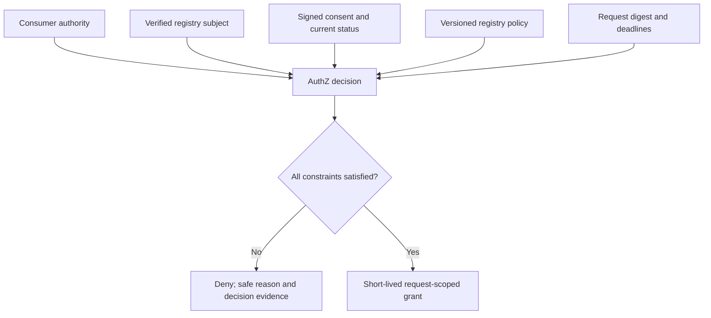
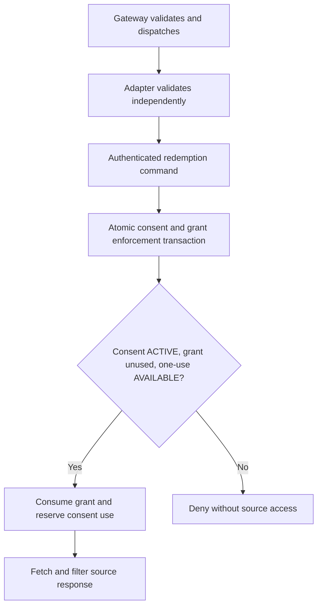

# Authorization and retrieval grants

## Decision inputs

Consent is necessary for the normal profile but never sufficient. AuthZ considers the authenticated consumer, verified subject context, exact request/consent binding, trusted consent issuer, registry policy, fields, purpose, recipient, assurance, deadlines, withdrawal and usage state.



The v1 policy model uses a signed, versioned per-registry bundle evaluated through a small deterministic decision interface. Request-time status, assurance and validity dominate authorization. Registry relationship hierarchies remain source-owned rather than being replicated into a central relationship engine. Revisit a policy engine such as Cedar/OPA only when concrete policy complexity justifies it. 

## Policy shape

```yaml
registry: lokos
version: v1
consumers:
  sakhi-credit:
    purposes: [credit_eligibility]
    resources:
      shg.membership:
        fields: [membership_status, savings_summary]
    require_verified_subject: true
    require_human_consent: true
    max_grant_seconds: 300
    max_disclosures: 1
```

This abbreviated example illustrates the policy envelope. Registry profiles also define assurance, issuer trust, recipient terms, source policy and canonical resource semantics. A decision records the exact policy version. Missing or unknown constraints fail closed.

## Grant claims

```json
{
  "iss": "https://authz.gramstack.example",
  "aud": "urn:gramstack:adapter:lokos",
  "sub": "request-scoped-subject-reference",
  "client_id": "sakhi-credit",
  "jti": "grant_73c2",
  "iat": 1793527320,
  "exp": 1793527620,
  "request_id": "req_8f21",
  "request_digest": "sha256:request-A",
  "resource": "shg.membership",
  "fields": ["membership_status", "savings_summary"],
  "purpose": "credit_eligibility",
  "consent_ref": "con_61b4",
  "subject_context_ref": "ctx_77",
  "policy_version": "lokos.v1"
}
```

AuthZ uses a signed grant with a separate trusted issuer and JWKS. Expiry is bounded by consent validity, subject-context validity, request deadline and registry policy. Claims contain authorization metadata, not registry response data. JWT payloads are readable unless separately encrypted, so avoid raw identifiers and unnecessary attributes.

Sender constraints are defined by the deployment security profile. A `client_id` claim alone does not bind a bearer token to its presenter. If selected, use a reviewed mTLS/DPoP design with `cnf`, proof validation and replay controls at the appropriate hop. Gateway termination and adapter enforcement must agree on how the original sender is authenticated; never pretend a forwarded string header is proof of possession.

## Issuance and one-time redemption

Grant issuance is an explicit consumer call after consent. Store/recover a stable issuance result so retries do not mint unlimited distinct grants. A one-time consent cannot be bypassed by creating a second `jti`.

The gateway performs perimeter validation, but the adapter is the redemption enforcement point. It independently validates issuer, signature, audience, time, request, resource and fields, then calls authenticated internal AuthZ redemption. Only the authoritative atomic reservation permits a source read.



Redemption also binds the adapter identity, request digest and a stable retrieval attempt ID. Repeated commands need a defined response: the same authenticated attempt may recover its status, but recovery must not authorize a second upstream execution or second release.

## Withdrawal and atomic enforcement

A status read followed by an independent Redis `SET NX` has a race: ACTIVE may be read before withdrawal, then redemption may succeed afterward. Single-use token replay prevention alone is insufficient.

Authoritative consent enforcement and grant redemption share one transactional SQL boundary. Consent and AuthZ remain separate modules with controlled writes. Gateway TTL state and Hydra SQL have separate responsibilities.

```text
BEGIN
  Lock consent enforcement record
  Validate consent status, version, expiry and one-use availability
  Validate grant, consumer, adapter and request binding
  Insert unique grant redemption
  Reserve the consent's single permitted use for attempt_id
  Record enforcement event and durable work item
COMMIT
```

Withdrawal locks/checks the same consent enforcement record. Whichever transaction commits first determines whether retrieval is admitted. This defines the retrieval admission cutoff; it does not promise cancellation up to the final response byte. A requirement to cancel after admission needs additional cancellation/release coordination and a precisely defined final cutoff.

An equivalent atomic store can implement the enforcement contract. Independent stores require a coordination protocol that preserves the same consistency guarantees. See [state](08-state-and-evidence).

## After redemption

The one-use profile is conservative: the grant remains consumed after source failure, evidence failure or ambiguous timeout. Do not reauthorize automatically or cache a response to make retries easy. A fresh disclosure request and approval may be required. This preserves one-use semantics even when a failure requires the user to authorize a new attempt.

Record failed, attempted and uncertain outcomes separately. A server completing transmission is not proof of complete client receipt. Evidence of attempted disclosure and a spent grant remain valid even when the consumer reports a timeout.

## Versioned grant profile

The [0.1.0 authorization contract](specifications/authorization) specifies ES256 signed grants and an mTLS presenter-binding profile. The consumer certificate is checked at the gateway, and trusted presenter context crosses authenticated service transport to the adapter. DPoP requires a separately specified proof-verification profile.
