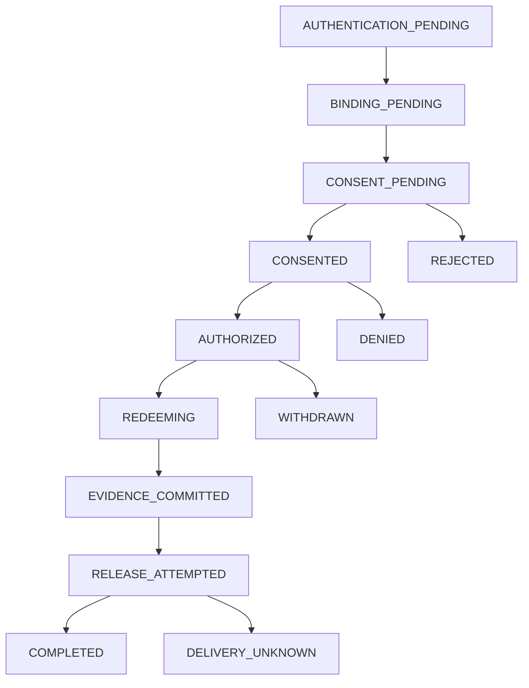

# Request lifecycle

## The immutable request

One access request is one consumer asking for one bounded disclosure from one registry. Consumer/recipient, registry/resource, subject hint, fields, purpose, requested validity, terms revision, deadline and schema version are fixed after acceptance. Mutable workflow metadata holds current status/version and references to authentication, verified subject, consent, grant and evidence.

Canonicalization must be specified before digest-based interoperability: schema validation, defaults, explicit units, normalized field-set ordering, Unicode/string treatment and a documented JSON canonicalization/hash profile. Signing arbitrary `JSON.stringify` output from different languages is not a protocol. Tests must prove semantically equivalent inputs produce the defined digest, and changed scope produces a different one.

The final consent binds both the immutable request and verified subject context. A hint is not authoritative identity. Changes to scope or recipient require a new request and fresh approval.

## Persisted states

All active stages have deadline and integrity-failure handling. The graph highlights the main path. CREATED, SUBJECT_BOUND and RETRIEVED are recorded as events; persisted states identify waits and recovery boundaries.

| State | Entry condition | Responsible next action |
|---|---|---|
| AUTHENTICATION_PENDING | Request accepted and durably correlated | Subject enters/resumes login |
| BINDING_PENDING | Authentication completed | Approved verification workflow or mock test context |
| CONSENT_PENDING | Registry subject context accepted | Human views notice and decides |
| CONSENTED | Consent ACTIVE after required evidence | Consumer requests grant |
| AUTHORIZED | AuthZ decision and grant issuance recorded | Consumer submits retrieval |
| REDEEMING | Grant consumed and consent use reserved | Adapter executes the single admitted attempt |
| EVIDENCE_COMMITTED | Required access receipt durable | Release gate admits response |
| RELEASE_ATTEMPTED | Response release intent recorded | Complete transmission or classify uncertainty |
| COMPLETED | Defined server transmission condition met | Evidence reconciliation and eventual cleanup |
| DELIVERY_UNKNOWN | Transmission/crash outcome uncertain | Preserve evidence; no automatic resend |

CANCELLED, REJECTED, DENIED, WITHDRAWN, EXPIRED and FAILED are distinct terminal outcomes. Owner-initiated cancellation atomically invalidates unadmitted consent and records its consumer actor separately from a human rejection or withdrawal. It conflicts after a consumed reservation, even if the workflow projection has not caught up. FAILED carries a safe reason/stage and a separate internal diagnostic reference. Consumer-visible failures must not reveal whether a guessed citizen record exists.

## Conditional transitions

Each command reads the current expected state/version, verifies caller authority, deadline and request binding, then atomically updates the state and version. Terminal states cannot be resurrected by delayed callbacks. The authoritative consent/redemption store may advance before the gateway projection; reconciliation corrects the projection without undoing enforcement.

| Event | Guard | Effect |
|---|---|---|
| Login callback | Matching one-time auth transaction | Advance to binding; reject replay |
| Verification result | Trusted issuer, correct principal/request, adequate assurance | Create consent interaction |
| Consent ACTIVE event | Trusted source, matching artefact/request and current version | Advance to CONSENTED |
| Grant issuance retry | Same consumer, request and idempotency input | Recover original result |
| Withdrawal | Valid subject authority; admitted cutoff not crossed | Block future redemption |
| Duplicate callback | Already processed event ID or stale version | Return existing result/no new authority |
| Deadline worker | Still active, deadline reached | Terminal expiry plus required evidence work |
| Retrieval timeout | Consult authoritative attempt/redemption status | Never reset consumed grant to AUTHORIZED |

## Deadline versus cleanup

A business deadline determines whether new actions can be admitted. A cleanup TTL determines when recovery/idempotency metadata may be removed. They are not the same timestamp.

A deadline index/worker must process expiry before state is deleted, commit necessary evidence and retain a bounded terminal lookup window. Redis keyspace notifications or expiration events alone are not reliable audit delivery. In-flight redemption/evidence work needs a separate bounded recovery policy.

The examples use a 10-minute human interaction and a grant of up to 5 minutes. Deployments set these limits through registry and channel policy. Different channels, accessibility needs and assisted workflows may need different limits.

## Retry matrix

| Stage | Retry behavior |
|---|---|
| Create request | Same idempotency key/body returns the original request |
| Provider redirect/callback | One-time correlation; retry must not duplicate authentication authority |
| Human decision | Duplicate identical decision returns existing record; incompatible decision conflicts |
| Artefact signing | Stable artefact ID and digest; do not activate twice |
| Evidence commit | Stable event ID and payload digest; reconcile ambiguous acknowledgements |
| Notification | At least once, bounded backoff and receiver deduplication |
| Before redemption | Safe operations may retry within deadlines |
| After redemption | Recover attempt status; do not silently execute another read |
| During/after release | No automatic plaintext resend under the one-use profile |

## Synchronous/asynchronous contract

A `202` acknowledges durable workflow acceptance, not a successful disclosure. Login redirects, verification challenges and consent can span instances and minutes. Polling is sufficient for the polling-based consumer integration; consumer webhooks add their own authenticated delivery protocol and are not assumed. Grant issuance and retrieval remain bounded HTTP requests. Internal outbox workers handle eventual propagation and evidence retries without extending the caller's request indefinitely.
