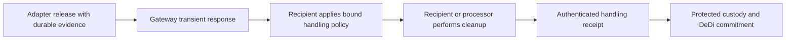
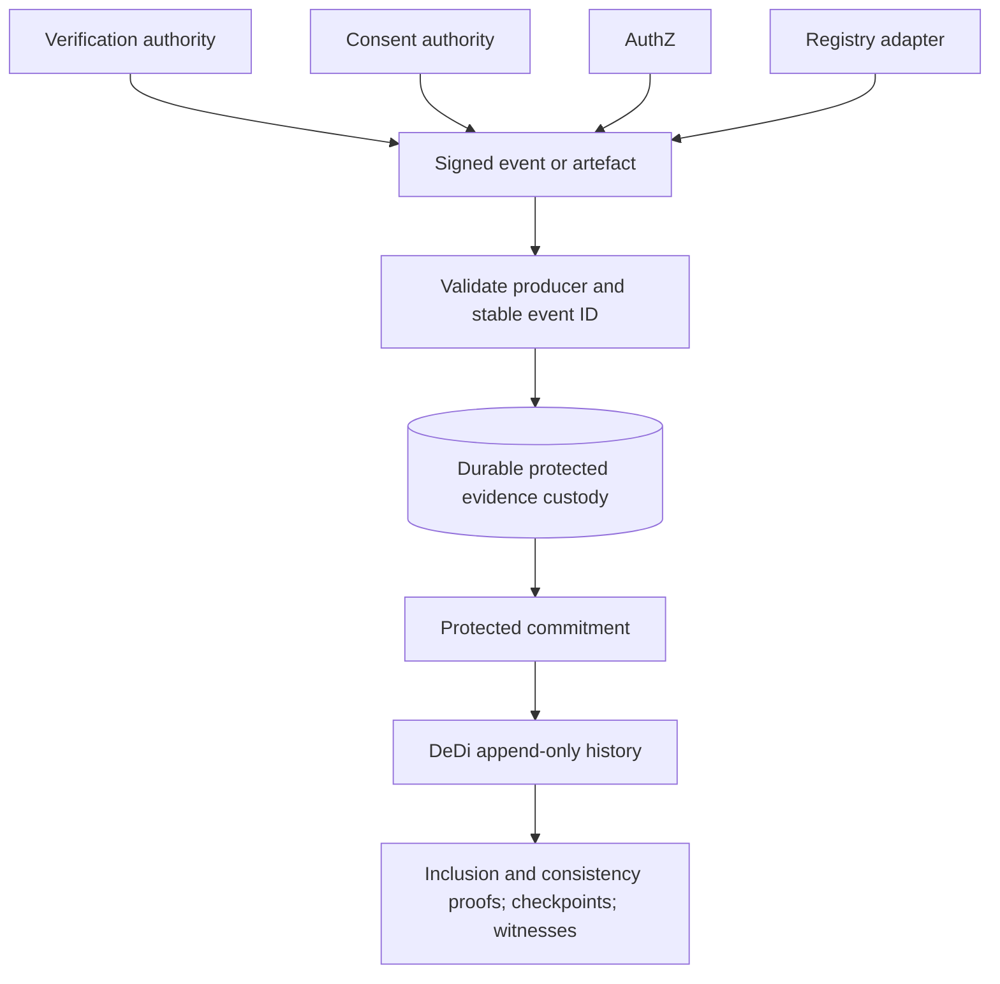
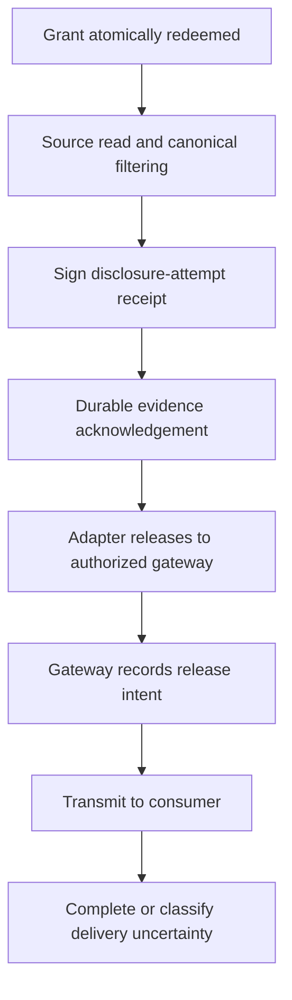

# State and evidence

## State inventory

| Store or custodian | Contents | Lifetime and restrictions |
|---|---|---|
| External IdP | Citizen accounts, credentials, recovery and upstream authentication | External authority's lifecycle |
| Registry | Native person mappings, membership, savings and business policy | Authoritative source lifecycle |
| Hydra SQL | Consumer configuration, keys and OAuth/OIDC operational state | Durable config plus tested cleanup; inspect sessions/logs/backups |
| Gateway TTL store | Status/version, canonical request, digest, deadlines and opaque references | Workflow plus bounded terminal/recovery window |
| Authentication TTL store | State, nonce, PKCE, callback correlation, session and transient principal context | Short transaction/session lifetime |
| Consent SQL | Request/notice snapshots, decisions, artefacts, current status, history and outbox | Enforcement window plus approved evidence retention |
| Enforcement SQL (shared transaction boundary) | Consent use reservation, grant issuance/redemption and attempt outcomes | Validity plus bounded recovery; retain necessary event evidence |
| Key management | Signing keys and versioned trust material | Controlled access, rotation and retirement |
| Protected evidence custodian | Signed notices, consent, grant decisions and access receipts | Explicit legal/policy retention and access controls |
| DeDi | Protected commitments, checkpoints, proofs and witness metadata | Durable; no registry response bodies or public citizen identifiers |
| Gateway/adapter memory | Transient source and canonical response bytes | Request lifetime; no body logging or central persistence |
| Consumer | Grant and delivered data | Grant expires; data handling subject to approved terms and obligations |

Opaque references and hashes can still be personal or linkable data. Encryption, access control, purpose limitation and retention apply to evidence as well as operational stores.

## Storage responsibilities

Gateway workflow state and authentication transactions use shared TTL storage. Durable consent metadata and reliable notifications use SQL. Consent enforcement and grant redemption share an atomic transaction boundary so withdrawal cannot race a separate status check.

| Concern | Storage | Consistency requirement |
|---|---|---|
| Gateway workflow | Redis or equivalent TTL store | Conditional state/version transitions |
| Authentication transaction | Ephemeral transaction/session store | One-time callback completion |
| Consent and notices | SQL metadata and protected evidence | Durable decisions, artefact references and history |
| Grant redemption | SQL unique redemption and consent-use reservation | One admitted attempt per authorized use |
| Withdrawal | Same enforcement boundary as redemption | Atomic ordering against retrieval admission |
| Hydra protocol state | Isolated Hydra SQL schema | Protocol-specific retention and access controls |

The same physical Postgres instance can host isolated schemas and roles where operational policy allows it. Sharing infrastructure does not grant every module access to every table. Durable consent evidence does not require citizen login accounts or business-data replication.

## Conceptual consent records

```text
consent_request
  id, access_request_id, request_digest, schema_version
  consumer_id, registry_id, resource, fields, purpose, terms_version
  subject_context_ref, notice_snapshot_ref, deadline_at

consent_decision
  id, consent_request_id, decision, authenticated_context_ref
  request_digest, subject_context_digest, notice_digest, language, occurred_at

consent_artefact
  id, decision_id, issuer, key_id, signed_payload, valid_until

consent_enforcement
  consent_id, status, version, valid_until, use_limit
  reserved_attempt_id, withdrawal_effective_at

grant_redemption
  grant_jti [unique], consent_id, request_id, attempt_id [unique]
  adapter_id, redeemed_at, outcome

outbox
  event_id [unique], payload_digest, destination, status, retry_at, attempts
```

These conceptual records describe the storage contract; database migrations implement this model. Separate minimum operational enforcement fields from retained evidence. Define deletion and compaction rules, including backups and signed artefact retention, before production.

## Extended evidence and operational records

| Record | Custodian and contents | Boundary |
|---|---|---|
| Purpose/processing snapshots | Protected configuration/evidence: version, digest, requirements, processor and responsibility references | Immutable bindings; no registry values |
| Notice presentation | Consent evidence custodian: exact notice, channel/language, confirmation and assistance references | Separate from authority artefact; protected channel evidence |
| Data-handling policy | Responsible organisation: data categories, purposes, retention triggers, exceptions, processors and backup rules | Policy is bound before approval; not proof of execution |
| Data-handling receipt | Evidence custodian: signed producer assertion, disclosure/category, action, time, policy and exceptions | Does not establish independently verified deletion |
| Rights case | Restricted case store: verified authority, routing, status, deadlines and outcomes | Separate from consent/use state; no copied business records by default |
| Privileged-access audit | Restricted security custodian: actor, role, purpose, record class and time | Includes reads/exports of evidence and administrative changes |

These records extend the conceptual architecture; they do not imply existing migrations or v0.1 endpoints accept their illustrative fields. Side records are linked through immutable IDs/digests and authenticated issuers. Mutable case progress and later handling receipts never rewrite the signed consent artefact.

## Data handling after disclosure



The platform's release gate is synchronous with retrieval. Recipient cleanup, rights processing and receipt publication are asynchronous, durable and retryable with stable IDs. Their acknowledgement never claims the action completed. A missing receipt is an unresolved obligation, not evidence of deletion; deployment policy defines escalation and whether future requests are suspended. Source pause or consumer suspension blocks new admission through current policy checks and does not recall prior releases.

The handling policy inventories source values, derived assessments, exports, caches, debug logs, backups and product-owned prompts/transcripts where applicable. Each category declares responsible organisation, processor, permitted purpose, retention trigger/period, lawful exceptions, cleanup mechanism and backup expiry/restoration handling. Data must not reappear after restoration without applying applicable erasure instructions. Product prompts, recordings, answers and model traces remain in the product/processor domain; GRAMStack stores only necessary protected references and attestations.

Illustrative recipient assertion:

```json
{
  "receipt_id": "handling_receipt_123",
  "producer": "sakhi-credit",
  "disclosure_id": "disclosure_123",
  "policy_ref": "handling_123",
  "data_category": "FETCHED_SOURCE_VALUES",
  "action": "ERASURE_REPORTED",
  "occurred_at": "2026-11-03T12:00:00Z",
  "evidence_ref": "recipient_attestation_123",
  "exceptions": []
}
```

Authenticate the producer and its authority over this disclosure, verify signature and policy binding, and deduplicate stable IDs. Conflicting content for the same ID is an integrity error. Retention exceptions identify the applicable basis, affected categories, responsible party and review/expiry condition. A recipient assertion cannot guarantee deletion of every downstream plaintext copy.

## Retention and incident operating model

Every deployment maintains a versioned retention matrix by legal role, data category, purpose, applicable rule, effective date, custodian and exception. It separates operational TTLs, consent evidence, security logs, recipient data and legally required retention. The DPDP Rules' First Schedule specifies at least seven years for the registered Consent Manager's specified records; that is not a universal retention setting for every internal module. Rule 8(3) separately specifies minimum one-year retention for processing data and logs for its stated purposes. Apply the relevant commencement provisions and current authoritative text before promising immediate disposal. See the [official Rules](https://www.meity.gov.in/static/uploads/2025/11/53450e6e5dc0bfa85ebd78686cadad39.pdf).

The responsibility manifest names fiduciaries, processors, consent authority, evidence custodians, incident responders and grievance contacts. Processor inventories include approved operations, subprocessors, hosting/transfer locations, security/incident obligations and termination cleanup. Geographic restrictions follow the applicable deployment/sector rules; India-only hosting is not an unconditional platform invariant.

Operational controls include least-privilege evidence access, audited administrative reads/exports, key custody/rotation, source emergency pause, and breach detection/triage/notification runbooks with accountable owners. The evidence system records incident and handling metadata without duplicating compromised business payloads. A signed artefact is evidence of a recorded process, not a standalone guarantee of lawful processing or operator registration.

## Evidence model



Candidate events include request accepted, verification result, notice/approval/rejection, consent activation/withdrawal, authorization decision, grant issuance/redemption, source attempt, transformation failure, disclosure release attempt and terminal recovery outcome. Event content is minimized by role. A commitment needs a retained underlying receipt and accountable custodian to remain useful in disputes.

An access receipt binds event ID, producer, request digest, consent/grant references, adapter/consumer identity, registry/resource/fields, purpose, policy version, attempt ID, outcome, timestamp and previous evidence references where useful. Response digests are optional and require privacy analysis; a guessable balance or member ID must not be publicly hashable evidence.

## The release boundary



Protected data crosses boundaries when the adapter sends it to the gateway, not only when the gateway sends to SakhiCredit. Adapter-side required evidence must precede that release. If the gateway creates a separate outward release receipt, its gate also precedes transmission. We must avoid falsely labelling one receipt as confirmation of successful delivery through both hops.

Deployments select one of two evidence anchoring profiles:

- **Synchronous DeDi commitment:** stronger immediate external verifiability, with DeDi availability/latency in the release path.
- **Durable local/custodian commitment plus batched anchoring:** release after durable protected logging, with a bounded anchoring SLA and reconciliation. This introduces an explicit interval before independent anchoring.

Neither option permits an in-memory log line as durability. Define acknowledgement, fsync/replication expectations, outage limits and recovery before choosing.

## What evidence proves

| Claim | Limit |
|---|---|
| A trusted producer signed a particular receipt | Signature and issuer trust can establish this |
| Committed history has not been silently rewritten | Depends on DeDi proofs, checkpoint and witness assumptions |
| Every GRAMStack-mediated release has required evidence | Depends on complete enforced release gates and controlled integration credentials |
| The consumer received every response byte | Not established by a pre-release receipt or server write completion |
| A recipient deleted all plaintext copies | Not established by consent terms, token expiry or DeDi |
| All native registry access is accounted for | Outside GRAMStack's integration claim |

`Cache-Control: no-store`, minimized fields and transient processing reduce accidental retention; they do not mathematically prove deletion by an arbitrary recipient.
