System architecture · Version 0.15 · 4 November 2026

[Download Markdown](static/gramstack-design.txt).

# Purpose and scenario

## What GRAMStack does

GRAMStack is a read-only interoperability and trust layer over existing Indian DPI source systems. Consumers request canonical resources through a common API. The layer coordinates authentication, registry-specific subject verification, human consent, policy decisions, short-lived retrieval grants, adapter execution and access evidence.

LokOS, JEEViKA, AgriStack and other sources retain authority over their records. GRAMStack does not become a rural-economy system of record, an eligibility engine, a central identity graph or a synchronized financial-history store. Domain applications can build those capabilities under their own explicit governance.

## The running example

**Hypothetical scenario:** SakhiCredit wants Sunita Devi's SHG membership status and savings summary from LokOS to assess credit eligibility. Neither the named application nor the example source endpoints imply an existing production integration.

| Actor | Responsibility | What the actor cannot assert alone |
|---|---|---|
| SakhiCredit | Authenticate as an approved consumer; declare scope, purpose and recipient terms | That Sunita owns a guessed member record or has consented |
| Sunita | Authenticate, participate in required verification and approve/reject | That source policy allows an otherwise forbidden disclosure |
| CRP/operator | Assist through a registry-approved procedure | Consent silently on Sunita's behalf |
| Registry operator | Own data, approve verification methods, authorize adapter credentials | That downstream plaintext was subsequently deleted |
| Gateway | Coordinate a bounded asynchronous request | Invent identity ownership or bypass independent adapter enforcement |
| Consent authority/custodian | Attest to approval and retain necessary evidence | Replace authentication, subject verification or AuthZ |
| AuthZ | Evaluate policy and issue/redeem narrowly scoped access | Turn consent into unlimited access |
| DeDi | Anchor signed evidence commitments and verifiable history | Prove the truth of every assertion or absence of unrelated native access |

## Architectural invariants

1. **Read-only v1.** Retrieval and approvals are in scope; source-record writes are excluded.
2. **Actual human consent.** Normal personal-data retrieval requires explicit approval by the person whose data will be disclosed.
3. **No persistent citizen identities.** External authorities authenticate citizens. GRAMStack does not provision citizen login accounts, credentials or cross-provider account links.
4. **No replicated business state.** No cached SHG balances, mirrored registry records or synchronized citizen relationships.
5. **Necessary state is permitted.** Pending workflows, callback correlation, replay prevention and consent enforcement can use bounded state. Historical security evidence may be durable.
6. **Gateway-owned lifecycle.** Request coordination is an internal gateway responsibility, not a mandatory standalone orchestrator service.
7. **Registry adapters are the integration boundary.** Transport, credentials, mappings, filtering and enforcement belong together. No additional connector service is required.
8. **Evidence before protected release.** Every successful GRAMStack-mediated disclosure must pass authorization and the required durable evidence boundary.
9. **Inclusive authentication.** Aadhaar is not the canonical GRAMStack identifier. Alternative routes must be assessed under registry policy and applicable obligations.
10. **Verification remains necessary.** Each registry integration must establish the approver's relationship to the requested record through a registry-approved mechanism.

## Two entry journeys

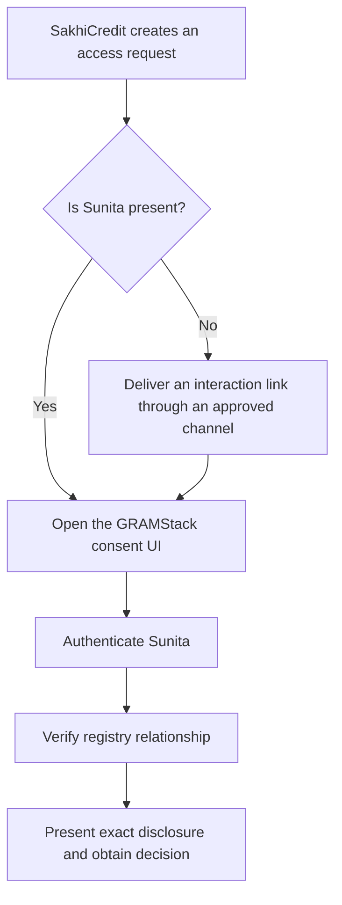

The default journey uses the GRAMStack consent UI and its backend as the OIDC client in both cases. Its authentication handlers belong to AuthN; its notice and decision handlers belong to the consent module. Delivery channels can vary. SMS merely delivers a locator; possession of the link does not prove identity, record ownership or approval.

An assisted journey must preserve Sunita's decision. A passbook number can be a lookup hint or evidence under an approved procedure; it is not a password. A CRP's own registry login may authenticate an operator who manages many members, not Sunita herself.

## Why registry adapters

Registry integrations do more than map JSON: they handle registry-specific verification, upstream authentication, policy enforcement and signed evidence. Each adapter owns this integration boundary; pure transformation remains an internal function.

## Scope outside this design

Source writes, universal citizen accounts, cross-registry identity matching, persistent economic histories, automated eligibility decisions, credential wallets, and statutory non-consent disclosure profiles are excluded from the normal v1 flow. None is made mandatory by the reference stack.

Development environments can use mock subject verification. Production integrations require a registry-approved verification mechanism.


---

# High-level architecture

## Interactive architecture walkthrough

Follow a SakhiCredit request from sign-in to the access audit. Select a step to see the components, call, and request state behind it.

<div data-architecture-walkthrough></div>

[Open the walkthrough in a full window](static/architecture-walkthrough.html)

## Component and trust-boundary view

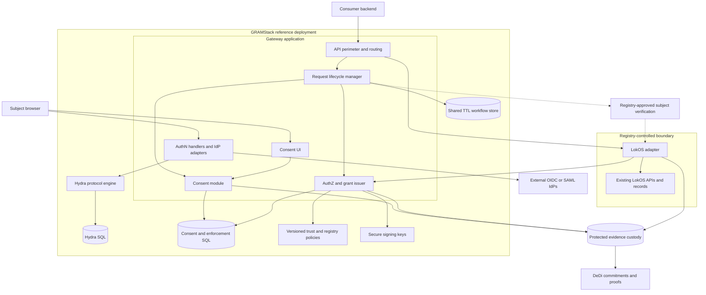

Sharing a deployment does not merge trust decisions. An externally exposed gateway must not expose Hydra admin APIs, private redemption APIs or signing keys.

## Responsibilities and contracts

| Component | Inputs | Outputs | Authoritative responsibility |
|---|---|---|---|
| API perimeter | Consumer token, request payload | Validated caller context, safe errors | Consumer authentication, quotas and routing |
| Lifecycle manager | API commands and verified callbacks | State transitions, deadlines, references | Overall request progress |
| AuthN integration | OIDC/SAML transactions | Issuer-qualified verified principal | Authentication context, not registry ownership |
| Subject verification | Principal and immutable request | Registry-approved request-bound context | Person-to-record relationship; registry-specific contract |
| Consent module | Verified context, request, human decision | Signed artefact and current status | Human disclosure approval and withdrawal |
| AuthZ | Consumer, consent, context, policy | Decision, scoped grant and redemption result | Permission to execute a particular read |
| Registry adapter | Authenticated caller and grant | Canonical approved fields and signed receipt | Independent source-side enforcement |
| Evidence subsystem | Signed events and artefacts | Durable acknowledgement, proof references | Accountable custody and anchoring |
| Discovery | Signed configuration | Capabilities, trusted issuers and endpoints | Configuration distribution, not citizen search |

## Consent control plane versus data plane

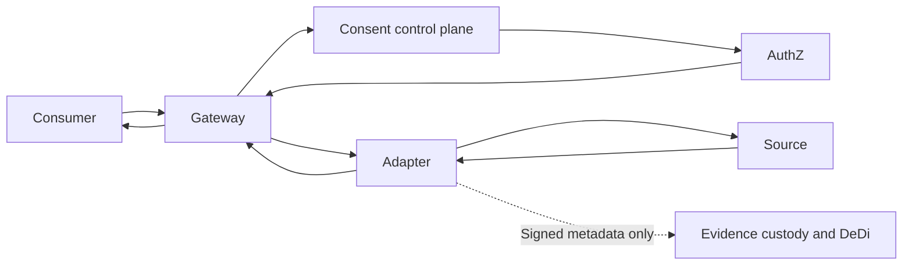

The consent module sees requested data categories and necessary identity references, not the returned membership/savings response. The gateway and adapter may process protected response bytes transiently. Therefore the overall gateway is not described as data-blind merely because the consent module is.

## Deployment guidance

The reference deployment uses one GRAMStack application containing gateway, lifecycle, login and consent handlers and AuthZ modules. Hydra and stores remain separate processes. Registry adapters can be embedded by registry owners or deployed in a controlled environment using exclusive integration credentials. Isolation of signing and consent services can be introduced when concrete operational or security requirements justify it.

The component contracts are language-independent. Deployment boundaries follow credential isolation, availability and scaling requirements rather than requiring a separate service for every logical module.

## Synchronous and asynchronous boundaries

| Boundary | Model | Consequence |
|---|---|---|
| Consumer authentication | Synchronous token exchange | No registry-data authority implied |
| Create access request | Synchronous validation, then `202` | Human approval is not held open in an HTTP request |
| External login | Browser redirects and callbacks | Persist state/nonce/PKCE correlation across instances |
| Registry verification | Immediate result or asynchronous challenge | Never assume an HTTP timeout is a rejection |
| Human decision | Asynchronous interaction | Subject can reject, abandon or time out |
| Artefact signing / evidence | Durable background work if required | Approval can be recorded before usable consent exists |
| Status propagation | At-least-once notifications plus reconciliation | Duplicate and missed deliveries are expected |
| Grant issuance | Bounded synchronous decision | Explicit consumer call |
| Redemption and retrieval | Bounded synchronous execution | Atomic reservation before source access |
| DeDi anchoring | Synchronous or batched according to deployment policy | Release depends on the chosen durable evidence boundary |

## Exclusive integration claim

Every GRAMStack-facing retrieval must pass authorized enforcement and produce required evidence before protected release. Upstream credentials must not be exposed to consumers. This claim covers GRAMStack-mediated retrieval, not unrelated native LokOS applications, administrative access or other integration credentials.


## Adapter discovery and onboarding trust

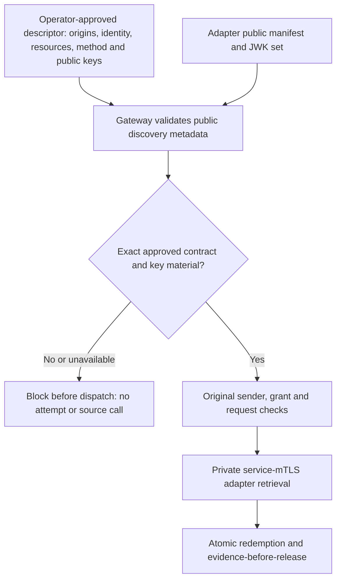

An independently hosted adapter publishes public capabilities and public verification keys. Its protected verification/retrieval RPCs use a separate mTLS listener. The gateway's descriptor pins the public metadata origin, private data origin/service identity, registry, adapter ID/audience, verification method, resource name/version/fields and approved signing key material. Discovery confirms the deployed contract; it cannot enroll a key, choose a new host, broaden policy or verify a person's registry ownership.

The [adapter discovery profile](specifications/adapter-discovery) defines fixed well-known paths, explicit versions, bounded JSON and strict EC/P-256 public JWKs. Before each protected dispatch, gateway checks the advertised method, required capabilities, resource versions and exact approved key points. Redirects, private key parameters, unknown fields, duplicate identities and unsupported algorithms fail closed. Metadata reads send no consumer token, cookie or private service credential. Production metadata uses HTTPS; explicit development permits literal-loopback HTTP only.

Unavailable or incompatible metadata returns a safe failure before the gateway claims an attempt. The request can proceed after valid metadata is restored. Actual permission still requires current source policy, verified subject, ACTIVE consent, original consumer certificate, independent SDK checks, atomic one-use admission and durable evidence. The manifest is a capability declaration, with dependency availability checked separately from trust.


## SakhiCredit consumer product boundary

SakhiCredit is an independent consumer, with its own Go module, browser experience and database. Its backend uses both GRAMStack interfaces: the OAuth-authenticated control API for request/status/grant operations, and the private consumer-mTLS data API for one admitted disclosure. The product browser uses a separate product session; it receives neither consumer credentials nor retrieval grants. Authentication, source ownership, exact notice, consent and access enforcement stay in the platform.

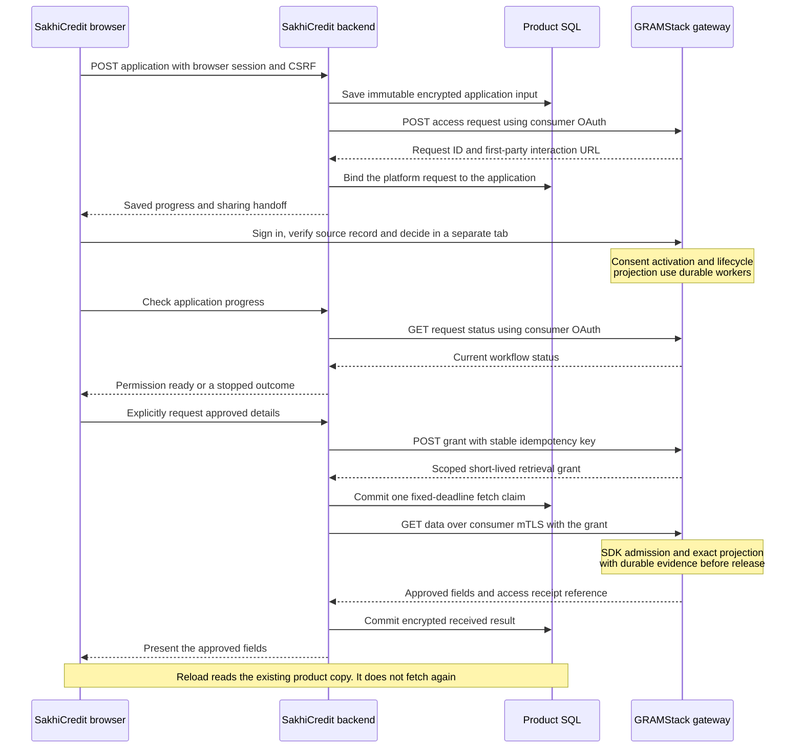

The product presents membership status and an optional source-reported INR savings summary. A person chooses the requested fields before creation, then approves or rejects the whole exact notice in the first-party portal. Changing scope requires cancellation and a new application. The reference product prepares information for credit review; it does not decide eligibility or issue a loan.

| Boundary | Execution and persistence | What the person sees |
|---|---|---|
| Application creation | Product SQL commits before the platform call; stable idempotency recovers a lost response | Saved application and identity/consent handoff |
| Identity, ownership and notice | Platform-controlled interaction in a separate tab; product credentials remain server-side | Exact request, verification and explicit approve/reject controls |
| Progress | Browser polls its backend; backend checks platform metadata, without reading source data | Waiting, ready, rejected, withdrawn, cancelled or expired |
| Approved retrieval | One product fetch claim, then the platform's independent one-use admission/evidence gate | In-flight state followed by approved details or a safe uncertain outcome |
| Reload/restart | Product reads its encrypted copy; ambiguous or abandoned attempts never regain a source-fetch slot | Existing received result or a clearly reported uncertain outcome |
| External evidence | Batch custody is synchronous with release; DeDi publication is asynchronous | A durable sharing reference, without claiming external publication has completed |

The reference browser experience is English, responsive to desktop/mobile widths, and uses only locally served assets. It retains only an opaque application ID in session storage. The synthetic demo uses browser-session possession for product ownership and fictional source/identity fixtures. Production customer accounts, onboarding and a lending decision policy remain separate product responsibilities; the platform's authenticated person-to-source verification is not replaced by this demo session.


---

# Authentication

## Separate consumer and subject authentication

SakhiCredit authenticates as an institution/application. Sunita authenticates as the person making the consent decision. A consumer token cannot stand in for Sunita's session. An ID token attests to authentication for its intended client; it is not a registry-data access token.

## How the two authentications join the same request

The boxes below are steps in one journey, rather than separate deployed applications. SakhiCredit is the external consumer; its backend uses the consumer token to create the access request. Sunita then opens that same request and authenticates through GRAMStack AuthN.

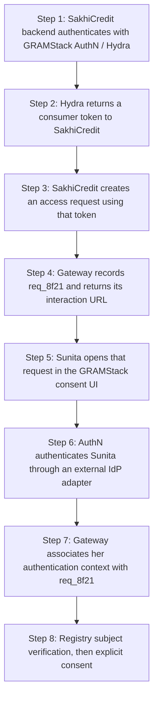

| Authentication | What it establishes | Where the result is used |
|---|---|---|
| SakhiCredit authenticates as a client | Which application is requesting access | Gateway creation, ownership and policy checks for `req_8f21` |
| Sunita authenticates through an IdP | Which person is interacting and with what assurance | Registry subject verification and the consent decision for the same request |

Neither authentication alone permits retrieval. The shared request connects the consumer, verified registry subject, human decision and eventual grant.

## What runs inside AuthN

**AuthN owns login initiation, callbacks, sessions and IdP adapter integration.** These handlers are part of the AuthN layer, not a separate application or a new deployment boundary. Hydra calls them to obtain the external authentication result; the consent UI uses the resulting first-party session.

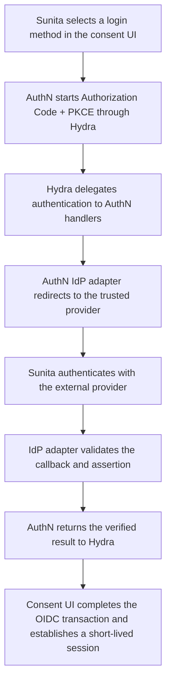


## Authentication components

| Function | Owner | Reason |
|---|---|---|
| OAuth/OIDC protocol engine | Ory Hydra | Reuse protocol implementation without citizen account provisioning |
| Citizen credentials and accounts | External IdPs | Preserve no-local-citizen-identity invariant |
| Provider-specific federation | AuthN handlers and IdP adapters | Own integration without forking protocol internals |
| Consumer registration | Durable operator configuration | Institutional client identity is not a citizen registry |
| Disclosure consent | GRAMStack consent module | OAuth client consent is a different decision |
| Retrieval grants | GRAMStack AuthZ | Request binding, single-use enforcement and consent status |

The reference architecture uses Hydra without a local citizen identity store. Provider-specific authentication is delegated upstream. Each deployment pins a supported release and validates its enabled protocol features and retention settings.

Hydra needs operational SQL state. The authentication profile disables remembered login/consent and refresh-token issuance for this profile, uses appropriate opaque subject handling, and schedules cleanup. `remember: false` is not a guarantee that all database rows, backups, logs and traces are anonymous or promptly removed. Retention controls cover table contents, logs, traces and backups.

## Login adapter contract

The adapter is transaction-oriented, not account-oriented. The following language-neutral pseudocode describes the integration contract.

```typescript
interface IdentityProviderAdapter {
  capabilities(): ProviderCapabilities;
  begin(input: AuthRequest, transaction: AuthTransaction): AuthChallenge;
  complete(callback: ProviderCallback, transaction: AuthTransaction): VerifiedPrincipal;
}

type VerifiedPrincipal = {
  issuer: string;
  subject: string;
  authTime: number;
  methods: string[];
  assurance?: { value: string; issuer: string };
  transactionId: string;
};
```

| Common integration layer | Provider adapter |
|---|---|
| Allocate one-time transactions, safe browser cookies and callback routing | Construct provider-specific challenge or redirect |
| Configure trusted provider and redirect allowlists | Validate protocol assertions using maintained libraries |
| Enforce transaction state and one-time completion | Verify issuer, audience, signature and protocol-specific correlation |
| Normalize safe errors and select accepted assurance | Preserve upstream assurance provenance without inventing equivalence |
| Issue first-party session after successful protocol completion | Handle provider metadata/key rotation under explicit trust configuration |

Ownership of state, nonce and PKCE checks must be unambiguous in the implementation. A shared library may implement checks on behalf of an adapter; neither layer may assume the other performed them.

## Browser flow and correlation

1. The consent UI backend creates a login transaction bound server-side to the access request and provider choice.
2. The consent UI backend starts Authorization Code + PKCE with Hydra using state and nonce.
3. AuthN handlers create a separate upstream transaction if federation requires another redirect.
4. Adapter validates the upstream response against that transaction.
5. AuthN handlers accept the matching Hydra login challenge using an appropriate opaque subject.
6. The consent UI backend exchanges its code and validates the expected issuer, audience and nonce.
7. The consent UI backend rotates/creates a Secure, HttpOnly session and records a short-lived verified principal reference.
8. Registry subject verification still runs before final disclosure consent.

Arbitrary query parameters and the browser's returned `request_id` are not trusted request binding. The authoritative mapping is server-side transaction correlation. A request locator is never a bearer authorization capability.

## eSignet and Indian integrations

The reference demo uses the official MOSIP eSignet service and UI as its upstream OIDC provider, backed by MOSIP’s mock identity system. Other deployments select a trusted provider through the adapter profile. A registry-run IdP only solves subject ownership if it authenticates the actual member and securely asserts the account-to-record relationship; an operator login or arbitrary `sub` does not produce that guarantee.

MeriPehchaan/JanParichay is a production integration candidate subject to onboarding, partner contracts and verified protocol documentation. Do not assume an endpoint described as OAuth is OIDC. SAML or custom integration may be needed. An AUA is a UIDAI ecosystem role, not automatically a third-party OIDC provider.

The independent Go module `adapters/auth/oidc` owns provider discovery, token authentication, signature verification and normalization to a verified principal. A versioned public profile pins issuer, client ID, accepted ID-token algorithms and the client-assertion audience; secrets and signing keys are supplied separately. The eSignet profile uses `private_key_jwt` and PS256. State custody, browser binding, request ownership and short-lived first-party sessions remain platform responsibilities. Neither OAuth login nor an upstream identity claim grants disclosure consent.

Local mock OIDC tests provide fast protocol regressions alongside the official eSignet integration. SAML and government integrations use the provider’s documented protocols, trust configuration and access agreements through the same transaction-oriented adapter boundary. An authentication result preserves issuer, pairwise subject, signed authentication time, methods when supplied, assurance provenance and transaction correlation; it invents no registry ownership or assurance equivalence.

## Security and failure behavior

Reject wrong issuer/audience, unsigned or disallowed-algorithm assertions, expired responses, state/nonce mismatch, unsolicited callbacks and replay. Fail closed when required validation cannot complete. Do not silently downgrade assurance on IdP outage. OTP proves control of a channel; it does not alone establish registry ownership. Citizen passkeys remain with upstream IdPs, avoiding first-party credential storage.

Key rotation must overlap valid token lifetimes. Unknown key IDs cause bounded trusted refresh, not arbitrary URL fetching. ID tokens and upstream assertions must not enter URLs, analytics or routine logs.


---

# Consent manager

## Implementation direction

GRAMStack implements a consent subsystem for request-bound registry disclosure, using DEPA as its architectural reference and established open implementations as engineering references.

The module displays exact notices, collects explicit approval or rejection, binds the human decision to the request and verified subject, signs consent artefacts, maintains authoritative status and withdrawal, delivers reliable events and retains necessary evidence. Consent does not issue retrieval grants or process registry response bodies.

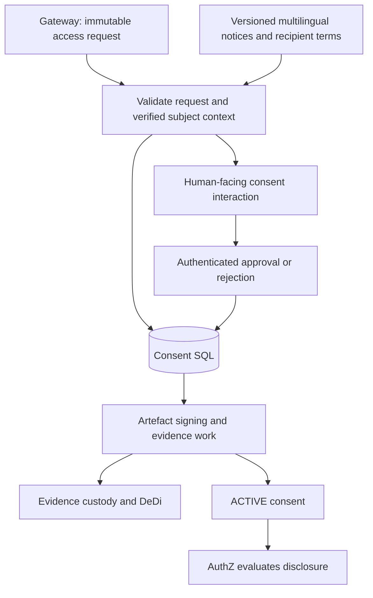

## What Sunita is deciding

The notice identifies SakhiCredit, LokOS, the requested membership and savings fields, credit-eligibility purpose, frequency, validity, recipient retention terms, withdrawal method, consequences of refusal and help/grievance channel. It is presented in an accessible language; language, template revision and exact rendered content are retained as evidence.

For the single-disclosure profile, approval covers one bounded disclosure. Repeated/recurring consent, minors, guardians and delegated consent require explicit profiles. The interaction approves or rejects the exact request as a whole. There is no partial-refusal state, request-revision object or scope negotiation in the platform. If the person wants a narrower scope, the client cancels the old request and creates an independent new request with a fresh notice and decision. Cancellation must be acknowledged before treating the old authority as blocked; it cannot undo an admitted disclosure.

The browser session must correspond to the trusted verified-subject context. The module derives the approver from validated session state, never caller-provided `subject` JSON. CRP assistance does not make the CRP the approver.

## Lifecycle and background work

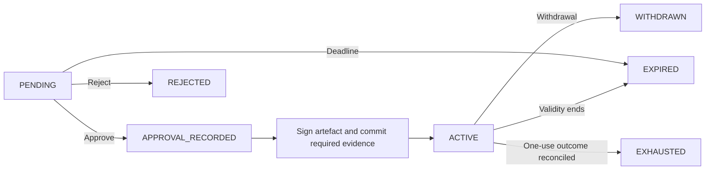

`APPROVAL_RECORDED` is a recovery boundary. Approval is durable, but no usable consent exists until signing and the chosen mandatory evidence commitment succeed. Transient outages leave recoverable work, not an invented ACTIVE status. Rejection/withdrawal evidence is also retained according to policy.

A human withdrawal during artefact preparation must prevent later activation. The worker conditionally updates the expected version; a late job cannot overwrite a cancellation. Cancellation before activation prevents the consent from becoming usable.

One-time usage has a separate enforcement lifecycle: AVAILABLE → RESERVED → outcome (release attempted, failed, or uncertain). Do not mark a consent successfully used merely because a grant was issued or a source HTTP request started. A use reservation and its recorded outcome distinguish exhausted disclosure authority from successful data delivery.

## Durable transaction and outbox

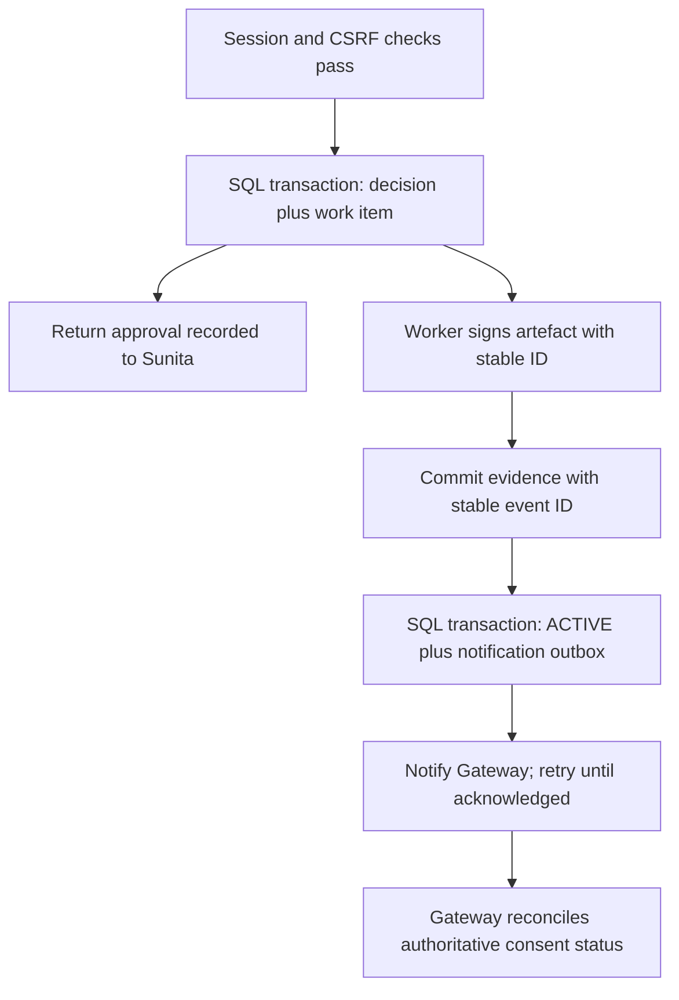

No distributed transaction is assumed across SQL, signing, DeDi and gateway workflow state. Stable IDs, conditional updates, durable work items, acknowledgements and reconciliation handle partial completion. Notification delivery is at least once. A webhook or browser redirect is not proof of current consent status.

## Artefact structure

Illustrative consent payload:

```json
{
  "consent_id": "con_61b4",
  "schema_version": "gramstack.consent.v1",
  "issuer": "https://consent.gramstack.example",
  "request_digest": "sha256:request-A",
  "subject_context_digest": "sha256:context-B",
  "consumer": "sakhi-credit",
  "provider": "lokos",
  "resource": "shg.membership",
  "fields": ["membership_status", "savings_summary"],
  "purpose": "credit_eligibility",
  "frequency": "ONCE",
  "recipient_terms_version": "sakhi-retention-v1",
  "notice_digest": "sha256:notice-HI-v1",
  "approved_at": "2026-11-01T10:02:00Z",
  "valid_until": "2026-11-01T10:07:00Z",
  "status_endpoint": "https://consent.gramstack.example/v1/consents/con_61b4/status"
}
```

Use a standard signature envelope and trusted issuer/key discovery. The consent authority's signature attests to its recorded approval process; it is not Sunita's personal digital signature. A signed ACTIVE artefact does not prove consent remains active later. Status is authoritative for enforcement. Sensitive references are protected; no global citizen identifier is introduced for convenience.

## Withdrawal and user history

An authenticated subject can review the notice/artefact and request withdrawal while future access remains possible. A permanent citizen account is not required. Later access uses reauthentication, an authorized evidence lookup and request-bound recovery correlation. A raw receipt ID or SMS link alone cannot authorize withdrawal.

The reference flow admits retrieval at atomic redemption; withdrawal before that point blocks admission. Consent status and redemption must share one atomic enforcement boundary to prevent check-then-use races. See [authorization](05-authorization). After plaintext release, withdrawal cannot recall copied data. Applicable downstream obligations need operational enforcement beyond token revocation.

## Product and platform boundary

Products supply use cases and user interfaces; GRAMStack supplies bounded disclosure authority and accountable evidence. A voice assistant, a credit application and a mobile field application use the same platform contracts. Speech recognition, conversational memory, AI interpretation and credit/advisory decisions remain in the product. A model may propose a request; it cannot establish identity, row ownership, representative authority or consent.

| Platform contract | Product responsibility | Platform enforcement |
|---|---|---|
| Purpose manifest | Declare the processing purpose and why each field is needed | Resolve an approved version; bind requirements, scope and time window to the request |
| Notice presentation | Present the approved notice in the selected language/channel | Bind presentation evidence to the exact notice and authenticated decision |
| Processing profile | Declare recipients, processors and data-handling commitments | Resolve trusted versions; bind them to notice and consent; enforce source policy |
| Authority context | Initiate an approved self/representative verification flow | Verify issuer, subject, request, assurance, authority scope and expiry |
| Rights and handling interfaces | Provide user screens and perform downstream actions | Authorize requests, route to responsible organisations and retain authenticated outcomes |

These are architecture extension contracts. Their illustrative records below do not add accepted fields to the published [current message schema](specifications/schemas). Extensions require explicit capability negotiation and a versioned contract before wire use. Unknown security-sensitive fields remain rejected.

## Purpose and processing profiles

A purpose manifest identifies its owner, version, field-level justifications, canonical resource and applicable time window. A processing profile identifies the responsible recipient, processor inventory, permitted uses, derived-data handling and retention policies. Approval of a registered purpose does not bypass the source owner's current policy.

The platform resolves approved manifests from trusted configuration, validates their compatibility with the exact request and stores immutable snapshots or content digests. An arbitrary client URL is not a trusted manifest. Material changes to purpose, fields, recipients, time windows or processing terms require a new request and fresh approval. A processing/decision rules version is a reference supplied by the product; the platform does not execute business decisions or certify their correctness.

Illustrative binding record, retained alongside the immutable request and committed by the extended request digest:

```json
{
  "access_request_id": "req_8f21",
  "purpose_manifest": {
    "id": "sakhi-credit-eligibility",
    "version": "1.0",
    "digest": "sha256:purpose-manifest-A",
    "requirements": [
      {"field": "membership_status", "justification": "Verify eligible SHG membership"},
      {"field": "savings_summary", "justification": "Assess savings history"}
    ],
    "period": {"from": "2025-11-01", "to": "2026-10-31"}
  },
  "processing_profile": {
    "id": "sakhi-credit-assessment",
    "version": "1.0",
    "digest": "sha256:processing-profile-A",
    "responsible_organisation": "sakhi-credit",
    "processor_manifest_ref": "processors_123",
    "data_handling_policy_ref": "handling_123",
    "derived_data_policy_ref": "assessment_results_123",
    "responsibility_manifest_ref": "responsibilities_123"
  }
}
```

Canonical resource semantics must define whether historical windows are supported and how dates, inclusivity, freshness and missing periods are interpreted. Do not silently add a date filter to a resource that cannot enforce it. The adapter enforces any supported time and field bounds independently.

## Presentation and decision evidence

The consent authority retains exact notice content; a hash without retrievable content is insufficient. A presentation record distinguishes the approved template from what was actually displayed or played. It records language, channel, content digest, timing, confirmation method and optional assistance. Evidence is access controlled and authenticated; a client-supplied claim that audio was played is not by itself proof of a person's informed approval.

```json
{
  "presentation_id": "presentation_123",
  "consent_request_id": "cr_123",
  "notice_ref": "notice_789",
  "notice_version": "consent-notice-v1",
  "rendered_content_digest": "sha256:notice-HI-v1",
  "language": "hi-IN",
  "channel": "VOICE",
  "presented_at": "2026-11-03T10:00:00Z",
  "confirmation_method": "AUTHENTICATED_EXPLICIT_CONFIRMATION",
  "confirmation_evidence_ref": "evidence_123",
  "assistance": {"assistant_ref": "worker_123", "role": "FACILITATOR"}
}
```

A voice integration can attach protected references to read-back evidence and interpreter/model versions. The product owns interpretation and ambiguity handling; the platform accepts only a structured decision bound to the authenticated subject and exact notice/request. A model confidence score is never approval authority. Audio retention is an explicit policy choice, not a default requirement; audio hashes also need privacy review. Translations and accessible renderings must preserve scope, recipient, retention and withdrawal meaning.

Assistance records describe participation, not delegation. An office-bearer role does not automatically authorise members' personal data; household membership does not establish authority over other adults. Unsupported guardian or representative profiles fail closed. Where approved aggregate resources are used, compute and minimise them at the source/adapter before individual rows cross the boundary; aggregates still require disclosure/privacy assessment.

## Explicit cancellation and a new request

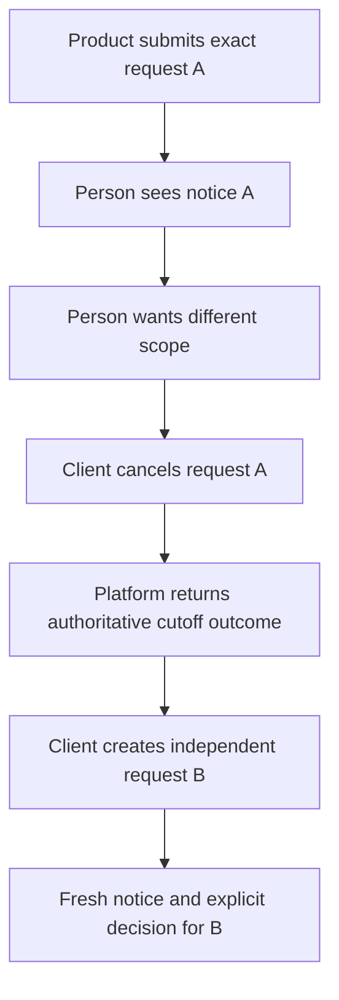

No approval, reservation or grant carries from A to B. The cancellation path authenticates the owning client, records its reason separately from a human rejection, invalidates unadmitted authority under the same transactional boundary as redemption and makes late activation/grant work fail. Before consent exists it terminates the request; after approval it also blocks consent activation or future admission. After redemption it reports that the admission cutoff has passed and preserves the attempt outcome. It does not falsely report that an in-flight disclosure was recalled. The person may independently reject or withdraw using subject-authorised interfaces.

For multiple sources, the client creates separate bounded requests and handles product-level completeness. A conversation or parent application reference is correlation metadata, never authority to reuse consent across sources or subsequent questions.

## Rights and responsible organisations

The [post-disclosure profile](specifications/post-disclosure) specifies independent history sign-in, the consent record download, rights case intake and private operator queues.

The platform exposes authorised consent/disclosure history and machine-readable receipt export, with metadata minimised for the caller. It accepts and routes access, correction, erasure and grievance requests to the organisation responsible for the relevant records. Source correction happens in the registry's own process; read-only interoperability does not become registry mutation. Withdrawal, cancellation and erasure are distinct operations.

Each rights case records the verified requester/authority reference, request type, affected consent/disclosure references, responsible organisation, acknowledgement, policy-defined deadline, status and authenticated outcome or exception. Acceptance is not completion. Products provide user interfaces and notifications; the platform provides durable case correlation and status. History lookup and export require reauthentication and subject/role checks, without introducing a universal citizen identity index. Never return other household members' records through an export.

Registered external consent managers and wallet services are integrations with explicit trust, authority and conformance profiles. OAuth tokens and wallet authorisation are not substitutes for source-subject binding or disclosure consent. External redirects use one-time unpredictable state bound server-side to the transaction; token revocation stops future calls but does not erase fetched data.


## Implementation references

| Implementation | What to inspect | Important fit questions |
|---|---|---|
| GovStack / iGrant Consent BB | Generic agreement revisions, consent APIs, UI and dashboard | External identity without local citizen provisioning; DEPA artefact mapping |
| TSI DPDP CMS | Notices, purpose checks, withdrawal, verification, notifications and administrative workflows | Identity/storage model, runtime scope, interoperability and evidence export |
| ProjectEKA | Asynchronous health-consent and data-flow separation | Health-specific assumptions, user module and licensing before code reuse |

Source links are listed in [references](12-references). These projects inform implementation patterns; adopting their code requires license and security review. Product claims do not substitute for GRAMStack conformance checks.

## DEPA and legal posture

DEPA is the architectural reference for granular, revocable, auditable disclosure consent with separated consent and data flows. The older iSPIRT architecture repository is not treated as a maintained runtime dependency or a universal current conformance standard. ReBIT provides a concrete financial-ecosystem reference, not an automatic contract for LokOS.

The DPDP Act defines a Consent Manager as a registered person. A software module and a legally registered operator are separate matters. Each deployment defines its responsible fiduciary, consent authority, evidence custodian, retention policy and applicable regulatory obligations. This document makes no certification or registration claim.

## First-party WEB interaction

The [consent portal profile](specifications/consent-portal) binds the actual rendered notice to the request's authenticated session. English is supported explicitly; other languages are rejected. The portal serves both the choice screen and a protected human/JSON record. Its export never contains source identifiers, lookup hints, identity-provider subjects or business rows.

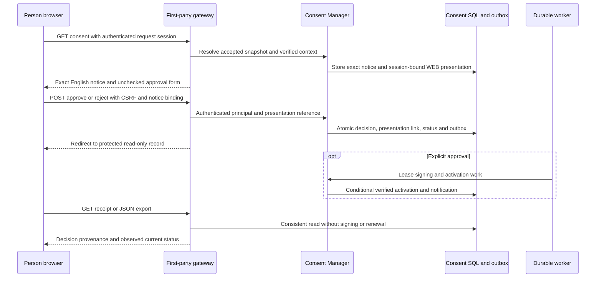

| Stored object | Location | Exposure |
|---|---|---|
| Exact notice, recipient terms and immutable decision | Consent SQL | Owner-authenticated record |
| Render time, language, channel, notice binding | Consent presentation SQL | Owner record excludes private principal/session binding |
| Decision-to-presentation link and checkbox confirmation | Same decision transaction | Owner provenance |
| Request-bound session and verified context | Gateway encrypted state | Server only |
| Pending work and lifecycle notifications | Metadata outbox | Worker/service only |
| Signed artefact | Immutable consent artefact SQL | Authenticated record when it exists |

An approval receipt says **Approval recorded** until the trusted activation work completes. A render or download never creates ACTIVE consent. Withdrawing preserves the original decision while stopping future admissions. An admission cutoff indicator does not establish successful delivery. Short-lived interaction receipts and later protected history/recovery are distinct capabilities.

## Worker delivery and recovery

The reference runtime has bounded embedded signing, notification and expiry loops. Signing and gateway notifications have independent durable acknowledgements; one subscriber cannot consume an event needed by another. A claim uses a database lease and a fresh fencing token. Work is acknowledged only after its effect succeeds. A failed or lost worker leaves recoverable work; a successor reuses the stable event and re-reads current authority.

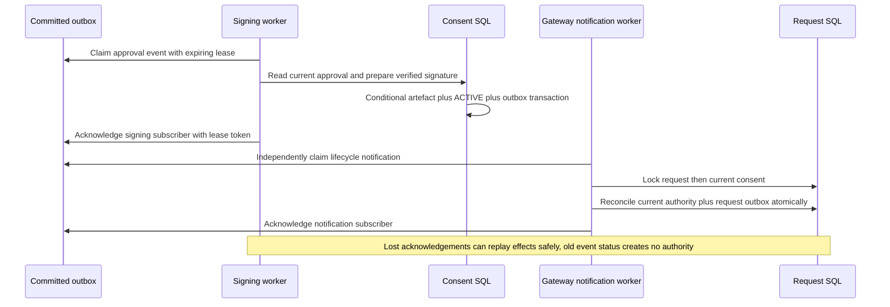

Request lifecycle [0.3.0](specifications/lifecycle) includes withdrawal while CONSENT_PENDING, covering approval that is stopped before activation. Versions 0.1.0 and 0.2.0 remain unchanged. A late ACTIVE event is only a prompt to re-read current state; it cannot overwrite withdrawal/cancellation/expiry or restore a consumed disclosure. Recorded stops can be projected after the interaction deadline without creating new authority.

Each maintenance pass bounds expiry/reconciliation to 32 objects, encrypted TTL-state cleanup to 128 rows, and terminal accepted-snapshot cleanup to 32 rows after the declared 24-hour retry window. Deadline checks remain authoritative during worker outages. Exact notices, original decisions, signed artefacts, consumed reservations and delivery acknowledgements are not erased by TTL cleanup. Recipient/back-up deletion and later protected history use separate policies and contracts. Internal SQL notification delivery is distinct from external webhooks.


---

# Authorization and retrieval grants

## Decision inputs

Consent is necessary for the normal profile but never sufficient. AuthZ considers the authenticated consumer, verified subject context, exact request/consent binding, trusted consent issuer, registry policy, fields, purpose, recipient, assurance, deadlines, withdrawal and usage state.

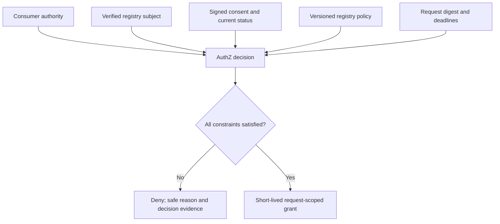

The v1 policy model uses a signed, versioned per-registry bundle evaluated through a small deterministic decision interface. Request-time status, assurance and validity dominate authorization. Registry relationship hierarchies remain source-owned rather than being replicated into a central relationship engine. Revisit a policy engine such as Cedar/OPA only when concrete policy complexity justifies it. 

## Policy shape

```json
{
  "registry": "lokos",
  "version": "lokos.v1",
  "consumer_id": "sakhi-credit",
  "purpose": "credit_eligibility",
  "resource": "shg.membership",
  "fields": ["membership_status", "savings_summary"],
  "require_verified_subject": true,
  "require_human_consent": true,
  "max_grant_seconds": 60,
  "max_disclosures": 1
}
```

Each policy is signed with the source’s approved key using `typ=gramstack-policy+jws`. SQL retains immutable versions and the current enabled head for each registry/consumer/resource/purpose tuple. A replacement requires the expected current version. A retired version cannot be restored, and restarting with the same signed file cannot undo a disable. Registry profiles additionally bind issuer trust, recipient terms, supported assurance and canonical resource semantics. Unknown policy fields fail closed.

## Grant claims

```json
{
  "iss": "https://authz.gramstack.example",
  "aud": "urn:gramstack:adapter:lokos",
  "sub": "request-scoped-subject-reference",
  "client_id": "sakhi-credit",
  "jti": "grant_73c2",
  "iat": 1793527320,
  "exp": 1793527620,
  "request_id": "req_8f21",
  "request_digest": "sha256:request-A",
  "resource": "shg.membership",
  "fields": ["membership_status", "savings_summary"],
  "purpose": "credit_eligibility",
  "consent_ref": "con_61b4",
  "subject_context_ref": "ctx_77",
  "policy_version": "lokos.v1",
  "cnf": {"x5t#S256": "registered-consumer-certificate-SHA256-base64url"}
}
```

AuthZ uses a signed grant with a separate trusted issuer and JWKS. Expiry is bounded by consent validity, subject-context validity, request deadline and registry policy. Claims contain authorization metadata, not registry response data. JWT payloads are readable unless separately encrypted, so avoid raw identifiers and unnecessary attributes.

The selected profile uses mTLS sender constraints. At issuance, Hydra authenticates the consumer and AuthZ binds `cnf.x5t#S256` to its registered certificate. Retrieval additionally verifies possession of that certificate. The gateway and adapter convey presenter context only over authenticated service transport; the adapter’s private redemption call attests the verified original presenter. AuthZ verifies the adapter certificate owns the audience and matches the attested presenter to the grant. A forwarded identity header alone is never proof. DPoP would require its own defined proof-verification profile.

## Issuance and one-time redemption

Grant issuance is an explicit consumer call after consent. Store/recover a stable issuance result so retries do not mint unlimited distinct grants. Existing issuance retries return the same signed bytes without requiring the signer to be online, while still checking current authority; expiry never extends. A one-time consent cannot be bypassed by creating a second `jti`.

The gateway performs perimeter validation, but the adapter is the redemption enforcement point. It independently validates issuer, signature, audience, time, request, resource and fields, then calls authenticated internal AuthZ redemption. Only the authoritative atomic reservation permits a source read.

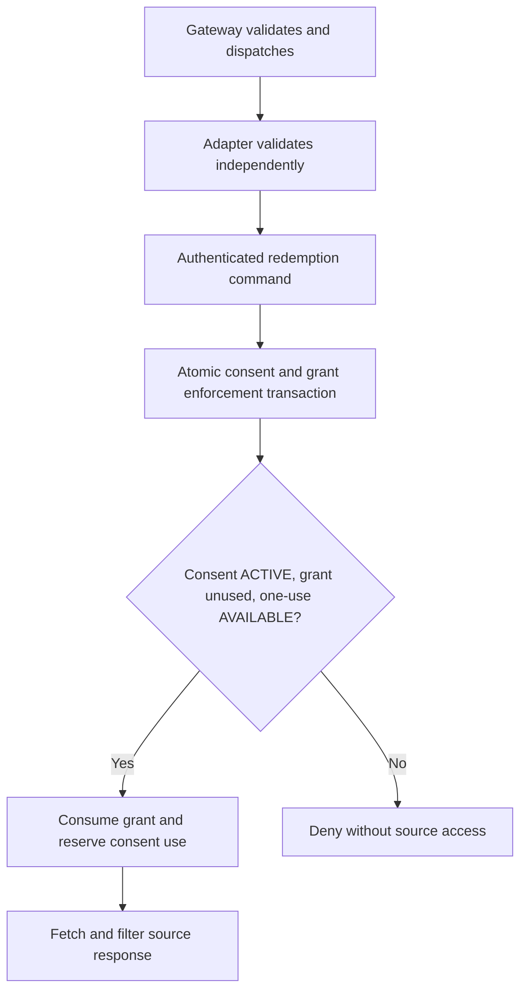

Redemption also binds the adapter identity, request digest and a stable retrieval attempt ID. The same authenticated attempt recovers its reservation metadata with `first_redemption=false`, even after withdrawal, policy revocation or grant expiry. That response acknowledges a historical admission. It never grants another source read or data release. A different attempt conflicts.

## Withdrawal and atomic enforcement

A status read followed by an independent Redis `SET NX` has a race: ACTIVE may be read before withdrawal, then redemption may succeed afterward. Single-use token replay prevention alone is insufficient.

Authoritative consent enforcement and grant redemption share one transactional SQL boundary. Consent and AuthZ remain separate modules with controlled writes. Gateway TTL state and Hydra SQL have separate responsibilities.

```text
BEGIN
  Lock request, current source policy head, then consent enforcement record
  Validate consent status, version, expiry and one-use availability
  Validate grant, consumer, adapter and request binding
  Insert unique grant redemption
  Reserve the consent's single permitted use for attempt_id
  Record enforcement event and durable work item
COMMIT
```

Withdrawal locks/checks the same consent enforcement record. Whichever transaction commits first determines whether retrieval is admitted. This defines the retrieval admission cutoff; it does not promise cancellation up to the final response byte. A requirement to cancel after admission needs additional cancellation/release coordination and a precisely defined final cutoff.

An equivalent atomic store can implement the enforcement contract. Independent stores require a coordination protocol that preserves the same consistency guarantees. See [state](08-state-and-evidence).

## After redemption

The one-use profile is conservative: the grant remains consumed after source failure, evidence failure or ambiguous timeout. Do not reauthorize automatically or cache a response to make retries easy. A fresh disclosure request and approval may be required. This preserves one-use semantics even when a failure requires the user to authorize a new attempt.

Record failed, attempted and uncertain outcomes separately. A server completing transmission is not proof of complete client receipt. Evidence of attempted disclosure and a spent grant remain valid even when the consumer reports a timeout.

## Versioned grant profile

The [0.1.0 authorization contract](specifications/authorization) specifies ES256 signed grants and an mTLS presenter-binding profile. The consumer certificate is checked on the retrieval transport, and trusted presenter context crosses authenticated service transport to the adapter. DPoP requires a separately specified proof-verification profile.

## Synchronous calls and durable authority

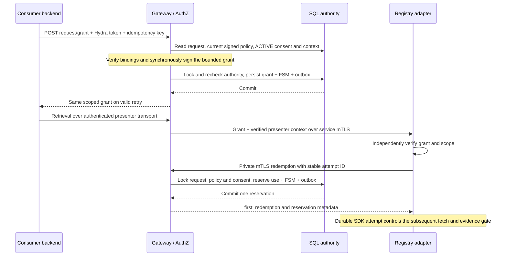

Issuance and admission are synchronous. Both persist authority and metadata outbox events before responding; asynchronous notification delivery cannot grant or restore authority. SQL stores signed policies, current policy heads, immutable grants and reservation metadata. The grant contains no source response. The private consent-status endpoint is restricted to the adapter audience associated with the issued grant and is informational; a status read cannot replace atomic admission. Public JWKS contains only verification keys, and clients pin its trusted issuer/origin rather than follow a token-provided URL.


---

# Request lifecycle

## The immutable request

One access request is one consumer asking for one bounded disclosure from one registry. Consumer/recipient, registry/resource, subject hint, fields, purpose, requested validity, terms revision, deadline and schema version are fixed after acceptance. Mutable workflow metadata holds current status/version and references to authentication, verified subject, consent, grant and evidence.

Canonicalization must be specified before digest-based interoperability: schema validation, defaults, explicit units, normalized field-set ordering, Unicode/string treatment and a documented JSON canonicalization/hash profile. Signing arbitrary `JSON.stringify` output from different languages is not a protocol. Tests must prove semantically equivalent inputs produce the defined digest, and changed scope produces a different one.

The final consent binds both the immutable request and verified subject context. A hint is not authoritative identity. Changes to scope or recipient require a new request and fresh approval.

## Persisted states

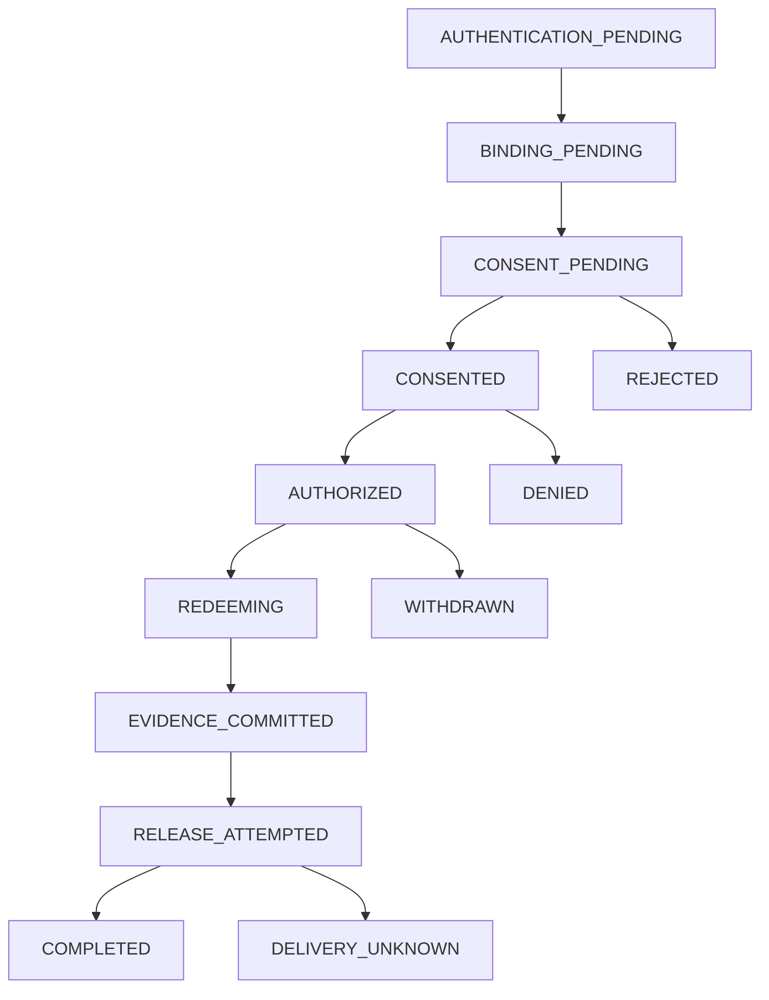

All active stages have deadline and integrity-failure handling. The graph highlights the main path. CREATED, SUBJECT_BOUND and RETRIEVED are recorded as events; persisted states identify waits and recovery boundaries.

| State | Entry condition | Responsible next action |
|---|---|---|
| AUTHENTICATION_PENDING | Request accepted and durably correlated | Subject enters/resumes login |
| BINDING_PENDING | Authentication completed | Approved verification workflow or mock test context |
| CONSENT_PENDING | Registry subject context accepted | Human views notice and decides |
| CONSENTED | Consent ACTIVE after required evidence | Consumer requests grant |
| AUTHORIZED | AuthZ decision and grant issuance recorded | Consumer submits retrieval |
| REDEEMING | Grant consumed and consent use reserved | Adapter executes the single admitted attempt |
| EVIDENCE_COMMITTED | Required access receipt durable | Release gate admits response |
| RELEASE_ATTEMPTED | Response release intent recorded | Complete transmission or classify uncertainty |
| COMPLETED | Defined server transmission condition met | Evidence reconciliation and eventual cleanup |
| DELIVERY_UNKNOWN | Transmission/crash outcome uncertain | Preserve evidence; no automatic resend |

CANCELLED, REJECTED, DENIED, WITHDRAWN, EXPIRED and FAILED are distinct terminal outcomes. Owner-initiated cancellation atomically invalidates unadmitted consent and records its consumer actor separately from a human rejection or withdrawal. It conflicts after a consumed reservation, even if the workflow projection has not caught up. FAILED carries a safe reason/stage and a separate internal diagnostic reference. Consumer-visible failures must not reveal whether a guessed citizen record exists.

## Conditional transitions

Each command reads the current expected state/version, verifies caller authority, deadline and request binding, then atomically updates the state and version. Terminal states cannot be resurrected by delayed callbacks. The authoritative consent/redemption store may advance before the gateway projection; reconciliation corrects the projection without undoing enforcement.

| Event | Guard | Effect |
|---|---|---|
| Login callback | Matching one-time auth transaction | Advance to binding; reject replay |
| Verification result | Trusted issuer, correct principal/request, adequate assurance | Create consent interaction |
| Consent ACTIVE event | Trusted source, matching artefact/request and current version | Advance to CONSENTED |
| Grant issuance retry | Same consumer, request and idempotency input | Recover original result |
| Withdrawal | Valid subject authority; admitted cutoff not crossed | Block future redemption |
| Duplicate callback | Already processed event ID or stale version | Return existing result/no new authority |
| Deadline worker | Still active, deadline reached | Terminal expiry plus required evidence work |
| Retrieval timeout | Consult authoritative attempt/redemption status | Never reset consumed grant to AUTHORIZED |

## Deadline versus cleanup

A business deadline determines whether new actions can be admitted. A cleanup TTL determines when recovery/idempotency metadata may be removed. They are not the same timestamp.

A deadline index/worker must process expiry before state is deleted, commit necessary evidence and retain a bounded terminal lookup window. Redis keyspace notifications or expiration events alone are not reliable audit delivery. In-flight redemption/evidence work needs a separate bounded recovery policy.

The examples use a 10-minute human interaction and a grant of up to 5 minutes. Deployments set these limits through registry and channel policy. Different channels, accessibility needs and assisted workflows may need different limits.

## Retry matrix

| Stage | Retry behavior |
|---|---|
| Create request | Same idempotency key/body returns the original request |
| Provider redirect/callback | One-time correlation; retry must not duplicate authentication authority |
| Human decision | Duplicate identical decision returns existing record; incompatible decision conflicts |
| Artefact signing | Stable artefact ID and digest; do not activate twice |
| Evidence commit | Stable event ID and payload digest; reconcile ambiguous acknowledgements |
| Notification | At least once, bounded backoff and receiver deduplication |
| Before redemption | Safe operations may retry within deadlines |
| After redemption | Recover attempt status; do not silently execute another read |
| During/after release | No automatic plaintext resend under the one-use profile |

## Synchronous/asynchronous contract

A `202` acknowledges durable workflow acceptance, not a successful disclosure. Login redirects, verification challenges and consent can span instances and minutes. Polling is sufficient for the polling-based consumer integration; consumer webhooks add their own authenticated delivery protocol and are not assumed. Grant issuance and retrieval remain bounded HTTP requests. Internal outbox workers handle eventual propagation and evidence retries without extending the caller's request indefinitely.


---

# API contracts

[Open the Swagger API explorer](https://gramstack-gateway-b9b69819.up.railway.app/swagger/) to browse the implemented service routes, payloads, responses and authentication. Select a service or the core protocol in the explorer. [Runtime catalogue](/specifications/runtime).

> [!info] API conventions
> This catalogue describes GRAMStack-facing interfaces. Payloads use illustrative identifiers and values. Native registry endpoints remain behind their adapters; subject-verification mechanisms follow each registry's approved integration profile.

## Consumer-facing APIs

| Method and route | Authentication | Behavior |
|---|---|---|
| `POST /oauth2/token` | Registered consumer client authentication | Hydra consumer token; institutional identity only |
| `POST /v1/access-requests` | Consumer token + idempotency key | Validate, persist, return 202 and interaction/status locators |
| `GET /v1/access-requests/{id}` | Owning consumer token | Current safe status and next action; no private verification candidates |
| `POST /v1/access-requests/{id}/cancel` | Owning consumer token | Idempotently cancel unadmitted authority; 409 after admission or incompatible terminal state (contract v0.2) |
| `POST /v1/access-requests/{id}/grant` | Owning consumer token + idempotency key | Evaluate consent/context/policy; return grant or safe denial |
| `GET /v1/access-requests/{id}/data` | Retrieval grant plus defined presenter authentication | Single admitted retrieval; evidence before release; no-store |

The retrieval endpoint consumes disclosure authority. Clients must not prefetch or automatically retry it. An integration can expose an explicit POST retrieval command with equivalent enforcement semantics where required by client infrastructure. No generic public member-by-ID lookup is implied.

## Create access request

```http
POST /v1/access-requests
Authorization: Bearer <consumer-token>
Idempotency-Key: sakhi-application-482
Content-Type: application/json
```

```json
{
  "registry": "lokos",
  "resource": "shg.membership",
  "subject_hint": {"type": "member_reference", "value": "member-12345"},
  "fields": ["membership_status", "savings_summary"],
  "purpose": "credit_eligibility",
  "access": {"mode": "single_use", "valid_for_seconds": 300},
  "recipient_terms": {"retention_policy_id": "sakhi-retention-v1"}
}
```

The server derives consumer and recipient identity from trusted client configuration. Validate registry/resource/field allowlists, purpose, terms version, size limits and deadline policy. Treat hints as sensitive untrusted lookup inputs. Scope the idempotency key to caller and operation and associate it with a canonical request digest.

```http
HTTP/1.1 202 Accepted
Location: /v1/access-requests/req_8f21
Cache-Control: no-store
```

```json
{
  "request_id": "req_8f21",
  "status": "AUTHENTICATION_PENDING",
  "status_url": "/v1/access-requests/req_8f21",
  "interaction_url": "https://consent.example/interactions/int_35",
  "expires_at": "2026-11-01T10:10:00Z"
}
```

Same key and equivalent input returns the prior result within the defined retention window. Same key with changed input returns 409. A locator never grants authority; all subsequent access has caller/session checks.

## Status and errors

```json
{
  "request_id": "req_8f21",
  "status": "CONSENTED",
  "version": 6,
  "next_action": "REQUEST_GRANT",
  "expires_at": "2026-11-01T10:10:00Z"
}
```

```json
{
  "error": {
    "code": "VERIFICATION_UNSUCCESSFUL",
    "message": "We could not complete verification for this request.",
    "request_id": "req_8f21",
    "retryable": false
  }
}
```

Transport handling: 400 invalid schema, 401 invalid caller authentication, 403 policy/authority denial, 404 inaccessible/not-found without enumeration, 409 state/idempotency conflict, 410 expired interaction where safe, 429 throttled and 503 unavailable mandatory dependency. Separate stable public codes from internal upstream diagnostics. HTTP status is not the workflow's authoritative terminal outcome by itself.

## Browser interaction APIs

| Method and route | Processing |
|---|---|
| `GET /interactions/{id}` | Resolve authorized interaction, authenticate or resume |
| `GET /auth/callback` | Validate first-party OIDC transaction and rotate session |
| Provider-specific callbacks | Validate upstream protocol, correlation and trust |
| `POST /interactions/{id}/verify` | Request-bound session, exact Origin and form CSRF; registry verification, no browser-supplied principal or mapping |
| `GET /interactions/{id}/consent` | Render immutable request and exact notice snapshot |
| `POST /interactions/{id}/decision` | Session/principal/context and CSRF checks; record decision idempotently |
| `POST /consents/{id}/withdrawal` | Reauthenticate/authorize subject; enforce atomic cutoff |
| `GET /interactions/{id}/receipt` | Authorized view of notice, artefact and safe release outcome |

Withdrawal targets the consent resource. Later review and withdrawal require authorized reauthentication and request correlation. Return URLs are allowlisted, never arbitrary redirects.

```http
POST /interactions/int_35/decision
Cookie: <secure-http-only-session>
X-CSRF-Token: <session-bound-value>
Content-Type: application/json
```

```json
{
  "decision": "approve",
  "request_digest": "sha256:request-A",
  "notice_digest": "sha256:notice-HI-v1",
  "notice_version": "consent-notice-v1",
  "language": "hi"
}
```

The server compares browser values with the notice actually presented. It derives principal and registry context server-side. The response distinguishes APPROVAL_RECORDED from ACTIVE readiness.

## Registry-approved subject verification

The independently versioned [subject-verification profile 0.1.0](/specifications/subject-verification) defines the private gateway-to-adapter exchange alongside core contract 0.2.0. A trusted descriptor pins the HTTPS origin, registry, server certificate identity, approved method and `verification_contract_version`. Both sides require the matching `Gramstack-Subject-Verification-Version` header. Unsupported contracts fail closed.

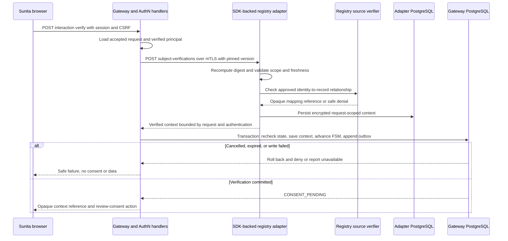

The verification interaction waits synchronously for its outcome. The consumer’s accepted workflow remains asynchronous and pollable. Network verification holds no core SQL lock; cancellation and deadlines are checked again when committing. Context, FSM transition and outbox event share the transaction. Outbox delivery is asynchronous. Identical live retries converge on one context; a late result cannot revive cancelled authority.

The browser sends only form field `csrf`; principal and accepted request are loaded server-side. The private adapter request carries `{snapshot, request_digest, principal}`. Its response is a VerifiedSubjectContext, not membership or savings data. Verified native mappings remain source-owned; only opaque mapping handles are returned across the adapter boundary. Both adapter and gateway encrypt their bounded context custody, and database TTL checks remain effective after restart.

## Internal consent APIs

| Method and route | Caller | Behavior |
|---|---|---|
| `POST /internal/consent-requests` | Gateway | Idempotently create immutable consent request using trusted context reference |
| `GET /internal/consent-requests/{id}` | Gateway | Authoritative preparation/decision state for reconciliation |
| `GET /internal/consents/{id}/artefact` | Authorized services | Signed artefact with access-controlled metadata |
| `GET /internal/consents/{id}/status` | AuthZ/Gateway | Current version, validity, withdrawal and usage status |
| `POST /internal/consent-events` | Consent event publisher | Gateway receiver for signed/authenticated events; stable-ID deduplication |

```json
{
  "event_id": "evt_con_61b4_active_1",
  "type": "consent.active",
  "consent_id": "con_61b4",
  "access_request_id": "req_8f21",
  "request_digest": "sha256:request-A",
  "status_version": 1,
  "occurred_at": "2026-11-01T10:02:00Z"
}
```

Events include authenticated issuer and payload integrity in the chosen transport envelope. A duplicate ID with different content is an integrity error. Stale events cannot undo withdrawal.

## Redemption, adapter and evidence APIs

| Method and route | Caller | Behavior |
|---|---|---|
| `POST /internal/v1/grants/redeem` | Authenticated adapter | Atomic consent/grant/use reservation; stable attempt ID |
| `POST {adapter}/internal/v1/retrievals` | Authenticated gateway | Independently enforce grant, fetch/map/filter and gate release |
| `POST /internal/v1/evidence` | Authorized evidence producers | Idempotent signed event commitment and durable acknowledgement |
| `GET /.well-known/gramstack-adapter` | Authorized discovery as policy requires | Capabilities and trust metadata, not personal records |
| Issuer JWKS routes | Verifiers | Trusted keys and bounded rotation; no private key material |

```json
{
  "grant": "<signed-retrieval-grant>",
  "request_id": "req_8f21",
  "request_digest": "sha256:request-A",
  "attempt_id": "attempt_04"
}
```

Consumer tokens, browser sessions, service tokens, grants and evidence signatures are distinct credentials with separate audiences. Internal APIs require service authentication and network restrictions; `internal` in a path is not a security control.

## Registry verification integration

Capability discovery and verification workflows are adapter responsibilities. The gateway consumes a trusted verified context bound to the principal, registry and access request. Native verification mechanisms and assurance profiles are registry-specific; the architecture does not require every registry to operate an IdP.

## Platform extension interfaces

The [post-disclosure profile](specifications/post-disclosure) defines the implemented routes for protected history, recipient handling reports and rights cases. The table also includes architecture extension points that need their own versioned contracts before client adoption.

| Interface | Authorised caller | Contract and timing |
|---|---|---|
| Resolve purpose/processing profile | Gateway and authorised clients | Read approved versions/digests; reject arbitrary URLs and incompatible scope |
| Record presentation evidence | Trusted consent presentation component | Bind exact notice, channel, language and authenticated decision; durable before activation |
| Consent/disclosure history and export | Reauthenticated subject or supported representative | Access-controlled, paginated/minimised history and machine-readable export |
| Create/read rights case | Verified requester and responsible case handler | Durable acceptance and safe status; asynchronous routing/outcome |
| Submit handling receipt | Registered recipient or authorised processor | Authenticate producer, verify disclosure/policy binding and commit idempotently |
| Pause source or suspend consumer | Authorised source owner/operator | Audited current-policy change enforced at issuance and admission |

Cancellation and receipt submission use operation-scoped idempotency keys; same key with changed content conflicts. Rights-case creation acknowledges acceptance, not erasure or correction. Public statuses distinguish pending, acknowledged, in progress, completed, exception and failed without exposing private internal diagnostics. Reliable notifications use authenticated outbox delivery and deduplication; polling/status remains authoritative.

Neither case IDs nor export locators grant access. Browser mutations require session/CSRF protection; service mutations require scoped service credentials. Receipt lookup, export and administrative access are audited. The platform derives organisation/subject authority from trusted context, never from an arbitrary payload identity.


## Versioned implementation contracts

Use the [implementation specifications](specifications/) for the normative API, message and adapter contracts. [OpenAPI](specifications/openapi), [message schemas](specifications/schemas), [adapter requirements](specifications/adapter) and [conformance scenarios](specifications/conformance) are published from the repository’s canonical `specs/` sources.


---

# State and evidence

## State inventory

| Store or custodian | Contents | Lifetime and restrictions |
|---|---|---|
| External IdP | Citizen accounts, credentials, recovery and upstream authentication | External authority's lifecycle |
| Registry | Native person mappings, membership, savings and business policy | Authoritative source lifecycle |
| Hydra SQL | Consumer configuration, keys and OAuth/OIDC operational state | Durable config plus tested cleanup; inspect sessions/logs/backups |
| Gateway SQL metadata | Status/version, canonical request digest, bounded accepted snapshot, one dispatch and response outcome | Workflow plus bounded terminal/recovery window; spent attempts survive restarts |
| Encrypted authentication TTL store | State, nonce, PKCE, callback correlation, session and transient principal context | Short transaction/session lifetime, with SQL TTL and one-use checks |
| Registry adapter SQL | Verified context, encrypted native mapping, durable attempt/outcome, encrypted signed evidence and private response-commitment salt | Short context TTL plus controlled attempt/evidence retention; no resource plaintext |
| Consent SQL | Request/notice snapshots, decisions, artefacts, current status, history and outbox | Enforcement window plus approved evidence retention |
| Enforcement SQL (shared transaction boundary) | Consent use reservation, grant issuance/redemption and attempt outcomes | Validity plus bounded recovery; retain necessary event evidence |
| Key management | Signing keys and versioned trust material | Controlled access, rotation and retirement |
| Protected evidence custodian | Signed notices, consent, grant decisions and access receipts | Explicit legal/policy retention and access controls |
| DeDi | Protected commitments, checkpoints, proofs and witness metadata | Durable; no registry response bodies or public citizen identifiers |
| Gateway/adapter memory | Transient source and canonical response bytes | Request lifetime; no body logging or central persistence |
| Consumer | Grant and delivered data | Grant expires; data handling subject to approved terms and obligations |

Opaque references and hashes can still be personal or linkable data. Encryption, access control, purpose limitation and retention apply to evidence as well as operational stores.

## Storage responsibilities

Gateway workflow checkpoints use SQL, with bounded accepted snapshots and encrypted TTL authentication transactions. Durable consent metadata and reliable notifications use SQL. Consent enforcement and grant redemption share an atomic transaction boundary so withdrawal cannot race a separate status check.

| Concern | Storage | Consistency requirement |
|---|---|---|
| Gateway workflow | SQL metadata, immutable dispatch scope and bounded snapshots | FSM plus transactional expected-version checks and outbox |
| Authentication transaction | Encrypted SQL transaction/session TTL store | One-time callback completion and expiry |
| Consent and notices | SQL metadata and protected evidence | Durable decisions, artefact references and history |
| Grant redemption | SQL unique redemption and consent-use reservation | One admitted attempt per authorized use |
| Withdrawal | Same enforcement boundary as redemption | Atomic ordering against retrieval admission |
| Hydra protocol state | Isolated Hydra SQL schema | Protocol-specific retention and access controls |

The same physical Postgres instance can host isolated schemas and roles where operational policy allows it. Sharing infrastructure does not grant every module access to every table. Durable consent evidence does not require citizen login accounts or business-data replication.

## Conceptual consent records

```text
consent_request
  id, access_request_id, request_digest, schema_version
  consumer_id, registry_id, resource, fields, purpose, terms_version
  subject_context_ref, notice_snapshot_ref, deadline_at

consent_decision
  id, consent_request_id, decision, authenticated_context_ref
  request_digest, subject_context_digest, notice_digest, language, occurred_at

consent_artefact
  id, decision_id, issuer, key_id, signed_payload, valid_until

consent_enforcement
  consent_id, status, version, valid_until, use_limit
  reserved_attempt_id, withdrawal_effective_at

grant_redemption
  grant_jti [unique], consent_id, request_id, attempt_id [unique]
  adapter_id, redeemed_at, outcome

outbox
  event_id [unique], payload_digest, destination, status, retry_at, attempts
```

These conceptual records describe the storage contract; database migrations implement this model. Separate minimum operational enforcement fields from retained evidence. Define deletion and compaction rules, including backups and signed artefact retention, before production.

## Approval-use events in the running system

GRAMStack automatically writes structured lifecycle events to its PostgreSQL outbox in the same transaction as the corresponding state change. The event that marks an approval as **used to authorize retrieval** is `request.transitioned` with status `REDEEMING`. It is written only when the adapter first reserves the grant against the approved consent, after the gateway rechecks the consent, current policy, exact scope and authenticated presenter. Approval and dispatch are earlier milestones.

| Outbox event | When it is written | What it establishes |
|---|---|---|
| `consent.approval_recorded`, then `consent.active` | The owner's decision commits, then the signing worker activates the consent | Permission was granted. No source retrieval is implied. |
| `retrieval.dispatched` | The gateway claims the one dispatch attempt | A retrieval was initiated. The consent reservation has its own event. |
| `request.transitioned` → `REDEEMING` | The first grant redemption and consent-use reservation commit together | This approval was used for the bound retrieval attempt. A retry of that reservation adds no second admission event. |
| `evidence.received` | Signed adapter evidence and pending anchor work commit | The gateway accepted a receipt for the outcome. A receipt alone does not establish that a response was sent. |
| `request.transitioned` → `COMPLETED` or `DELIVERY_UNKNOWN` | The gateway records the outcome of the response attempt | The gateway wrote the response or could not confirm delivery. An uncertain outcome does not automatically re-fetch. |
| `evidence.anchored` | The worker verifies and stores DeDi inclusion | A commitment to the signed evidence was recorded. This event can arrive after release. |

Each event has an ID, an aggregate version and a UTC occurrence time. The `REDEEMING` event carries the request ID, request digest and status. The durable reservation links that request to its consent ID, grant ID, authenticated presenter, adapter, attempt and reservation time. The signed receipt ties the attempt to its exact field names and outcome. Use those records together for attribution. Registry response values, bearer tokens and private keys are excluded from these events.

The outbox is an **internal durable event stream**. The running deployment consumes selected events with its own workers, including the DeDi anchoring worker. A public telemetry endpoint, external event feed and third-party analytics export are outside this demo. The owner sees a projection from the persisted records in signed-in consent history. The one-use guarantee covers retrieval through GRAMStack. It does not track downstream reads of the recipient's copy.

### Validate one disclosure at the platform layer

In signed-in consent history, copy the **Request reference** from a completed audit card. An operator with a read-only connection to the gateway database can run:

```sh
gramstack verify-admission <request-id>
```

Supply the private database connection via `DATABASE_URL`. The command checks that exactly one admission event matches the request and that the consent reservation, grant, presenter, adapter attempt and signed receipt reference agree. It returns the authorization event reference, approval-use timestamp, receipt reference and use count so the operator can compare them with the owner-facing card. It fails if the request is incomplete or the retained links are inconsistent. It reads metadata only. Use `gramstack verify-anchors` separately to verify retained DeDi proofs against the pinned checkpoint key.

## Extended evidence and operational records

| Record | Custodian and contents | Boundary |
|---|---|---|
| Purpose/processing snapshots | Protected configuration/evidence: version, digest, requirements, processor and responsibility references | Immutable bindings; no registry values |
| Notice presentation | Consent evidence custodian: exact notice, channel/language, confirmation and assistance references | Separate from authority artefact; protected channel evidence |
| Data-handling policy | Responsible organisation: data categories, purposes, retention triggers, exceptions, processors and backup rules | Policy is bound before approval; not proof of execution |
| Data-handling receipt | Evidence custodian: signed producer assertion, disclosure/category, action, time, policy and exceptions | Does not establish independently verified deletion |
| Rights case | Restricted case store: verified authority, routing, status, deadlines and outcomes | Separate from consent/use state; no copied business records by default |
| Privileged-access audit | Restricted security custodian: actor, role, purpose, record class and time | Includes reads/exports of evidence and administrative changes |

These records extend the conceptual architecture; they do not imply existing migrations or v0.1 endpoints accept their illustrative fields. Side records are linked through immutable IDs/digests and authenticated issuers. Mutable case progress and later handling receipts never rewrite the signed consent artefact.

## Data handling after disclosure

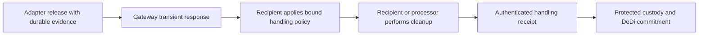

The platform's release gate is synchronous with retrieval. Recipient cleanup, rights processing and receipt publication are asynchronous, durable and retryable with stable IDs. Their acknowledgement never claims the action completed. A missing receipt is an unresolved obligation, not evidence of deletion; deployment policy defines escalation and whether future requests are suspended. Source pause or consumer suspension blocks new admission through current policy checks and does not recall prior releases.

The handling policy inventories source values, derived assessments, exports, caches, debug logs, backups and product-owned prompts/transcripts where applicable. Each category declares responsible organisation, processor, permitted purpose, retention trigger/period, lawful exceptions, cleanup mechanism and backup expiry/restoration handling. Data must not reappear after restoration without applying applicable erasure instructions. Product prompts, recordings, answers and model traces remain in the product/processor domain; GRAMStack stores only necessary protected references and attestations.

Illustrative recipient assertion:

```json
{
  "receipt_id": "handling_receipt_123",
  "producer": "sakhi-credit",
  "disclosure_id": "disclosure_123",
  "policy_ref": "handling_123",
  "data_category": "FETCHED_SOURCE_VALUES",
  "action": "ERASURE_REPORTED",
  "occurred_at": "2026-11-03T12:00:00Z",
  "evidence_ref": "recipient_attestation_123",
  "exceptions": []
}
```

Authenticate the producer and its authority over this disclosure, verify signature and policy binding, and deduplicate stable IDs. Conflicting content for the same ID is an integrity error. Retention exceptions identify the applicable basis, affected categories, responsible party and review/expiry condition. A recipient assertion cannot guarantee deletion of every downstream plaintext copy.

## Retention and incident operating model

Every deployment maintains a versioned retention matrix by legal role, data category, purpose, applicable rule, effective date, custodian and exception. It separates operational TTLs, consent evidence, security logs, recipient data and legally required retention. The DPDP Rules' First Schedule specifies at least seven years for the registered Consent Manager's specified records; that is not a universal retention setting for every internal module. Rule 8(3) separately specifies minimum one-year retention for processing data and logs for its stated purposes. Apply the relevant commencement provisions and current authoritative text before promising immediate disposal. See the [official Rules](https://www.meity.gov.in/static/uploads/2025/11/53450e6e5dc0bfa85ebd78686cadad39.pdf).

The responsibility manifest names fiduciaries, processors, consent authority, evidence custodians, incident responders and grievance contacts. Processor inventories include approved operations, subprocessors, hosting/transfer locations, security/incident obligations and termination cleanup. Geographic restrictions follow the applicable deployment/sector rules; India-only hosting is not an unconditional platform invariant.

Operational controls include least-privilege evidence access, audited administrative reads/exports, key custody/rotation, source emergency pause, and breach detection/triage/notification runbooks with accountable owners. The evidence system records incident and handling metadata without duplicating compromised business payloads. A signed artefact is evidence of a recorded process, not a standalone guarantee of lawful processing or operator registration.

## Evidence model

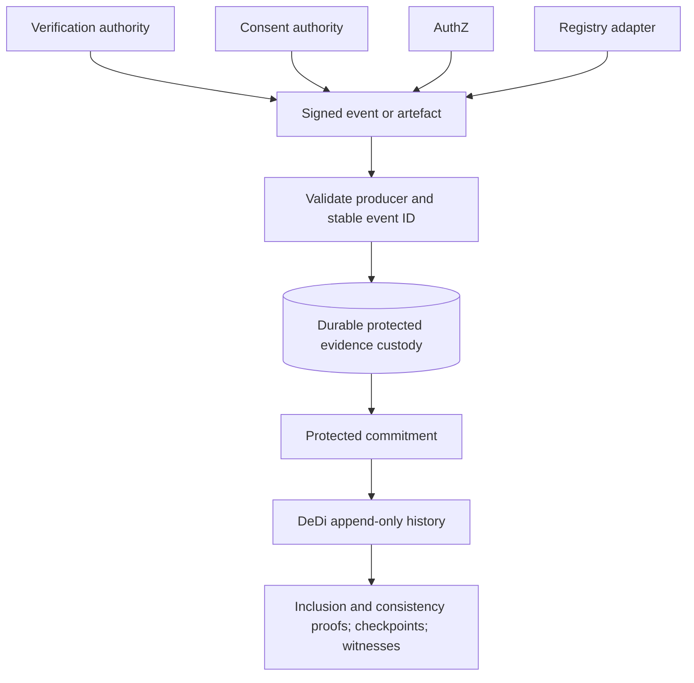

Candidate events include request accepted, verification result, notice/approval/rejection, consent activation/withdrawal, authorization decision, grant issuance/redemption, source attempt, transformation failure, disclosure release attempt and terminal recovery outcome. Event content is minimized by role. A commitment needs a retained underlying receipt and accountable custodian to remain useful in disputes.

An access receipt binds event ID, producer, request digest, consent/grant references, adapter/consumer identity, registry/resource/fields, purpose, policy version, attempt ID, outcome, timestamp and previous evidence references where useful. Response digests are optional and require privacy analysis; a guessable balance or member ID must not be publicly hashable evidence.

## The release boundary

```mermaid
graph TD
    A["Grant atomically redeemed"] --> B["Source read and canonical filtering"]
    B --> C["Sign disclosure-attempt receipt"]
    C --> D["Durable evidence acknowledgement"]
    D --> E["Adapter releases to authorized gateway"]
    E --> F["Gateway records release intent"]
    F --> G["Transmit to consumer"]
    G --> H["Complete or classify delivery uncertainty"]
```

Protected data crosses boundaries when the adapter sends it to the gateway, not only when the gateway sends to SakhiCredit. Adapter-side required evidence must precede that release. If the gateway creates a separate outward release receipt, its gate also precedes transmission. We must avoid falsely labelling one receipt as confirmation of successful delivery through both hops.

## One dispatch through two release boundaries

```mermaid
sequenceDiagram
    participant S as SakhiCredit backend
    participant G as Gateway
    participant A as Registry adapter / Go SDK
    participant R as Native registry
    S->>G: GET data with grant and original consumer mTLS
    G->>G: Verify certificate cnf and commit one dispatch in core SQL
    G->>A: Service mTLS with snapshot, grant and trusted presenter
    A->>A: Verify grant, context and exact fields, claim local SQL attempt
    A->>G: Private AuthZ redemption with stable attempt ID
    G->>G: Core SQL checks current authority and atomically reserves use
    G-->>A: New reservation
    A->>A: Persist source-start in adapter SQL
    A->>R: Fetch once
    R-->>A: Source record
    A->>A: Map, project approved fields and sign salted commitment
    A->>A: Encrypt evidence and salt in adapter SQL
    A->>G: Private custody call with signed metadata
    G->>G: Atomically commit receipt, anchoring outbox and lifecycle
    G-->>A: Durable acknowledgement
    A->>A: Persist evidence and release checkpoints
    A-->>G: Projected data and receipt ID
    G->>G: Verify receipt scope and commit release intent
    G-->>S: Projected data and receipt ID
    G->>G: Core SQL records server-write outcome
    Note over G: AuthZ and custody are modules in this service
    Note over A: Recovery never fetches again or serves cached data
```

The original consumer certificate terminates at the retrieval gateway. The reference transport uses its private TLS listener, or an ingress that preserves that actual mTLS proof; a generic forwarded certificate string is insufficient. Public request/status/interaction traffic and authenticated data traffic have separate ingress responsibilities. The adapter accepts presenter context only from its authenticated gateway and attests that binding to AuthZ over its own service identity.

| Boundary | Durable state before proceeding | Data kept in memory | Client-visible result |
|---|---|---|---|
| Gateway dispatch | One request/attempt, grant digest, presenter and fixed deadline | Accepted snapshot while forwarding | Duplicate dispatch is 409, with no second adapter call |
| Adapter admission | Local attempt plus central consent-use reservation | Verified source mapping during the call | An admitted slot cannot be restored by a timeout |
| Native read | Source-start checkpoint | Source record, then exact projection | Only approved `membership_status` and/or `savings_summary` in this resource |
| Adapter release | Encrypted evidence/salt plus verified durable custody acknowledgement | Projected resource response | Data and receipt ID |
| Gateway release | Verified signed receipt and release-intent FSM/outbox checkpoint | Projected response during this write | Data and receipt ID, or a safe error |
| Recovery | Terminal failure/uncertainty and occupied attempt | No cached resource response | Status/receipt metadata, requiring fresh authorization for another disclosure |

A reference gateway dispatch has a fixed 60-second deadline that cannot be extended to revive it. Recovery classifies at most 32 expired running dispatches per pass: FAILED before admission, DELIVERY_UNKNOWN after admission. It never resends the adapter request. Adapter calls are bounded, and the reference native transport disables implicit retries on a reused connection. HEAD requests cannot consume a disclosure.

A failure to commit dispatch performs no adapter call. A failure at custody or the gateway release-intent checkpoint withholds outward data. A partial response write becomes DELIVERY_UNKNOWN; a lost final checkpoint stays occupied until conservative recovery. COMPLETED describes the server finishing its write, with the client-receipt limits below. Withdrawal before admission blocks the source read; withdrawal after the reservation reports the cutoff and does not create another slot.

Deployments select one of two evidence anchoring profiles:

- **Synchronous DeDi commitment:** stronger immediate external verifiability, with DeDi availability/latency in the release path.
- **Durable local/custodian commitment plus batched anchoring:** release after durable protected logging, with a bounded anchoring SLA and reconciliation. This introduces an explicit interval before independent anchoring.

Neither option permits an in-memory log line as durability. Define acknowledgement, fsync/replication expectations, outage limits and recovery before choosing.

## Automatic anchoring after durable custody

The reference runtime selects **batch custody**. Receipt acceptance and resource release are synchronous with the SQL custody transaction; DeDi publication happens asynchronously. A pending acknowledgement means the signed evidence and its work item committed, not that the external log already contains it. Repeating receipt submission returns the original acknowledgement even after anchoring completes; latest anchor state is a separate protected projection.

```mermaid
sequenceDiagram
    participant A as Registry adapter
    participant G as Gateway custody
    participant S as Gateway SQL
    participant W as Anchoring worker
    participant D as DeDi node
    A->>G: Scoped signed evidence over service mTLS
    G->>S: Commit immutable receipt, pending anchor and outbox
    S-->>G: Durable commit
    G-->>A: Receipt ID and pending acknowledgement
    Note over A,G: Batch profile permits the evidence-gated response
    W->>S: Lease evidence.received work
    S-->>W: Opaque receipt reference
    W->>S: Re-read and verify signed custody and admission
    W->>D: Create-only signed protected commitment
    D-->>W: Inclusion proof and signed checkpoint
    W->>W: Verify exact digest, publisher, first version and pinned checkpoint
    W->>S: Atomically store anchored proof and evidence.anchored event
    W->>S: Acknowledge leased work
```

The worker runs one bounded publication at a time, using 30-second SQL leases and a 20-second operation deadline. Failed deliveries retain their work and back off from one to 64 seconds; another process can recover an expired lease. SQL controls scheduling and completion across restarts. DeDi receives only a schema identifier and the digest of the exact compact signed evidence. Its record name is derived from the opaque custody receipt ID. Source data, identity claims, signed receipt bytes and the adapter's private commitment salt stay out of the publication.

DeDi writes use create-only preconditions. If publication succeeded but the SQL checkpoint failed, the retry verifies the existing first-version record instead of overwriting it. Once SQL has committed a verified proof, a lost queue acknowledgement recovers by checking that retained proof offline. The `pending → anchored` transition uses an FSM; anchored state, proof and timestamp cannot be overwritten. A single `evidence.anchored` event commits with that transition. Neither publication nor retry changes disclosure permission or causes another source read.

The retained reference includes the Merkle audit path, leaf metadata and signed checkpoint. Verification pins the node key and checkpoint origin, namespace, registry, publisher, record name, first version and exact protected commitment. This proves inclusion under that checkpoint. Cross-checkpoint consistency and independent witness verification are additional deployment requirements for non-equivocation claims. Batch mode continues to release after durable custody during a DeDi outage; operators must monitor pending age and backlog and apply their chosen outage policy. The reference runtime does not claim an enforced maximum anchoring delay or an implemented synchronous custody profile.

## Consumer copy and product recovery

The reference SakhiCredit consumer has a separate database. It encrypts the member locator and received result with AES-GCM, binding each ciphertext to the application, browser owner and payload purpose. Input comparison for idempotency uses an owner-bound keyed digest. Browser tokens are stored only as hashes; product-session cookies are HttpOnly, host-only and Secure on HTTPS. Product changes require the configured Origin and a matching CSRF token.

Applications and their received copies are inaccessible after one hour; browser sessions expire after two hours without sliding renewal. Bounded maintenance physically removes expired rows, separately from enforcing TTL on access. The product's shorter retention fits within the recipient terms' maximum window. SQL expiry does not prove deletion of backups, screenshots or arbitrary browser copies.

The product FSM commits a single FETCHING claim with an immutable 45-second recovery deadline before calling the private data endpoint. It persists an encrypted result before returning it to the browser. A reload or repeated successful product operation returns that already received copy, rather than another platform disclosure. A failed response/checkpoint or abandoned attempt becomes UNKNOWN and cannot fetch again. Platform permission, certificate binding, admission and evidence checks remain independent and authoritative.

Cancellation first persists a product-side fence, then asks the platform to cancel. A dependency outage retains CANCELLING, with bounded retries of that same cancellation; it never exposes a new fetch slot. Withdrawal prevents new admission and does not retroactively erase a recipient copy already received. Consent receipts and access receipts remain distinct records, connected by the request and disclosure references.

## What evidence proves

| Claim | Limit |
|---|---|
| A trusted producer signed a particular receipt | Signature and issuer trust can establish this |
| Committed history has not been silently rewritten | Depends on DeDi proofs, checkpoint and witness assumptions |
| Every GRAMStack-mediated release has required evidence | Depends on complete enforced release gates and controlled integration credentials |
| The consumer received every response byte | Not established by a pre-release receipt or server write completion |
| A recipient deleted all plaintext copies | Not established by consent terms, token expiry or DeDi |
| All native registry access is accounted for | Outside GRAMStack's integration claim |

`Cache-Control: no-store`, minimized fields and transient processing reduce accidental retention; they do not mathematically prove deletion by an arbitrary recipient.


---

# Dry runs and user screens

## Scenario assumptions

All actors, IDs, balances and source APIs are illustrative. The example verified subject context is `ctx_77`. In the reference demo it is produced by real eSignet authentication followed by the SDK-backed adapter and the separate native mock’s approved fictional mapping. The native source remains a demo; a production registry supplies its approved identity-to-record verification mechanism. Time values are example bounds.

| Item | Value |
|---|---|
| Consumer | SakhiCredit |
| Data subject | Sunita Devi |
| Registry | LokOS |
| Access request | `req_8f21` |
| Consent request | `cr_92a1` |
| Consent artefact | `con_61b4` |
| Grant | `grant_73c2` |
| Retrieval attempt | `attempt_04` |
| Fields | Membership status and savings summary |
| Purpose | Credit eligibility |
| Frequency | One admitted disclosure |
| Decision deadline | Example: 10 minutes |
| Grant lifetime | Example: up to 5 minutes, never beyond other validity bounds |

## End-to-end message sequence

The solid request arrows are individual HTTP exchanges. The human wait and durable worker/notification stages span exchanges; no consumer request stays open through them. Step-by-step flowcharts below provide the same path in a simpler view.

```mermaid
sequenceDiagram
    participant C as SakhiCredit
    participant G as Gateway
    participant U as Sunita
    participant N as AuthN and verification
    participant M as Consent module
    participant Z as AuthZ
    participant A as LokOS adapter
    participant E as Evidence sink
    C->>G: Create access request
    G-->>C: 202 with status and interaction URL
    Note over C,U: Asynchronous wait for the person
    U->>N: Authenticate and verify registry relationship
    N-->>G: Trusted subject context
    G->>M: Create exact consent request
    U->>M: Review notice and approve
    M->>E: Commit signed consent evidence
    E-->>M: Durable acknowledgement
    M-->>G: ACTIVE event with reconciliation
    C->>G: Request retrieval grant
    G->>Z: Evaluate policy and consent
    Z-->>C: Scoped grant via Gateway
    C->>G: Request data with grant
    G->>A: Dispatch scoped retrieval
    A->>Z: Atomically redeem and reserve use
    Z-->>A: Admitted attempt
    A->>A: Fetch source and filter canonical response
    A->>E: Commit disclosure-attempt receipt
    E-->>A: Durable acknowledgement
    A-->>G: Approved data
    G-->>C: Attempt response release
```

## Step 1: consumer creates a request

SakhiCredit obtains a consumer token and submits the access request. Gateway validates its authority, scope and recipient terms, fixes the request digest and returns 202 with status and interaction URLs.

```mermaid
graph LR
    C["SakhiCredit"] --> A["Authenticate consumer"]
    A --> V["Validate access request"]
    V --> W[("Persist bounded workflow")]
    W --> R["202 with locators"]
```

**Stored:** gateway request/version/deadline; client configuration already exists. **Not done:** no personal business-data retrieval, consent or grant. **SakhiCredit sees:** “Waiting for the person to complete verification and consent.”

## Step 2: Sunita authenticates and the subject gate completes

SakhiCredit opens the GRAMStack consent UI while Sunita is present, or provides the interaction link through an approved channel. She authenticates through the selected external IdP. The portal correlates the callback and establishes a short-lived session. Registry verification then completes through the approved mechanism; this dry run injects `ctx_77` as an explicitly non-production fixture.

**Stored:** auth transaction/session in TTL state, verified context reference in workflow. **Screen:** login method selection followed by verification progress/challenge. A failed or ambiguous match does not display alternative member records to the consumer.

## Step 3: create and display the consent request

Gateway creates `cr_92a1` idempotently, with the request digest and verified context. Consent module snapshots the notice and terms and returns an interaction URL. The HTTP exchange ends. Human waiting is asynchronous.

```text
SakhiCredit wants information from LokOS

Information requested
  - SHG membership status
  - Savings summary

Purpose
  Assess eligibility for credit

Access
  One retrieval before the displayed expiry

After sharing
  Plain-language recipient retention terms

Withdrawal
  How to stop future access, with the admission cutoff explained

Refusal and help
  Clear consequences, contact and grievance information

                 Reject       Approve
```

This is a text wireframe, not an active consent request. Render in the selected language. Notices must explain real recipient terms rather than invent “no retention” for a credit workflow that requires records.

**Stored:** consent SQL request, notice content/version/language/digests and deadline. **Gateway:** CONSENT_PENDING. **Consumer:** pending status, no grant. **Sunita:** exact disclosure, with genuine approve/reject choices.

## Step 4: approval becomes usable consent

```mermaid
graph TD
    A["Sunita approves"] --> B["Validate session, subject context, CSRF and notice digest"]
    B --> C["SQL transaction: approval plus work item"]
    C --> D["Sunita sees approval recorded"]
    C --> E["Sign stable consent artefact"]
    E --> F["Commit required consent evidence"]
    F --> G["SQL transaction: ACTIVE plus outbox event"]
    G --> H["Notify Gateway and reconcile"]
    H --> I["Gateway CONSENTED"]
```

Signing or evidence may finish inline if fast, but the durable protocol supports asynchronous completion. UI must not say “data shared” at this point. Duplicate approval returns the recorded result. Withdrawal during preparation prevents a late activation job from overriding it.

## Step 5: grant issuance

SakhiCredit polls status and explicitly requests a grant. AuthZ validates trusted consent/context, current status, consumer eligibility, field/purpose policy, recipient terms and validity. It records the decision and returns the stable issuance result. Grant issuance does not retrieve business data or consume a one-time disclosure.

**Gateway:** AUTHORIZED. **Consent:** ACTIVE, use AVAILABLE. **Sunita:** “Consent ready; waiting for retrieval.” **Consumer:** grant and expiry.

## Step 6: atomic redemption and scoped retrieval

```mermaid
graph TD
    C["SakhiCredit requests data"] --> G["Gateway perimeter validation"]
    G --> A["Adapter independently validates grant"]
    A --> Z["AuthZ atomic redemption"]
    Z --> T[("Consume grant and reserve consent use")]
    T --> L["Fetch source record from LokOS"]
    L --> F["Transform and allowlist fields"]
    F --> E["Durably commit disclosure-attempt receipt"]
    E --> R["Release canonical response through Gateway"]
```

Example response:

```json
{
  "source": "lokos",
  "resource_type": "shg.membership",
  "data": {
    "membership_status": "active",
    "savings_summary": {"amount": 12500, "currency": "INR"}
  }
}
```

The example amount is fictional. Canonical savings semantics are not defined by this payload: period, source freshness, aggregation rules and numeric representation must be specified before a real contract. Unknown native fields are not forwarded automatically.

## Step 7: close the attempt

Required evidence records the disclosure attempt before the adapter releases protected data to the gateway. Gateway records outward release intent and attempts transmission. Server completion becomes COMPLETED under the defined transport semantics; interruption can become DELIVERY_UNKNOWN. The response body is not retained by the gateway, adapter or consent module.

| Record | Final example state |
|---|---|
| Gateway | COMPLETED or DELIVERY_UNKNOWN |
| Grant | Consumed |
| Consent use | Reserved attempt reconciled with release outcome |
| Consent evidence | Durable signed notice/approval/artefact |
| Access evidence | Durable attempt and outcome references |
| DeDi | Commitments under chosen anchoring policy |
| Consumer | Approved canonical response and evidence references |

## Alternative run: rejection

Sunita rejects at the notice. Consent request becomes REJECTED and necessary notice/decision evidence is retained. Gateway becomes REJECTED. SakhiCredit gets a safe rejection outcome, no grant and no data. A delayed approval request cannot overwrite the recorded terminal decision.

## Alternative run: withdrawal wins

```mermaid
graph TD
    W["Sunita submits authenticated withdrawal"] --> T["Shared enforcement transaction"]
    R["Adapter submits redemption"] --> T
    T --> O{"Which commits first?"}
    O -->|Withdrawal| D["WITHDRAWN; deny redemption"]
    O -->|Redemption| P["Use RESERVED; admitted retrieval may proceed"]
```

The interaction explains this admission cutoff to the user. If stronger post-redemption cancellation is required, the release protocol must change; the current diagram does not promise it.

## Alternative run: failure or uncertainty

| Trigger | State/evidence | Human/consumer outcome |
|---|---|---|
| IdP unavailable | Authentication pending/failure within deadline | Retry supported provider; no silent assurance downgrade |
| Verification fails | Protected verification failure | Generic unsuccessful result; no candidate records leaked |
| Signing/evidence delayed after approval | APPROVAL_RECORDED and durable retry work | “Approval recorded; preparing receipt” |
| Source fails after redemption | Grant remains consumed, failed attempt evidence | No automatic second read; follow the one-use retry policy |
| Evidence sink unavailable after source read | Data withheld, retry/recovery state | Retrieval not completed; no business-data cache |
| Consumer disconnects during release | Release-attempt receipt and uncertain delivery | DELIVERY_UNKNOWN; no automatic resend |
| Duplicate redemption | Existing attempt recoverable only under protocol | No second source execution or release authority |

## Assisted route

Sunita presents an SHG passbook to an authenticated, registry-authorized CRP. The CRP follows the registry's approved verification process. The procedure establishes an auditable subject context at the registry verification gate; possession of the passbook number is insufficient. The consent screen or assisted presentation still records Sunita's actual decision.

Assisted access profiles can restrict disclosure to one registry, one visit and a specific purpose. Advisory-only verification does not automatically authorize a credit-data disclosure. The registry defines the assurance and purpose limits of each assisted route.

## Scope change and downstream rights

| Step | Actor | Platform behaviour | User-visible meaning |
|---|---|---|---|
| 1 | Product | Submit exact membership and savings request A | Show the matching notice and handling terms |
| 2 | Sunita | Ask the product to omit savings | No partial approval or inferred decision is recorded |
| 3 | Client | Cancel A and await its authoritative result | Explain whether future admission was blocked or already occurred |
| 4 | Client | Create independent membership-only request B | Present fresh scope, terms and approval/rejection |
| 5 | Platform | Apply source policy and normal admission/evidence gates | No authority carries from A to B |
| 6 | Recipient | Process the disclosed fields under the bound handling policy | History identifies recipient and disclosed scope |
| 7 | Sunita | Submit an erasure or grievance request | Receive a case reference, responsible organisation and status |
| 8 | Responsible organisation | Perform action or report a reasoned exception | Completion is distinct from acknowledgement and withdrawal |

If membership alone cannot serve the product's purpose, the product explains that and does not request unusable data. A voice interface may implement these screens as speech, but interpretation and business decisions remain in the product. Platform authority still comes from authenticated, request-bound confirmation.


---

# Failure and security review

## Failure matrix

| Failure | Required behavior | Evidence/state |
|---|---|---|
| Consumer invalid or disabled | Deny before protected workflow/redeem | Minimal security event |
| Unsupported registry/resource/fields | Reject schema/capability mismatch | Safe validation result |
| Guessed member ID | Never treat hint as ownership | No existence leak to unauthorized caller |
| Wrong IdP issuer/audience/nonce | Reject authentication | Correlated security event; consume invalid transaction safely |
| Operator account used as subject proof | Do not assume member ownership | Gate remains unresolved/failed |
| Verification missing, stale or ambiguous | Fail closed before consent activation/grant | Protected failure reference |
| Consent scope or digest mismatch | Reject; no silent narrowing/expansion | Integrity event |
| Human rejects | Terminal rejection | Appropriate notice/decision evidence |
| Consent withdrawn or expired | Deny issuance/redemption per atomic cutoff | Current authoritative status and evidence |
| Duplicate/reordered callback | Deduplicate; stale event cannot resurrect state | Event ID/version |
| Concurrent grant requests | Recover stable issuance result | Unique request/issuance record |
| Multiple grants for one consent | One-use constraint enforced across all JTIs | Shared consent-use reservation |
| Concurrent redemption | Single admitted attempt | Unique redemption and reservation |
| Source timeout after admission | Preserve consumed status; classify ambiguity | Attempt record and failure evidence |
| Native response adds unexpected fields | Allowlist/filter; fail on invalid mapping | No accidental broad JSON pass-through |
| Mandatory evidence unavailable | Withhold protected release | Durable recovery metadata |
| Crash after evidence before release | Do not claim delivery; reconcile intent | No automatic grant reset |
| Crash after release begins | DELIVERY_UNKNOWN where appropriate | Preserve attempted-release evidence |
| Cleanup worker delayed | Reject late actions by business deadline regardless of key existence | Recovery backlog; no TTL-as-authorization |

## Threat boundaries

### Request and identity substitution

A malicious consumer may change fields, purpose, recipient or member hint after Sunita sees the notice. Bind each authority artefact to the immutable request digest and verified subject context. Server-side transaction correlation prevents swapping a different login or callback into the interaction.

A phone OTP authenticates channel control under a defined assurance profile. It does not establish that the phone holder owns the requested LokOS savings record. A registry IdP must establish member-account semantics explicitly; operator credentials are not universal person identities.

### Browser interaction attacks

Secure, HttpOnly cookies, appropriate SameSite settings, session rotation, CSRF tokens, safe return URLs and short transaction expiry are needed. No state-changing approval or withdrawal GET route. Avoid sensitive information in URLs, referrers, analytics and logs. Interaction locators are unguessable but are not the sole authorization mechanism.

### Service and adapter bypass

Internal APIs require authenticated service identities and least-privilege network paths. Adapter source credentials are dedicated, restricted and unavailable to consumers. The adapter independently validates scopes and authoritative redemption; the gateway cannot simply assert “allowed” in a header.

Trust manifests and endpoints must be operator-approved. Do not follow attacker-controlled JWKS, callback or evidence URLs. Policy bundle signature/version validation and rollback rules are part of trusted configuration management.

### Consent and evidence abuse

A signed consent can be stale. A webhook can be delayed. A receipt can be fabricated by an untrusted signer. Validate issuer authority and current status, and ensure every protected release traverses the gate. Public commitments must resist guessing and correlation; opaque IDs are not automatically anonymous.

The consent authority signature is evidence of its process, not a cryptographic signature by Sunita. Evidence retains sufficient notice and authenticated-approval provenance for accountable review.

## Recovery invariants

1. Terminal workflow state cannot be resurrected by a stale callback.
2. SQL-enforced withdrawal/redemption wins over a lagging gateway projection.
3. A grant cannot become unused after an ambiguous network timeout.
4. A one-time consent cannot admit another attempt merely because a new grant JTI exists.
5. Evidence retry with the same event ID and content is idempotent; different content conflicts.
6. The source response is never persisted centrally to repair consumer retry semantics.
7. A server-side successful send is not recorded as proof of client receipt.
8. Expiration is evaluated against deadlines even when cleanup has not run.
9. Worker recovery records are durable before asynchronous acknowledgement.
10. No local citizen provisioning is introduced by a convenient consent or IdP SDK default.

## Additional platform assurance scenarios

| Scenario | Required outcome |
|---|---|
| Scope changes after notice presentation | Old authority is cancelled through the admission gate; new request requires fresh notice/decision |
| Cancellation races activation or redemption | Late activation cannot bypass cancellation; return the actual admission ordering |
| Client/model claims a different approver or representative | Reject without a supported verified authority context |
| Presented language/content differs from approved notice | Reject mismatched decision binding; retain presentation evidence |
| Purpose, time bounds or processing terms change | Reject substitution; require a new request and approval |
| Handler reports erasure before downstream work completes | Keep pending; receipt acceptance does not mean action completion |
| Duplicate receipt ID has different content | Integrity error; preserve original and investigate |
| Rights/export request targets another person's records | Deny without enumeration; audit the access attempt |
| Retention exception or missing handling receipt | Preserve accountable status and apply deployment escalation policy |
| Product correlates several source requests | No cross-request consent/grant reuse |


## Conformance plan before a real implementation

| Contract | Meaningful checks |
|---|---|
| Request | Canonical digest, changed-scope mismatch, caller-scoped idempotency, limits |
| AuthN | Issuer/audience/signature, nonce/state/PKCE, replay, rotation, provider outage |
| Verification gate | Missing/mismatched context fails; mock profile cannot run as production |
| Consent | Exact notice provenance, duplicate decision, concurrent withdrawal/activation, inaccessible receipt |
| AuthZ | Wrong purpose/fields/recipient, expired context, consumer disabled, policy version |
| Redemption | Competing attempts, multiple JTIs, withdrawal race, recovery of ambiguous result |
| Adapter | Extra-field leakage, malformed source data, source credentials, independent audience validation |
| Evidence | Commit outage, duplicate event, ambiguous acknowledgement, privacy-safe commitments |
| Lifecycle | Reordered callbacks, process restart, deadline worker, terminal cleanup window |
| UI | Keyboard use, accessible language, reject parity, accurate pending/release messages |

These checks define conformance expectations for the implementation. Example flows illustrate the protocol and do not imply production certification.


---

# Architecture choices

## Core design

| Concern | Architectural choice | Rationale |
|---|---|---|
| Source authority | Business data remains in existing registries | Avoid stale replicas and preserve source ownership |
| Citizen identity | Delegate authentication to external authorities | Avoid local citizen accounts and universal identity mappings |
| Scope | Read-only registry access | Keep source-record mutation outside the retrieval protocol |
| Coordination | Gateway-owned request lifecycle | Support asynchronous human interaction without requiring a standalone orchestrator |
| Integration | Registry adapters own transport, verification integration, transformation and enforcement | Keep source-specific behavior behind one executable boundary |
| Human approval | Explicit consent bound to the exact request and verified subject | Prevent substitution of fields, purpose, recipient or person |
| Authentication engine | Hydra with external login integrations | Reuse OAuth/OIDC protocol handling without citizen account provisioning |
| Consent | A dedicated consent module informed by DEPA and open implementations | Preserve notice provenance, withdrawal, signed artefacts and reliable events |
| Authorization | GRAMStack AuthZ evaluates versioned registry policies | Keep policy and retrieval capability separate from login and consent |
| Retrieval grants | Short-lived grants with audience, resource, fields, purpose and request binding | Constrain disclosure authority and its use |
| One-time use | Atomic consent-use reservation and grant redemption | Prevent replay and coordinate withdrawal with retrieval admission |
| Evidence | Durable signed evidence before protected release, anchored through DeDi | Make GRAMStack-mediated access accountable without storing business payloads |
| Credentials | Citizen credentials remain upstream | Avoid local password, recovery and passkey enrollment stores |
| Optional registry IdP | eSignet can sit upstream for a registry | Support registry-owned authentication without mandating it for onboarding |

## Registry subject verification

Subject verification establishes the relationship between an authenticated principal and a source-system record. The integration contract is hybrid: common trusted context, request binding and assurance metadata, with verification mechanics controlled by the registry.

A registry can support its own member IdP, an external identity assertion plus a registry challenge, or an approved assisted procedure. An operator account that can manage many members is not evidence that the operator owns every member's record. No registry is required to operate an IdP.

A verified context contains the authorized issuer, opaque registry subject, intended audience, authenticated principal reference, request digest, method, assurance, freshness and evidence reference. The gateway accepts it only under the registry's trust policy. A lookup hint, phone number or passbook number alone cannot satisfy this gate.

## Deployment profiles

| Profile dimension | Contract |
|---|---|
| Verification | Registry-approved method, issuer trust, assurance and failure handling |
| Consent | Versioned notice and artefact schema; authenticated decision and withdrawal |
| Sender binding | Defined mTLS/DPoP or equivalent presenter-authentication requirements at each relevant hop |
| Evidence anchoring | Synchronous DeDi commitment, or durable custody with bounded batched anchoring |
| Retention | Explicit operational cleanup and evidence custody policy, including backups |
| Runtime isolation | Module co-location or service separation according to key, credential and availability boundaries |
| Canonical data | Resource semantics, field mappings, source freshness and supported operations |

Profiles must preserve the same core guarantees. An integration cannot relax subject verification, human consent, scope enforcement or mandatory evidence by treating these as optional deployment details.

## Channel-independent platform contracts

| Concern | Architectural choice |
|---|---|
| Product logic | Voice/AI interpretation, credit/advisory decisions and conversational state remain outside the platform |
| Fixed scope | Approve/reject the exact request; clients cancel and create a new request when scope changes |
| Purpose and terms | Bind trusted, versioned purpose/processing snapshots and supported time bounds to the immutable request |
| Presentation | Retain exact notice and channel/language confirmation evidence separately from authority |
| Assistance and representation | Assistance confers no authority; representative profiles require explicit verified scope |
| Downstream handling | Bind recipient obligations and record authenticated handling assertions without claiming guaranteed deletion |
| Rights | Expose protected history/export and durable routing/status for responsible organisations |
| Multi-source products | Independent per-source requests; product correlation never broadens authority |
| Protocol evolution | Version and negotiate extensions; preserve the published v0.1 schema and adapter enforcement |


## Consistency boundaries

Gateway workflow state is a projection of progress; it cannot override authoritative consent withdrawal or grant consumption. Consent enforcement and redemption share a transaction boundary. A callback, cached status or delayed outbox event does not independently authorize a source read.

Asynchronous work uses stable IDs, durable work items, acknowledgements, deduplication and reconciliation. State-changing retries recover prior results rather than creating new disclosure authority. After admission, uncertain failures do not reset grants to unused.

## Extensibility

IdP adapters normalize verified authentication context while retaining provider assurance provenance. Registry adapters implement source transport and mappings while enforcing the canonical scope. Consent artefacts identify their issuer and schema so that trusted external consent providers can be integrated through explicit trust and conformance contracts.

These extension points do not require a central citizen registry, mirrored operator hierarchy, business-data cache or separate service for every logical responsibility.


---

# Standards and references

GRAMStack combines federated authentication, consent-based sharing, scoped capabilities and tamper-evident access evidence. The following standards and implementations inform those boundaries.

## DEPA and concrete consent references

| Source | Use |
|---|---|
| [iSPIRT DEPA architecture](https://github.com/iSPIRT/DEPA) | Architectural background and older draft API; not a runtime dependency |
| [DEPA World](https://depa.world/) | Conceptual flows and documentation; verify current ownership/version before normative use |
| [NITI Aayog DEPA discussion paper](https://niti.gov.in/sites/default/files/2023-02/DEPA-Book.pdf) | Separation of consent/data flows and data-blind consent role |
| [ReBIT API portal](https://api.rebit.org.in/) | Governed financial consent/data-sharing specifications; domain assumptions must be separated |
| [ReBIT AA API](https://api.rebit.org.in/spec/aa) | Consent lifecycle and artefact reference |
| [Sahamati standards](https://github.com/Sahamati/account-aggregator-standards) | AA schemas/contracts |
| [Sahamati conformance](https://github.com/Sahamati/certification-framework) | Ecosystem test structure |
| [DPDP Act — India Code](https://www.indiacode.nic.in/bitstream/123456789/22037/2/a2023-22.pdf) | Legal role definition; deployment software is not operator registration |

DEPA supplies the architectural reference for consented sharing. ReBIT maintains domain-specific financial-data-sharing standards. iSPIRT's [training](https://github.com/iSPIRT/depa-training) and [inferencing](https://github.com/iSPIRT/depa-inferencing) projects address additional privacy-preserving sharing/processing scenarios; they are not drop-in consent-manager successors.

## DPDP operating requirements

The [official DPDP Rules, 2025](https://www.meity.gov.in/static/uploads/2025/11/53450e6e5dc0bfa85ebd78686cadad39.pdf) inform notice accessibility, security, breach handling, retention, rights and registered Consent Manager obligations. Consult the [MeitY publication page](https://www.meity.gov.in/documents/act-and-policies/digital-personal-data-protection-rules-2025-gDOxUjMtQWa) for associated notifications and corrigenda. Deployments track applicable legal roles, commencement dates and current text in their responsibility/retention matrices. These obligations are distinct from DEPA architectural alignment and protocol conformance.


## Open implementation reading list

| Implementation | Links | Licensing/assessment |
|---|---|---|
| GovStack / iGrant Consent BB | [Go API](https://github.com/decentralised-dataexchange/bb-consent-api), [sharing UI](https://github.com/decentralised-dataexchange/bb-consent-data-sharing-ui), [privacy dashboard](https://github.com/decentralised-dataexchange/bb-consent-privacy-dashboard), [playground](https://github.com/decentralised-dataexchange/bb-consent-playground) | Apache-2.0; generic consent APIs, agreement revisions and user interfaces |
| GovStack specification/test working group | [Specification and examples](https://github.com/GovStackWorkingGroup/bb-consent) | Consent building-block specification and examples |
| TSI DPDP CMS | [Implementation and guides](https://github.com/tsi-coop/tsi-dpdp-cms) | Apache-2.0; India-focused notice, consent and withdrawal patterns |
| ProjectEKA | [Health consent manager](https://github.com/ProjectEKA/consent-manager) | Source visible; licensing must be confirmed before code reuse |

Inspect identity creation, status consistency, signing/key handling, agreement revisions, notice provenance, withdrawal, webhooks/reconciliation, security maintenance, dependencies, tests and evidence export. Published feature lists are not proof of production suitability.

## Authentication references

- [Ory Hydra](https://github.com/ory/hydra) and [Ory documentation](https://www.ory.com/docs/hydra)
- [Historical Hydra token-exchange discussion](https://github.com/ory/hydra/discussions/3359): exact current release must be checked rather than assuming a historical limitation persists.
- [MOSIP eSignet](https://github.com/mosip/esignet) and [mock services](https://github.com/mosip/esignet-mock-services)
- [MeriPehchaan onboarding](https://meripehchaan.gov.in/applicationonboarding) and [JanParichay partner portal](https://jppartners.meripehchaan.gov.in/)
- [OpenID Connect Core](https://openid.net/specs/openid-connect-core-1_0.html)
- [OAuth security best current practice, RFC 9700](https://www.rfc-editor.org/rfc/rfc9700)
- [Token exchange, RFC 8693](https://www.rfc-editor.org/rfc/rfc8693), [resource indicators, RFC 8707](https://www.rfc-editor.org/rfc/rfc8707), [rich authorization requests, RFC 9396](https://www.rfc-editor.org/rfc/rfc9396)
- [DPoP, RFC 9449](https://www.rfc-editor.org/rfc/rfc9449), [OAuth mTLS, RFC 8705](https://www.rfc-editor.org/rfc/rfc8705)
- [JSON canonicalization, RFC 8785](https://www.rfc-editor.org/rfc/rfc8785), as a candidate canonicalization profile to evaluate.

## Integration and assurance requirements

Deployments verify the exact Hydra release's grant types, sender-constraint support, hooks and retention behavior. Inspect real SQL rows, janitor cleanup, logs and backups; opaque subjects do not imply anonymous storage. Confirm eSignet adapter APIs and principal semantics from code. Obtain actual government partner docs, source-system contracts and onboarding access instead of treating old sandbox statements as guarantees.

The operating model defines the applicable consent profile, legal operator roles, commencement/retention obligations, evidence custody and audit process against current authoritative law and policy. An illustrative signed payload is not a certification or registration claim.

## Source repository

The architecture documents, Quartz site, build scripts and Railway deployment configuration are maintained in [theflywheel/GRAMStack](https://github.com/theflywheel/GRAMStack). The site source lives under `docs/`, with chapter Markdown under `docs/content/`.

## This site

Built with [Jacky Zhao's Quartz](https://github.com/jackyzha0/quartz), with Markdown sources, search, chapter links, Mermaid diagrams, a complete reading page and Markdown export. Diagrams are technical design illustrations; fallback step tables explain the same critical flow when scripts are unavailable. Railway hosts static output through a small HTTP server; it hosts no GRAMStack application, identities or registry data.

## Versioned implementation contracts

Use the [implementation specifications](specifications/) for the normative API, message and adapter contracts. [OpenAPI](specifications/openapi), [message schemas](specifications/schemas), [adapter requirements](specifications/adapter) and [conformance scenarios](specifications/conformance) are published from the repository’s canonical `specs/` sources.
