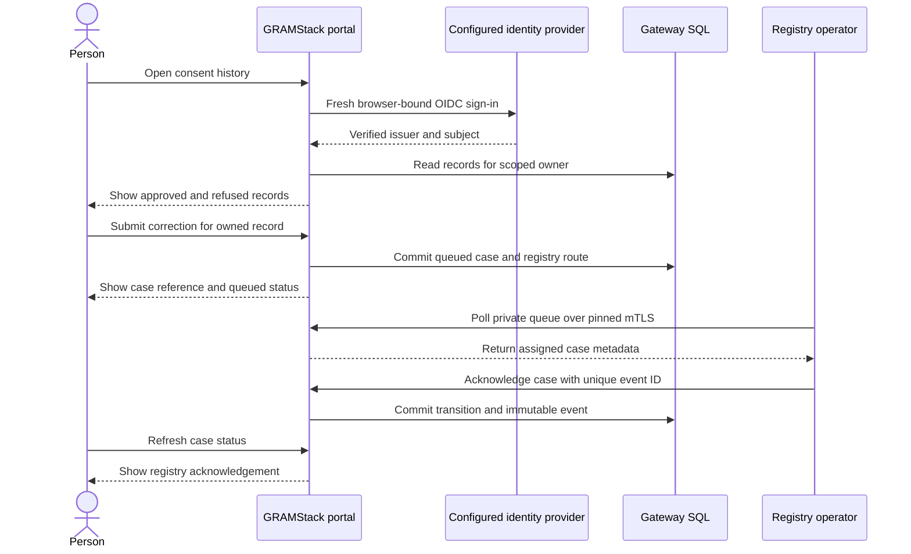

# Post-disclosure profile 0.1.0

This profile describes the GRAMStack history, downstream handling and rights interfaces that accompany core 0.3.0 and the English web consent portal. History exports keep the `gramstack.consent-record.v1` shape. The operations below have no effect on whether the original consent can authorize a disclosure.

## Public portal routes

| Method and path | Authentication and input | Result |
|---|---|---|
| GET `/consent-history/{registry}` | Registry-scoped history cookie for records. Optional `after` cursor | Sign-in prompt or up to 25 owned records, ordered by request reference |
| GET `/auth/history/{registry}` | Starts browser-bound OIDC with forced sign-in, state, nonce and PKCE | Redirect to the configured identity provider |
| GET `/consent-history/{registry}/{id}/receipt` | Verified history session and record ownership | Download the existing v1 consent record as JSON |
| GET `/consent-history/{registry}/{id}/rights` | Verified history session and record ownership | Case intake form and up to 25 recent cases for the record |
| POST `/consent-history/{registry}/{id}/rights` | Same session, exact portal Origin, URL-encoded `csrf`, `case_id` and `case_type` | 303 to the case status page after durable acceptance |

A history session MUST be independent of the interaction session. The server consumes OIDC state once for the initiating browser and checks that upstream authentication occurred during this flow. The history cookie expires within five minutes and is capped by the verified token lifetime. The lookup uses a keyed owner digest scoped to the upstream issuer, provider client and registry. Each request retains a separate principal. Identifiers and links alone convey no authority. The history list and receipts exclude raw upstream subjects, source locators and business records. A reserved single-use consent appears as spent.

Supported case types are `access`, `correction`, `erasure` and `grievance`. The server derives the responsible route from the protected record and case type. Source corrections go to the registry. Recipient-held access, erasure and grievances go to the recorded recipient. The case binds the consent and any eligible disclosure receipt present at intake. The demo uses a seven-day operational follow-up target. An identical retry retains the original case, while a conflicting reuse of the case reference returns 409.

## Private service routes

| Method and path | Authentication | Result |
|---|---|---|
| PUT `/v1/disclosures/{receipt}/handling-reports/{report}` | Registered recipient mTLS certificate | 200 with the recorded assertion, consent terms fingerprint and `verification: reported` |
| GET `/internal/v1/rights-cases/{role}/{actor}` | Registered recipient or explicitly pinned registry operator certificate | Up to 25 queued or acknowledged cases scoped to that route |
| PUT `/internal/v1/rights-cases/{role}/{actor}/{case}/{event}` | Same responsible-party certificate and matching case route | 200 with the original event acknowledgement and state version |

Use `recipient` or `registry` as the operator role. The registry adapter certificate grants no operator privileges unless separately configured for that role. The operator queue contains case metadata only. The private routes reject a wrong caller or route with 404. Their public ingress has no matching handlers.

A handling report MUST identify a release-ready disclosure with a completed or uncertain delivery attempt. The gateway derives the producer and terms binding from the disclosure and verifies the pinned certificate. The action time must be at or after evidence acceptance and at or before the database clock. An identical retry returns the original record. A conflicting reuse returns 409.

```json
{
  "action": "retention_exception",
  "exception_code": "legal_hold",
  "occurred_at": "2026-11-04T04:00:00Z"
}
```

Supported handling actions are `retained`, `deleted` and `retention_exception`. Only the last takes `exception_code`, which must be `legal_hold` or `statutory_retention`. The request-bound consent receipt shows up to ten recent recipient assertions. The v1 JSON download excludes these separate reports. Independent verification of recipient action requires additional evidence and authority.

An operator first submits `{"action":"acknowledge"}`. The case can then transition to `resolved` with `{"action":"resolve"}` or to `exception` using the example below. Supported exception codes are `legal_hold`, `statutory_retention` and `insufficient_information`.

```json
{
  "action": "record_exception",
  "exception_code": "insufficient_information"
}
```

The state transition and immutable operator event MUST commit together. A retry of an identical event ID returns the original acknowledgement, even after later transitions. Invalid transitions and changed retries return 409. The owner sees the latest state when refreshing. A resolution is an authenticated organisation report. Source changes and recipient-held data actions remain with those organisations.

## Case routing dry run



Conformance checks cover fresh sign-in after interaction, foreign browser and replay denial, cross-person and cross-registry isolation, CSRF rejection, private certificate and route isolation, duplicate submissions, invalid transitions and truthful pending and terminal outcomes.

[Download canonical profile](https://docs.gramstack.try-dough.com/static/specs/post-disclosure/0.1.0/README.md)
