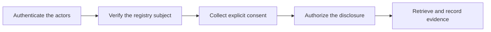

System architecture / v0.13

One request. Explicit consent. Verifiable access.

GRAMStack connects applications to authoritative Indian DPI registries through common read APIs, federated authentication, registry-specific subject verification, human consent and narrowly scoped retrieval grants.

Architecture and protocols1 November 2026Read-only interoperability

## Explore the architecture

Start with the [purpose and scenario](01-purpose), then the [architecture](02-architecture). For a continuous read, open the [complete document](complete-design), or [download the Markdown document](static/gramstack-design.txt).

| Chapter | What it covers |
|---|---|
| [01 · Purpose and scenario](01-purpose) | Scope, actors and architectural invariants |
| [02 · High-level architecture](02-architecture) | Components, trust boundaries, deployment and request paths |
| [03 · Authentication](03-authentication) | Hydra, IdP adapters, browser sessions, eSignet and Indian identity integrations |
| [04 · Consent manager](04-consent) | Notice, approval, artefacts, withdrawal and DEPA references |
| [05 · Authorization and grants](05-authorization) | Policy, single-use access, withdrawal ordering and sender binding |
| [06 · Request lifecycle](06-lifecycle) | Sync/async boundaries, transitions, deadlines, retries and recovery |
| [07 · API contracts](07-api-contracts) | Endpoint catalogue and illustrative requests/responses |
| [08 · State and evidence](08-state-and-evidence) | Storage, retention, evidence custody and DeDi guarantees |
| [09 · Dry runs and screens](09-dry-runs) | SakhiCredit → Sunita → LokOS, including assisted interaction |
| [10 · Failure and security](10-failures) | Negative cases, concurrency, threat boundaries and conformance |
| [11 · Architecture choices](11-decisions) | Component responsibilities, registry integration and deployment profiles |
| [12 · Standards and references](12-references) | Protocol standards, implementation references and integration sources |

## Implementation specifications

The [versioned contract set](specifications/) defines the HTTP APIs, message schemas, consent and grant rules, independently hosted adapter contract, evidence and lifecycle behavior. It includes downloadable OpenAPI and JSON Schema files, example payloads and conformance scenarios, generated directly from the repository’s `specs/` directory.

## The central distinction

Each step answers a different trust question. A successful login is not proof of record ownership. Consent does not override source policy. A valid token is not proof that a disclosure occurred.

## Architecture at a glance

**Federated identity:** external identity authorities authenticate citizens; GRAMStack does not provision persistent citizen accounts or maintain a cross-registry identity graph.

**Consent-first retrieval:** the person approves an exact disclosure. AuthZ checks that approval alongside registry policy, then issues a short-lived grant enforced independently by the adapter.

**Minimal state, accountable evidence:** the gateway coordinates bounded asynchronous workflows. Consent and redemption share transactional enforcement. Business records remain at their source, while DeDi anchors protected evidence of authorization and access.
