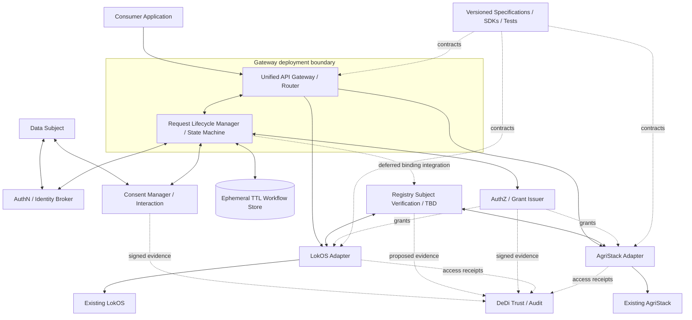
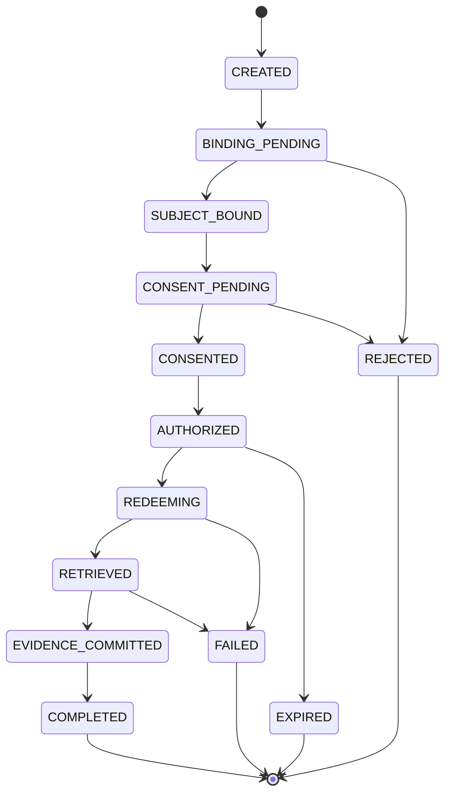

# GRAMStack — High-Level Design

**Version:** 0.11 | **Date:** 2026-10-31 | **Status:** Living architecture baseline

**Decision legend:** Agreed = accepted in discussion; Proposed = design recommendation; Open = unresolved. Example registry endpoints and identifiers are illustrative.

## 1. Purpose

GRAMStack is a read-only, consent-first interoperability layer exposing data from authoritative Indian DPI source systems through unified APIs. It coordinates authentication, registry-specific subject binding, explicit human consent, authorization, narrowly scoped retrieval grants, and verifiable access evidence. GRAMStack does **not** maintain a central citizen registry, a synchronized copy of registry business data, or a global cross-registry identity mapping.

### Agreed invariants

- **Read-only v1:** data retrieval and approvals, no source-record mutations.
- **Human consent:** the actual data subject must explicitly approve the normal personal-data retrieval flow.
- **Identity binding (unresolved security requirement):** authentication alone does not prove which registry record belongs to a person; no binding protocol is approved for implementation yet.
- **Identity-binding exploration deferred:** a hybrid subject-binding approach was favored conceptually, but its protocol, trust and security design are deferred to Appendix A. No mandatory registry IdP.
- **Registry adapters:** contain native API transport, identity resolution, data transformation, policy enforcement and evidence emission; no separate connector abstraction.
- **Minimal state:** bounded auth/request/replay state, not a central business-data cache. Asynchronous request lifecycle state is explicitly necessary and permitted.
- **Gateway-owned lifecycle:** the request state machine is an internal Gateway module, not a separately deployed orchestrator.
- **Audit:** DeDi anchors tamper-evident consent, binding, grant and access evidence.
- **Exclusive integration path:** every GRAMStack-mediated retrieval traverses authorization enforcement and produces durable evidence before protected release. Unrelated native registry access is outside this claim.
- GRAMStack MUST NOT provision or maintain persistent citizen identities. Authentication MUST be delegated to trusted external identity authorities. GRAMStack MAY maintain ephemeral authentication and authorization transaction state, and MUST retain only the configuration and security evidence necessary for operating and auditing the federation.

## 2. Architecture



This diagram makes the **Gateway deployment boundary** explicit: the Request Lifecycle Manager is a module inside the Gateway, not an independent microservice. The shared ephemeral workflow store is external to Gateway process memory so multiple instances can safely handle callbacks and resume requests. Specifications are versioned artifacts. Adapters can be embedded in registry infrastructure or deployed in a controlled environment. DeDi does not receive registry response bodies.

## 3. Component responsibilities and state

| Component | Responsibilities | State |
|---|---|---|
| Specifications | Canonical read contracts, binding, consent, grants, evidence, conformance | Versioned artifacts |
| Gateway (including Request Lifecycle Manager) | Unified API, validation, routing, perimeter enforcement; owns asynchronous request state machine, deadlines, callbacks, idempotency and recovery | Stateless compute with shared, short-lived workflow state |
| Ephemeral workflow store (e.g. Redis) | Stores pending request status, immutable request digest, correlation references, deadlines and atomic transition/replay markers | TTL-bound operational state; no registry response bodies or persistent citizen mappings |
| AuthN | OIDC/federated/first-party authentication, sessions | Auth/session state |
| Registry subject verification (deferred) | Establish subject-to-record relationship through a registry-approved mechanism; interface and trust model not finalized | TBD; no central identity mapping |
| Consent Manager | Present notice, human approval/rejection, withdrawal, evidence | Pending state; accountable evidence custody |
| AuthZ | Policy checks, scoped grants, revocation/replay protection | Policy + bounded operational state |
| Discovery | Adapter capabilities, endpoints, trusted issuers | Signed/static metadata |
| Registry Adapter | Subject verification, native API call, transform/filter, enforce grants, sign receipts | Transient processing; bounded challenges |
| DeDi | Merkle commitments, checkpoints, witnesses, verification | Durable evidence metadata |
| Source system | Authoritative records, native identifiers and policy | External authoritative state |

## 4. Trust model

**Consumer:** authenticated requester with an allowed purpose. **Data subject:** separately authenticated person approving disclosure. **CRP/operator:** may assist only under an approved verification and consent procedure; cannot silently consent on the subject's behalf. **Registry operator:** controls source records and determines acceptable proof of record ownership. **Evidence custodian:** holds signed evidence for legally necessary retention; DeDi holds protected commitments. A future Binding Authority role remains under security review.

Source systems must restrict the GRAMStack integration interface and upstream credentials to prevent bypass. The adapter must independently validate grants, not merely trust a gateway header.

## 5. Registry Adapter

A single executable adapter contains: (1) a future registry-specific subject verification integration point (contract deferred), (2) upstream API transport and credentials, (3) native-to-canonical transformation, (4) grant and field-level enforcement, (5) signed access evidence. The underlying registry is the existing source system, **not a new GRAMStack database or service**. Adapters advertise supported fields, verification methods and assurance levels. No writes in v1.

## 6. Registry subject verification — unresolved dependency

**Status: Deferred / security review required.** Authenticated user identity cannot be assumed to correspond to a particular registry record. GRAMStack MUST NOT release personal data unless the approving data subject is securely associated with the requested registry subject, using a mechanism accepted by the source registry. The exact protocol, assurance rules, authority delegation and failure behavior are not yet approved. The previously discussed hybrid binding concept and draft API are preserved in **Appendix A** as exploratory material, not normative requirements. No registry is required to operate an IdP.

**Design consequence:** The normal retrieval state machine has a subject-verification gate before consent and grant issuance, but its implementation remains a blocking open question for production. AuthN/AuthZ design can proceed independently using mock, pre-verified subject context in tests, explicitly marked as non-production.

## 7. First-class human consent

The normal personal-data retrieval profile requires trustworthy registry-subject verification **before** consent and signed consent **before** access grant issuance. Present requester, source, fields, purpose, frequency, validity, retention terms, withdrawal method, and consequences of refusal in an accessible language. Approval must bind the authenticated person, verified subject context (mechanism TBD) and immutable request digest. CRP assistance must preserve the person's actual decision.

Artifacts: short-lived pending request; signed consent artifact with notice/version and scope; active/withdrawn/consumed status; protected DeDi evidence commitment. Signed consent and notice evidence must be retained by the designated accountable fiduciary/consent authority for applicable obligations; GRAMStack need not centrally retain full artifacts indefinitely.

**Design references:** MeitY DEPA Electronic Consent Framework, DPDP Act and applicable phased Rules, RBI AA/ReBIT consent lifecycle as a technical reference only. A software Consent Manager is not automatically a registered DPDP Consent Manager. Regulatory role and retention require legal review.

## 8. AuthN, AuthZ and tokens

Consumer and data subject authenticate separately. AuthZ checks requester authority, registry-subject verification, explicit consent, source policy, fields, purpose, validity, withdrawal and replay. Consent alone does not authorize access. Use OIDC/OAuth patterns where appropriate and Aadhaar-independent authentication/verification routes.

**Proposed grant:** short-lived, registry/audience/resource/field/purpose/recipient-bound, preferably sender-constrained and single-use; contains request digest, subject-verification/consent references, `jti`, expiry. Candidate standards: OAuth 2.0, OIDC, RFC 8693 Token Exchange, RFC 8707 Resource Indicators, RFC 9396 Rich Authorization Requests, mTLS/DPoP. Immediate revocation or one-time redemption needs bounded state; expiration does not prove deletion of token copies.

**Open:** GRAMStack-issued token vs registry token exchange; exact scopes, proof-of-possession and revocation semantics.

## 9. End-to-end example

**Hypothetical:** SakhiCredit requests Sunita Devi's LokOS SHG membership status and savings summary for credit eligibility.

1. SakhiCredit authenticates as consumer.
2. It creates an immutable request specifying source, subject hint, fields, purpose, recipient and TTL.
3. Sunita authenticates through a supported route.
4. Binding coordinator discovers LokOS adapter capabilities; approved verification binds her to the correct LokOS record.
5. Registry-approved authority signs a request-bound subject assertion.
6. Sunita sees the exact notice and explicitly approves or rejects.
7. Consent evidence is signed and committed; accountable custodian retains the necessary artifact.
8. AuthZ evaluates policy and issues a short-lived scoped grant.
9. Consumer calls the unified retrieval API; gateway and adapter verify grant and redemption.
10. Adapter calls the authoritative source, transforms and filters the response in transient memory.
11. Signed access/disclosure-attempt evidence is durably committed before release.
12. Response is released; terminal status distinguishes attempted release from confirmed delivery.

### Proposed outer request state machine (Gateway-owned)



All nonterminal stages require appropriate timeout, rejection and technical-failure handling. The Gateway Request Lifecycle Manager owns transitions and callback correlation. Transitions must be atomic/idempotent using compare-and-set or equivalent concurrency control in the shared ephemeral store. Multiple Gateway instances must be able to resume the same request without relying on process-local memory. Retries must use stable idempotency keys; late or duplicate callbacks cannot resurrect terminal states. Do not return `REDEEMING` to `AUTHORIZED` after an ambiguous timeout without checking redemption. TTL expiration must produce a terminal outcome or recoverable evidence according to the defined audit policy.

### Gateway lifecycle module — operational requirements

- **Deployment:** internal module of the API Gateway; no separate orchestrator service for v1.
- **State:** ephemeral request metadata (status, immutable request digest, subject-binding and consent references, timestamps, deadlines, callback correlation and replay/idempotency markers), stored in Redis or equivalent shared TTL store.
- **Asynchrony:** pending subject verification, assisted challenges, human consent, callbacks, approvals, and subsequent retrieval may span multiple HTTP requests and Gateway instances.
- **Correctness:** atomic conditional state transitions, verified callbacks, timeout handling, safe retries, explicit terminal states, and recovery from instance restarts.
- **Boundaries:** AuthN, Consent, AuthZ, adapters and DeDi retain their separate responsibilities and interfaces; the Gateway coordinates rather than duplicating their authority.
- **Non-goals:** no persistent registry business data, central citizen directory, or long-lived identity mapping in workflow state.


## 10. Failure scenarios and evidence

| Failure | Outcome | State/evidence |
|---|---|---|
| Invalid consumer | Deny before protected request | Minimal security event |
| Unsupported registry/fields | Validation rejection | TTL request metadata |
| No valid binding method, mismatch, ambiguous match | Fail closed | Protected binding failure receipt |
| Challenge timeout | Expire | TTL cleanup and event |
| Human rejects consent | Reject | Signed rejection/notice evidence as appropriate |
| Consent withdrawn or expired | Deny grant/redeem | Revocation status and evidence |
| AuthZ policy denial | Reject | Signed decision receipt |
| Grant replay | Deny | Replay marker/security event |
| Source outage | Fail/retry within deadline | Failure receipt; no data cache |
| Field leakage/transform failure | Fail closed | Security event, no protected release |
| Audit commitment unavailable | Fail closed | Bounded retry/recovery metadata |
| Client disconnect after release | Delivery uncertain | Release-attempt receipt, not proof of delivery |

Avoid exposing whether a guessed citizen record exists through public error responses.

## 11. State inventory

| Artifact | Custodian | Retention posture |
|---|---|---|
| Access request / state machine | Gateway Request Lifecycle Manager; shared ephemeral store | TTL-bound, with atomic transitions and callback correlation |
| Auth session | IdP/AuthN | Session-bound |
| Binding challenge | Adapter/verification authority | TTL-bound |
| Binding assertion | Issuer / coordinator | Request-scoped; evidence retained as required |
| Consent request | Consent authority | Pending TTL |
| Signed consent and notice | Responsible fiduciary/consent authority | Applicable legal/policy retention |
| Access grant | Consumer; validated by AuthZ/adapter | Minutes |
| Redemption/revocation marker | AuthZ/enforcement point | Validity + tolerance |
| Source response | In-flight adapter/gateway | Transient; never centrally persisted |
| Signed access receipt | Evidence custodian | Required audit retention |
| Merkle commitment/checkpoint | DeDi | Durable, privacy-preserving |
| Business data | Source registry | Source's authoritative lifecycle |

Audit history is not a stale business-data replica. DeDi should not publish personal identifiers or low-entropy raw hashes. The signed underlying receipts need an accountable custodian, even if only protected commitments are publicly anchored.

## 12. DeDi evidence model

Reuse existing signed publication, append-only Merkle logs, inclusion/consistency proofs, signed checkpoints, delegated namespaces, independent witnessing and optional Raft replication. Bindings, consent, grants, withdrawal and retrievals emit signed receipts or protected commitments. Required evidence must be durably committed before protected response release; synchronous DeDi anchoring versus local durable log plus batched anchoring remains open.

**Can demonstrate:** a trusted party signed an assertion/receipt, evidence was committed, and published history is tamper-evident under the witness model. **Cannot independently prove:** deletion of plaintext by recipient, destruction of token copies, truth of every operator statement, or absence of unrelated native registry access. Complete GRAMStack-mediated accounting depends on enforced choke points and mandatory receipts.

## 13. Specification families

- `GS-API`: canonical read resources, field selection, pagination, errors and versions.
- `GS-SUBJECT` **(deferred, Appendix A):** potential discovery, challenges/results, signed assertions, trust and assurance; not yet a normative protocol.
- `GS-CONSENT`: notice, approval/rejection, withdrawal, artifacts, evidence.
- `GS-AUTHZ`: policies, scopes, grants, redemption, revocation.
- `GS-ADAPTER`: executable adapter contract, upstream behavior, filtering, conformance.
- `GS-EVIDENCE`: receipts, DeDi namespaces, commitments, witness verification.
- `GS-STATE`: request lifecycle, timeouts, idempotency and recovery.

## 14. Architecture decision register

| ID | Decision | Status |
|---|---|---|
| ADR-001 | Hybrid subject-binding concept favored; protocol design deferred pending security review; no mandatory registry IdP | **Deferred** |
| ADR-002 | Gateway owns Request Lifecycle Manager as an internal module; shared TTL-bound asynchronous workflow state is allowed and necessary; no standalone orchestrator service | **Agreed** |
| ADR-014 | Read-only retrieval for v1 | **Agreed** |
| ADR-003 | Adapter includes transformation and an extensible subject-verification integration point; exact protocol deferred | **Agreed boundary / deferred contract** |
| ADR-004 | Human consent first-class in normal personal-data retrieval | **Agreed** |
| ADR-005 | No central citizen graph or business-data replica | **Agreed** |
| ADR-006 | Short-lived narrowly scoped grants and minimal state | **Agreed principle** |
| ADR-007 | DeDi as evidence/trust infrastructure | **Agreed direction** |
| ADR-008 | Explicit request state machine | **Agreed** |
| ADR-009 | Final token issuer / token exchange | **Open** |
| ADR-010 | Binding authority delegation/trust manifest | **Proposed** |
| ADR-011 | Single-use sender-constrained grants default | **Proposed** |
| ADR-012 | Evidence anchoring strategy | **Open** |
| ADR-013 | Consent custody and legal roles | **Open** |
| ADR-015 | Ory Hydra as OAuth2/OIDC protocol engine (`remember: false`, no refresh tokens, pairwise subjects, janitor); no Kratos. See `GS-AUTH-eval-ory-hydra-keto.md` | **Proposed** |
| ADR-016 | GRAMStack AuthZ mints single-use retrieval grants (own JWKS), not Hydra | **Proposed** |
| ADR-017 | No Keto in v1; signed per-registry policy files evaluated in AuthZ | **Proposed** |
| ADR-018 | No first-party passkeys (would need stored per-user credentials) | **Proposed** |
| ADR-019 | MOSIP eSignet as optional per-registry IdP pattern, upstream of Hydra | **Proposed** |
| ADR-020 | Development/CI IdPs: local eSignet + mock SAML IdP; MeriPehchaan onboarding in parallel | **Proposed** |

## 15. Open questions and next iterations

1. Deferred: binding authority delegation, trust keys, assurance and registry-specific verification — see Appendix A.
2. Deferred: subject verification for no match, multiple matches, operator accounts, assisted verification and offline cases.
3. Consent: which legal entity is the artifact custodian, and how is withdrawal propagated before token redemption?
4. Token model: central issuance or registry-local exchange, sender constraint, single-use semantics and replay recovery?
5. DeDi: receipt schema, protected commitments, synchronous anchoring versus local durable queue, witness SLAs?
6. API resources: choose initial canonical SHG membership and savings-summary schema and actual registry integration contracts.
7. Gateway lifecycle: define complete transition table, retry/idempotency rules, callback authentication, TTL/recovery and audit status semantics (without extracting a standalone orchestrator).

**Next design priority:** `GS-AUTHN-001` and `GS-AUTHZ-001`, including identity-provider adapter contracts, consent interaction, policy and token security. Revisit `GS-SUBJECT-001` only after threat modeling and trust-boundary review.

## 17. AuthN/AuthZ design workstream — next priority

**Status: Design agenda, not yet accepted implementation decisions.** Authentication, subject verification, human consent and authorization remain separate trust decisions. The gateway owns the request state machine; AuthN and AuthZ may be separate modules or services, to be decided based on security and operational boundaries.

### 17.1 AuthN — first-party identity broker and adapters

- **Broker contract:** provide a stable, issuer-qualified principal (`iss`, `sub`), authentication context (`auth_time`, `amr`, `acr` where meaningful), and a secure session interface. Avoid a global citizen identity registry and avoid assuming a phone number, Aadhaar number or registry ID is a universal subject key.
- **Adapter SPI (proposed):** `discover()`, `beginAuthentication()`, `handleCallback()`, `validateExternalAssertion()`, `normalizePrincipal()`, `endSession()` and optional `refresh()`/`logout()`. The broker owns state/nonce/PKCE validation and policy; adapters own provider-specific protocol details. Do not invent common assurance equivalence across providers.
- **Candidate integrations:** OIDC providers, SAML government/enterprise IdPs, MeriPehchaan/JanParichay where onboarding permits, and first-party passkeys. OTP and assisted verification are separate authenticators or proofing workflows with explicitly lower/variable assurance, not automatic substitutes for OIDC.
- **Security design:** OAuth 2.0 Authorization Code + PKCE for interactive login; issuer/audience/signature validation; redirect allowlists; key rotation; session fixation and replay protection; phishing resistance; logout; federation trust; IdP outage and fallback behavior.
- **Extension/conformance:** provider configuration schema, adapter registration, supported feature/assurance manifest, deterministic error taxonomy, mock IdP, conformance fixtures, and security tests.

### 17.2 AuthZ — policy, consent and retrieval capabilities

- **Policy inputs:** authenticated consumer, separately authenticated data subject, verified registry-subject context (interface TBD), requested registry/resource/fields, declared purpose, consent evidence, provider policy, and current revocation/replay state.
- **Consent:** explicit, human-facing, granular approval of the immutable retrieval request; rejection, timeout and withdrawal are first-class transitions. The responsible fiduciary/consent authority retains legally necessary evidence; DeDi anchors protected commitments.
- **Grant model:** short-lived, audience-bound, recipient-bound, resource/field/purpose-limited capabilities. Evaluate signed JWT versus opaque tokens, sender constraints (mTLS/DPoP), one-time redemption, revocation checks and registry-local token exchange.
- **Enforcement:** gateway perimeter checks plus independent adapter-side enforcement; fail closed on invalid scope, unavailable revocation state or mandatory audit evidence failure.
- **Extensibility:** policy decision interface, policy bundles per registry, approval strategy plugins, consent provider interfaces, and conformance tests for least privilege and negative cases.

### 17.3 Priority design questions

1. Should GRAMStack implement its own OIDC authorization server, or broker identities through an established server (e.g., Keycloak) behind a stable internal contract?
2. What are the required first-party login methods, recovery paths, and assurance profiles for citizens versus institutional consumers?
3. Which parts of authentication and authorization should be in the gateway process versus isolated services?
4. What exact grant representation, token issuer, revocation semantics and sender constraints are appropriate for one-time reads?
5. How are consent presentation, identity assurance and delegated/assisted approval handled without confusing authentication with ownership of a registry record?
6. How do adapters advertise capabilities, rotate trust keys, and pass security conformance without exposing provider-specific secrets?

## 16. Change log

| Version | Change |
|---|---|
| v0.3 | Unified gateway, specifications, transformers, AuthN/AuthZ, DeDi |
| v0.4 | Human consent promoted to first-class retrieval step |
| v0.6 | Concrete consent-first retrieval sequence and state inventory |
| v0.7 | Registry adapters and first-class subject binding introduced |
| **v0.8** | Hybrid binding decision accepted; living HLD and ADR register established |
| **v0.9** | Gateway owns the Request Lifecycle Manager; standalone orchestrator removed. Ephemeral shared TTL workflow state explicitly permitted for asynchronous binding/consent/retrieval, with atomic transitions and recovery. ADR-002 added; previous read-only ADR retained as ADR-014. |
| **v0.10** | Subject Binding protocol moved to non-normative Appendix A pending security review. AuthN/AuthZ and extensible IdP adapters prioritized; registry subject verification remains a required but unresolved gate. |
| **v0.11** | AuthN/AuthZ technology evaluation (`GS-AUTH-eval-ory-hydra-keto.md`): Hydra as protocol engine, GRAMStack-minted grants, no Keto, no first-party passkeys, eSignet as optional registry IdP pattern, development IdPs and Indian sandbox landscape. ADR-015 to ADR-020 proposed. |

## Appendix A — Deferred Subject Binding exploration (non-normative)

> **Do not implement as a production security protocol without dedicated threat modeling, security review and registry-operator approval.** The following is preserved from v0.9 for later design discussion. The previously favored hybrid approach is a concept, not a finalized interoperability standard.

### A.1 Previous GS-SUBJECT-001 proposal (deferred)

**Agreed hybrid model:** standardize signed assertion format, binding states, capability discovery and challenge/result APIs. Leave identity verification mechanism registry-specific. A registry login may authenticate an operator, not the person whose record is requested; it does not guarantee a 1:1 mapping.

**Proposed endpoints:**

```http
GET  /.well-known/gramstack-adapter
POST /v1/subject-bindings
GET  /v1/subject-bindings/{binding_id}
POST /v1/subject-bindings/{binding_id}/verify
```

The manifest advertises capabilities, methods, trust issuers, challenges and assurance profiles without exposing whether an individual exists. Binding initiation uses a verified principal assertion (`issuer` + `subject`), request digest and optional untrusted subject hint. Possible mechanisms: registry IdP, external IdP plus challenge, approved identifier verification, assisted passbook/CRP verification, or accepted existing assertion. Passbook number alone is insufficient proof.

**Proposed signed assertion:** JWS/JWT with trusted issuer, opaque registry subject, intended audience, issuance/expiry, unique ID, authenticated principal issuer+subject, registry, immutable retrieval request digest, verification method, assurance and evidence reference. Validate signature, authorized issuer/key, audience, principal, request binding, freshness and replay. Binding states: `CREATED`, `CHALLENGE_REQUIRED`, `VERIFYING`, `VERIFIED`, `REJECTED`, `FAILED`, `EXPIRED`. Only `VERIFIED` advances to consent.

**Open:** assurance taxonomy, issuer delegation/trust manifests, ambiguous matches, challenge schemas, assertion reuse.

### A.2 Candidate: registry-run eSignet (ADR-019, proposed)

A registry can deploy MOSIP eSignet with a registry-specific authenticator plugin (e.g. LokOS member ID + passbook details + OTP to the LokOS-registered mobile). The resulting OIDC `sub` is the registry subject, so "registry as IdP" binding uses standard OIDC rather than a new GRAMStack protocol. It is optional for registries and sits upstream of GRAMStack's Hydra. Details: `GS-AUTH-eval-ory-hydra-keto.md` §8.

