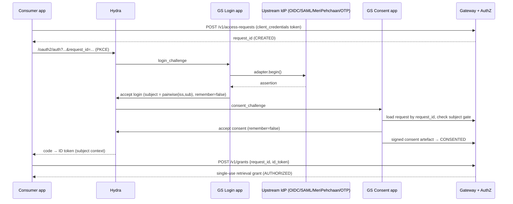

# GS-AUTH evaluation — Ory Hydra + Ory Keto

**Date:** 2026-10-31 | **Status:** Proposed (input to `GS-AUTHN-001` / `GS-AUTHZ-001`, ADR-009) | **Baseline:** HLD v0.10

**Question:** how well do Hydra (OAuth2/OIDC server) and Keto (Zanzibar-style permissions) serve GRAMStack, given the HLD invariant of *no persistent citizen identities*, and how much custom code is still needed?

**Short answer:** Use **Hydra** as the OAuth2/OIDC protocol engine. It fits the no-user-DB rule well, because Hydra stores no users and treats `subject` as an opaque string we choose. **Skip Keto for v1.** Most of our authorization questions are time-bound, per-request and attribute-based, which Keto doesn't model. The questions Keto does handle well would mean copying registry hierarchies into it. Most custom code goes into the login app with its IdP adapters and the consent app, and we would have to write both whatever product we picked.

---

## 1. Hydra

### 1.1 How GRAMStack flows map onto Hydra

| GRAMStack need | Hydra mechanism | Custom code? |
|---|---|---|
| Consumer (e.g. SakhiCredit) authenticates | `client_credentials` with `private_key_jwt` client auth | None, configuration only |
| Data subject (e.g. Sunita) logs in | Authorization Code + PKCE. Hydra redirects to **our Login app** with a `login_challenge`; we authenticate upstream and call `accept login` with a subject we derive | Login app + IdP adapters |
| No local accounts | Hydra has no user table. Use `remember: false`, and don't grant `offline_access` (so no refresh tokens) | None |
| Pairwise subject IDs | Built-in OIDC `pairwise` subject type per client | None, configuration only |
| Human consent screen (subject present in consumer's app) | Hydra redirects to **our Consent app** with a `consent_challenge`. We render the DEPA notice for the `request_id` (read from the challenge's `request_url`), then accept with `remember: false`, the audience set to the adapter, and request-bound claims | Consent app (needed anyway) |
| Consent when the subject is **not** in the consumer's app (SMS link, CRP-assisted) | No CIBA support in Hydra | Gateway-run decoupled flow |
| Custom token claims | Token hook webhook, called for all grant types; claims go under `ext` unless allow-listed at top level; `sub` can't be overridden ([docs](https://www.ory.com/docs/hydra/guides/claims-at-refresh)) | Small hook endpoint, if used |
| Discovery, JWKS, key rotation, introspection, revocation, logout | Built in | None |
| Token exchange (RFC 8693) | **Not supported.** The v2 release notes claimed it, and maintainers corrected them: the shipped feature is the RFC 7523 JWT-bearer grant ([discussion #3359](https://github.com/ory/hydra/discussions/3359)). Third-party add-on exists ([hydra-rfc8693](https://github.com/Exact-Realty/ts-hydra-rfc8693)) | Only if ADR-009 picks registry-local exchange |
| Rich Authorization Requests (RFC 9396 `authorization_details`) | Not supported | Carry scope in our own claims |
| Sender-constrained tokens (DPoP / mTLS-bound) | No support found. **Verify against the current release** | Enforce in the adapter if we mint grants (see 1.3) |
| SAML upstream IdPs | Hydra doesn't do SAML; upstream federation is the login app's job | SAML SP adapter |
| Single-use retrieval grants | Not modelled; introspection doesn't consume a token | Redis redemption (needed anyway) |

### 1.2 What state Hydra keeps, and whether it breaks the invariant

Hydra **requires a SQL database** (Postgres/MySQL/CockroachDB; SQLite only for development). In it Hydra keeps:

- **OAuth clients and keys:** durable configuration. This is allowed (federation configuration).
- **Login/consent requests, auth codes, token sessions:** short-lived protocol state, keyed by our opaque pairwise `subject`. Purge with `hydra janitor` on a schedule.
- **Remembered login/consent sessions:** turned off by using `remember: false`.
- **Refresh tokens:** not issued, because we don't grant `offline_access`.

With those settings, nothing in Hydra's database identifies a citizen beyond an opaque, short-lived pairwise subject. That fits the HLD rule that ephemeral auth transaction state is allowed and citizen identities are not. **The cost is running Postgres plus a janitor job**, a second store next to the Redis workflow store.

### 1.3 Who mints the retrieval grant: recommend GRAMStack AuthZ, not Hydra

The retrieval grant needs a request digest, field scope, purpose, single-use redemption, and issuance gated on the gateway state machine (`CONSENTED → AUTHORIZED`). Hydra can carry those claims through the token hook. But it can't do single-use redemption or sender constraint, and the decoupled consent flow never goes through Hydra's consent step anyway. So:

- **Hydra issues:** consumer access tokens (client credentials) and subject ID tokens (who authenticated, how, `acr`/`amr`).
- **GRAMStack AuthZ mints:** the retrieval grant, as a short-lived JWS with its own JWKS published through Discovery. AuthZ checks the consumer token, subject ID token, consent artefact and policy. Redemption uses an atomic Redis `SET NX` on `jti`. The adapter verifies the signature, redemption, and (later) DPoP.

This keeps a single code path for both the co-present and the decoupled consent flows, and avoids building on Hydra for features it lacks. It also leaves ADR-009 open: registry-local token exchange can be added on top of our own grant.

### 1.4 Co-present flow with Hydra

The decoupled flow is the same, except that the gateway's first-party consent portal is the OAuth client instead of the consumer's app.

---

## 2. Keto

Our AuthZ questions, and how well Keto fits each:

| Question | Keto fit |
|---|---|
| Is consumer X allowed purpose P on registry R, fields F? | Possible as tuples, but fields × purposes multiply fast. This is small, static config |
| Is CRP/operator Y allowed to assist subjects in SHG cluster Z? | Keto's strength (a ReBAC hierarchy). **But** the CRP→cluster→VO→SHG hierarchy lives in LokOS, so copying it into Keto replicates registry business state (violates ADR-005) |
| Is there a valid, unexpired, unwithdrawn consent for this exact request? | **Not a fit.** No tuple TTL ([feature request #346](https://github.com/ory/keto/issues/346), closed, no shipped TTL found). Per-consent tuples would also create citizen state |
| Is the grant unredeemed and unrevoked? | Not a fit; this is a Redis job |
| Does the subject's assurance level meet registry policy? Is it inside the time window? | Not a fit; OPL has no booleans or conditional logic ([forum](https://archive.ory.sh/t/28955092/u04uq68083h-i-believe-it-isn-t-possible-to-use-a-boolean-in-)) |

Keto would also add a third durable store (SQL tuples) and another service to operate, in return for answering one question that a config file answers.

**Recommendation:** for v1, use a **per-registry policy file** (signed, versioned, published through Discovery) evaluated by a plain function in AuthZ. Move to Cedar or OPA when policies outgrow that, for example with per-field conditions or many registries. If operator-hierarchy checks become necessary, ask the registry through the adapter, the same way subject verification works. Don't mirror the hierarchy.

---

## 3. Custom code we'd still write

Rough sizes for a Go or TypeScript implementation, excluding tests and UI styling.

| Component | With Hydra | Notes |
|---|---|---|
| Login app (Hydra login provider): method picker, challenge handling, accept/reject | ~400 LOC + UI | Thin; the adapters do the real work |
| IdP adapter SPI + OIDC adapter | ~250 | On top of `go-oidc` / `openid-client` |
| SAML SP adapter | ~400 | On top of `crewjam/saml` / `samlify`; metadata and cert rotation are most of it |
| MeriPehchaan adapter | 0–600 | Configuration only if its OIDC/SAML is standard; custom code if not. **Unknown until partner docs** |
| OTP authenticator | ~300 | SMS provider, Redis TTL, rate limits. Lower assurance |
| Consent app: DEPA notice, i18n, digest binding, signed artefact, withdrawal | ~800 + UI | **Same with any product** |
| Decoupled consent (link/SMS/CRP), the CIBA substitute | ~400 | Hydra provides nothing here |
| Retrieval grant minting + single-use redemption + JWKS | ~250 | `jose` + Redis `SET NX` |
| Policy evaluation (v1 policy file) | ~200 | Instead of Keto |
| Adapter-side grant verification library | ~150 | Shared by all registry adapters |
| DPoP (later) | ~150 | If Hydra lacks it; done at the adapter |
| **Total** | **~3.3k–3.9k LOC + 2 UIs** | |
| Hydra ops | configuration | Postgres, `hydra janitor` cron, client registration through the admin API, key rotation |

**What Hydra saves us:** the OAuth2/OIDC authorize, token, discovery, JWKS, introspection, revocation and logout endpoints, client authentication, PKCE, auth-code security and pairwise subjects. These are the security-critical, spec-heavy parts we shouldn't write ourselves. Building them on libraries instead, like the "lightweight broker" option, would add roughly 2–4k LOC that we'd then own for security.

---

## 4. Conflicts this surfaces with the HLD

1. **First-party passkeys (HLD §17.1) need stored per-user public keys, which is a user account.** That breaks the no-persistent-identity invariant. Either drop first-party passkeys, or accept passkeys only through upstream IdPs that hold them.
2. **OTP only proves control of a phone number.** That's fine as an authenticator, but it must never satisfy the subject-verification gate by itself (HLD §6).
3. **ADR-009** stays open but gets narrower: GRAMStack mints the grant, and registry-local exchange becomes an optional extra step at the adapter.

## 5. Proposed decisions

| ID | Decision | Status |
|---|---|---|
| ADR-015 | Ory Hydra is the OAuth2/OIDC protocol engine for consumer and subject authentication. Configured with `remember: false`, no refresh tokens, pairwise subjects, `hydra janitor`; no Kratos | Proposed |
| ADR-016 | GRAMStack AuthZ mints single-use retrieval grants itself (own JWKS); Hydra doesn't mint retrieval grants | Proposed |
| ADR-017 | No Keto in v1; signed per-registry policy files evaluated in AuthZ; revisit Cedar/OPA when policies outgrow them | Proposed |
| ADR-018 | No first-party passkeys; authenticator credentials live with upstream IdPs | Proposed |
| ADR-019 | MOSIP eSignet is the **optional** per-registry IdP pattern ("registry as IdP"): it sits upstream of Hydra, never replaces it; registries are not required to deploy it (ADR-001 holds) | Proposed |
| ADR-020 | Development and CI identity providers: local eSignet + mock identity system (OIDC) and a mock SAML IdP. MeriPehchaan/JanParichay onboarding runs in parallel through a sponsoring department | Proposed |

## 6. Verify before accepting

- Hydra DPoP / mTLS-bound token support, and device-flow status, in the current release.
- Exactly which tables Hydra's JWT access-token strategy writes, and how long data lasts under `janitor`.
- Whether MeriPehchaan's partner OAuth endpoint is OIDC-compliant (ID token, discovery, JWKS) or a custom API.
- eSignet's authenticator plugin interface (recalled as `kycAuth` / `kycExchange` / `sendOtp` in `esignet-integration-api`); confirm against the repo before designing a LokOS plugin.
- Spike: Hydra with local eSignet (OIDC) and a mock SAML IdP through the Login app, then confirm the database holds only opaque subjects after janitor runs.

---

## 7. Indian identity systems and sandboxes

No Indian government identity system offers a self-service "Login with ..." sandbox.

| Option | What it is | Sandbox access | Role in GRAMStack |
|---|---|---|---|
| MeriPehchaan / JanParichay | Government SSO (SAML, OAuth, Open API) | No public sandbox; a test/proxy setup is issued during onboarding (requirements form → proxy → checklist → live) ([partner portal](https://jppartners.meripehchaan.gov.in), [onboarding](https://meripehchaan.gov.in/applicationonboarding)) | **Production target.** Needs a sponsoring department; OIDC compliance unknown |
| UIDAI Aadhaar auth (AUA/ASA) | Yes/no verification via OTP or biometrics. An AUA is a licensed requester, **not an IdP** | Old public staging (AUA code `public`, test UIDs) is documented only for outdated API versions ([testing data](https://uidai.gov.in/en/916-developer-section/data-and-downloads-section/11350-testing-data-and-license-keys.html)). Face Authentication SDK + sandbox launched 9 Sep 2026 ([Biometric Update](https://www.biometricupdate.com/202609/uidai-expands-aadhaar-face-authentication-with-native-sdk-developer-sandbox)); access process unpublished | Don't become an AUA. Aadhaar reaches GRAMStack via MeriPehchaan or DigiLocker |
| DigiLocker auth partner | Aadhaar-backed OAuth plus verified documents | Partner registration; [API Setu sandbox](https://docs.apisetu.gov.in/document-central/explore-apisetu/Sandbox.html) covers data/document APIs, not SSO | Document-based verification |
| KYC aggregators (Setu, Cashfree, ...) | Licensed intermediaries over DigiLocker / offline KYC | Vendor-issued sandbox credentials (e.g. [Setu](https://docs.setu.co/data/digilocker/quickstart)) | Experiments only; a vendor inside the trust boundary |
| ABDM / ABHA | Health ID | NHA-issued sandbox credentials, test ABHA addresses | Not standard OIDC; out of scope |
| MOSIP eSignet | Open-source OIDC IdP for national ID systems | Runs locally (Docker Compose + mock identity system) | **Development and CI stand-in** for an OIDC government IdP (ADR-020) |

**Aadhaar offline verification** (Secure QR / paperless offline e-KYC XML, signed by UIDAI) can be verified with UIDAI's public certificate without a live CIDR call. That makes it a candidate for the CRP-assisted route. Formal use likely requires registering as an Offline Verification Seeking Entity (OVSE) under UIDAI's offline verification regulations. **Verify before relying on it.**

Open with UIDAI: whether the old test UIDs still work, and how developers get into the Face Authentication sandbox.

---

## 8. Do we need Hydra if we deploy eSignet?

**Yes.** They do different jobs.

- **Hydra:** a protocol engine with no built-in login. Our Login app chooses the upstream (OIDC, SAML, MeriPehchaan redirect, OTP, CRP). That matches GRAMStack's broker role.
- **eSignet:** an IdP in front of **one** identity system through an authenticator plugin, which works as challenge-response (individual ID + OTP/biometric/knowledge answers). It doesn't federate onwards to other IdPs.

Why eSignet can't replace Hydra in the core:

1. **It only supports authorization-code login.** The defaults allow only `authorization_code`, `private_key_jwt` client authentication and PKCE S256 ([config](https://deepwiki.com/mosip/esignet/4.4-configuration-properties)). Without `client_credentials`, consumers can't authenticate as machines.
2. **MeriPehchaan's redirect-based SAML/OAuth doesn't fit the challenge-response plugin model.**
3. **Heavier stack:** Java/Spring, MOSIP key manager, Postgres, Redis.

**Where eSignet fits: as a per-registry IdP (ADR-019).** A LokOS eSignet instance with a LokOS authenticator plugin (member ID + passbook details + OTP to the LokOS-registered mobile) would return an OIDC `sub` that **is** the LokOS member. That is the HLD's "registry as IdP" mode, and it would settle subject binding (HLD §6) for that registry using standard OIDC instead of a new protocol. Hydra's Login app treats it as one more upstream OIDC IdP. Offering it is optional; ADR-001 (no mandatory registry IdP) still holds.

**When dropping Hydra would make sense:** only if GRAMStack stops being a broker, meaning every registry runs eSignet, consumers get tokens directly from them, and GRAMStack AuthZ just checks registry ID tokens and mints grants. That forces every registry to deploy eSignet, which ADR-001 deliberately avoided.
